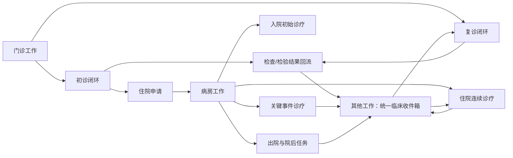
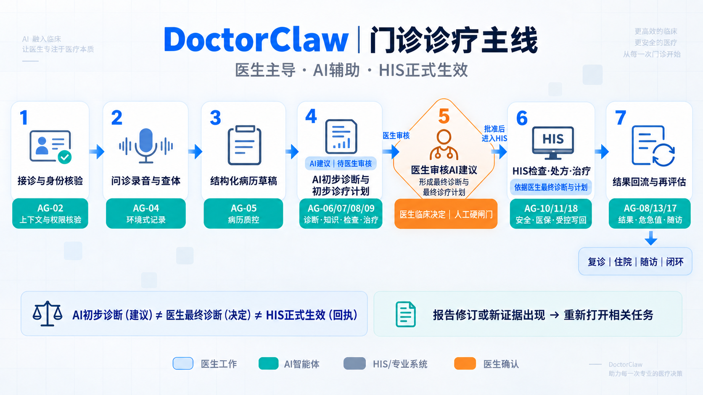
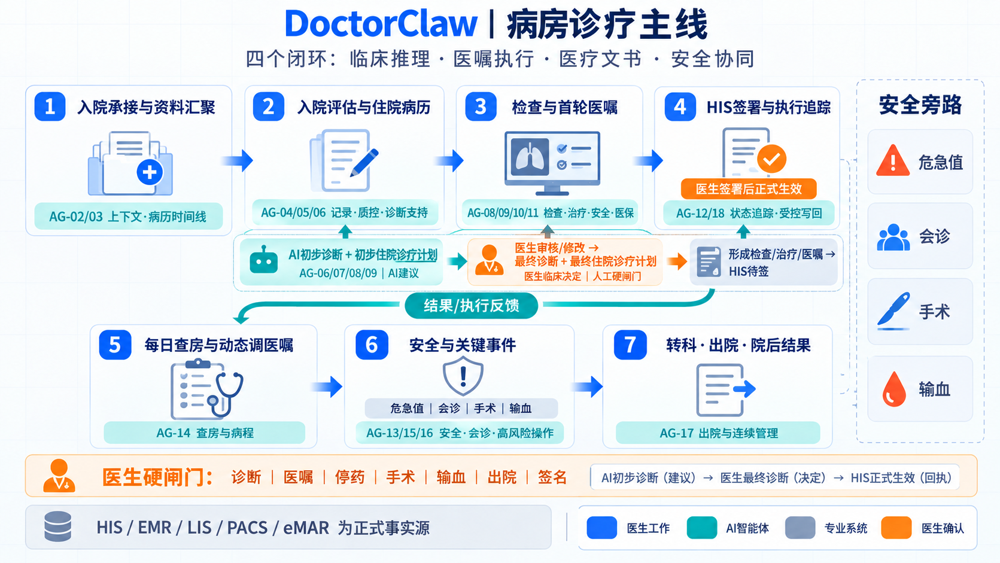

# CLINVEXA 医生端三大工作板块智能体工作流与落地方案

**版本：** V3.3（领导审批稿 + M0业务/产品架构基线 + 流程图局部优化）  
**日期：** 2026-09-08  
**当前状态：** 待业务、临床与技术共同评审；本轮不修改产品代码；不构成真实医院写回或生产上线授权  
**适用视角：** 仅以医生临床办公为主视角；护理、药学、医技、医保等只描述与医生任务发生交互的边界  
**目标读者：** 项目负责人、临床专家、医务/药学/护理/信息部门、CLINVEXA 产品与研发团队

---

## 0. 文档结论

CLINVEXA 后续不应继续以“零散医疗工具 + 聊天入口”为核心，而应升级为一套围绕医生真实诊疗责任运行的工作流系统：

1. 首页原有三个一级板块 **“临床文书 / 患者管理 / 智能办公”整体替换为“门诊工作 / 病房工作 / 其他工作”**。
2. 三个新板块不是改名后的工具分类，而是三个医生工作域。医生进入某一板块后，应看到该工作域中的患者、任务、风险、文书和待确认事项。
3. 门诊主线不是一次性线性流程，而是 `接诊 → 采集事实 → AI建议 → 医生决策 → 开单 → 结果回流 → 再评估 → 治疗/住院/随访` 的循环。
4. 病房主线不是“写住院病历—开医嘱—复诊”三步，而是同时运行临床推理、医嘱执行、医疗文书和安全协同四个闭环。
5. “其他工作”不是泛化办公工具集合，应首先承接跨门诊/病房的医生临床收件箱、危急值、结果回阅、会诊、交接、病历质控、合理用药与医保提醒，再逐步扩展科研、教学和科室管理。
6. CLINVEXA 的定位是 **医生侧智能工作流与决策辅助层**。HIS/EMR/CPOE、LIS、PACS、药房、护理、手术麻醉、医保和电子签名系统仍是正式事实与交易系统。
7. AI 可以做资料汇总、事实抽取、草稿、候选方案、解释和提醒；最终诊断、检查、治疗、处方、医嘱、停药、手术、病历签署和任务关闭均保留医生或相应专业人员的确认。

本文件既是供负责人确认方向的业务蓝图，也是批准后 CLINVEXA 产品、数据、接口、智能体、规则、测试和实施拆分的 **M0基线**。领导批准本文件，表示批准三大板块方向、能力边界和M0详细设计工作；并不表示可跳过医院模板/SOP/接口确认直接开发，更不表示授权连接真实患者数据或开放HIS正式写回。完成第12.5节研发就绪门槛后，本文与节点契约包、接口字典和原型共同升级为代码研发基线。

建议本轮审批结论明确写为：

| 审批项 | 建议结论 | 本轮不授权的事项 |
|---|---|---|
| 首页信息架构与医生工作域 | 批准“门诊工作 / 病房工作 / 其他工作”替换原三个一级板块 | 不等同于立即修改生产代码 |
| 工作流和智能体总体方案 | 批准作为M0详细设计范围及后续研发拆分依据 | 不把AI候选视为临床决定 |
| 医院系统集成方向 | 批准开展接口盘点、Mock和测试环境方案 | 不接真实生产库，不开放正式写回 |
| 后续开发 | M0产物通过临床、信息、安全联合签字后另行批准 | 不依据概念流程直接排生产上线 |

---

## 1. 本次需求的准确解释

### 1.1 首页一级信息架构替换

根据现有首页截图及源码核对，当前一级分类由 `clinical / patient / office` 三个静态分类驱动，界面显示为“临床文书 / 患者管理 / 智能办公”。本方案要求将其整体替换为以下信息架构：

| 新一级板块 | 医生进入后首先看到什么 | 主要对象 | 不再是什么 |
|---|---|---|---|
| 门诊工作 | 今日候诊、当前接诊、待结果、待处置结果、复诊患者、待签病历 | 一次门诊 Encounter 及其跨日结果任务 | 不是“门诊文书工具”列表 |
| 病房工作 | 我的病区、新入院、今日查房、待确认医嘱、危急/疗程提醒、待签文书、拟出院 | 一次住院 Encounter / EpisodeOfCare | 不是“住院患者资料管理”列表 |
| 其他工作 | 立即处理、今日待办、等待外部结果、待签字/待关闭，以及会诊、交接、质控等专题入口 | 跨患者、跨就诊、跨科室的医生任务 | 不是通用“智能办公”工具箱 |

一级板块切换时，下方功能卡、工作列表、默认筛选、患者上下文和可调用智能体必须一同切换。不得出现“页签显示病房工作，但卡片仍是患者管理或普通办公工具”的半替换状态。

现有六张快捷卡不应删除，而应从一级分类卡改造成流程内动作：

| 当前快捷卡 | 新落点 |
|---|---|
| 开始问诊记录 | 门诊 OP-N09—N16；病房入院 IP-A07—A08；查房 IP-R03—R04 |
| 整理已有病历 | 门诊诊前摘要、病房多源资料汇聚和其他工作中的文书整理 |
| 检查病历质量 | 每次事实草稿、病历签名前，以及出院归档前的固定质控节点 |
| 定时任务 | 其他工作底层能力，用于疗程、结果、会诊、文书、随访到期，不作为孤立功能 |
| 填写HIS草稿 | 医生确认后的检查、处方、医嘱和文书节点中的“同步到HIS”动作 |
| 医学知识检索 | 诊断/治疗建议旁的证据抽屉，保留独立高级检索入口 |

### 1.2 业务术语校正

- 门诊保留“初诊患者 / 复诊患者”。
- 病房不再使用“初诊患者 / 复诊患者”，改为：
  - **入院初始诊疗**：入院接诊、入院评估、住院病历、首次病程、首轮医嘱；
  - **住院连续诊疗**：每日查房、结果回阅、病程记录、疗效评估和医嘱调整；
  - **关键事件诊疗**：危急值、抢救、会诊、转科、手术、输血、疑难病例讨论；
  - **离院连续诊疗**：出院评估、出院记录、出院医嘱、未决结果和随访。

### 1.3 “AI自动生成”的产品语义

本方案中的“AI自动生成”统一解释为：

> 系统在满足触发条件后自动准备一份可追溯、可编辑、待医生确认的建议或草稿；绝不等于自动形成正式诊断、自动下达医嘱或自动签署病历。

医生对 AI 结果应能逐项执行 `采纳 / 修改后采纳 / 拒绝 / 暂缓`。系统保留原建议、医生修改、决定理由、知识与规则版本、HIS回执，不只保存最后一段文本。

### 1.4 用户原始需求追踪

| 用户提出的需求 | 本方案对应节点 |
|---|---|
| 门诊叫号 | OP-N02—N04 |
| 首次问诊录音、病历检查和书写 | OP-N09—N16 |
| AI初步诊断、诊断依据、检查建议和初步诊疗计划 | OP-N17—N23 |
| 医生结合判断形成最终诊断和计划 | OP-N24—N25、OP-N35 |
| 点击CLINVEXA建议同步HIS并开检查 | OP-N26—N30；写回协议10.6 |
| AI生成药物、输液、治疗、住院方案，医生拍板并进入HIS/医保路径 | OP-N36—N43 |
| 复诊录音，关注症状改善、新发症状和原计划 | OP-R01—R15 |
| 门诊病历基础上完善住院病历、避免无意义重复检查 | IP-A01—A17、IP-O01—O03 |
| 住院初始医嘱并融合HIS | IP-O04—O17 |
| 每日查房录音、术后症状/体征/切口等记录并优化方案 | IP-R01—R10、IP-S10—S13 |
| 药物已使用若干天后的停药/继续提醒及医保理由 | 6.5疗程复评闭环 |
| 其他工作自行补充 | 第7章统一临床收件箱及P0/P1/P2工作流 |

### 1.5 三大板块与急诊、留观、日间手术的范围边界

本期一级导航固定为三个板块，不增加第四个一级板块；但不能把不同就诊性质强行混成普通门诊或普通住院。建议按HIS/ADT正式就诊类型路由：

| 场景 | 本期处理方式 | 后续扩展点 |
|---|---|---|
| 急诊 | 不在本期详细建模范围；门诊或病房发现急危重后，只负责生成交接任务并取得急诊/抢救接收回执 | 若医院上线急诊医生端，再评估作为独立工作域或“门诊工作”内专属子工作台 |
| 门诊留观/急诊留观 | 保留独立 `ObservationEncounter` 语义；不得因“过夜”自动当住院 | 复用医嘱执行、结果和交接子流程，并按目标医院留观制度补专属节点 |
| 日间手术 | 以ADT正式就诊类型为准：住院建档者进入病房工作，门诊建档者留在门诊工作并复用围术期子流程 | M0必须确认责任科室、麻醉、术后观察、非计划住院和离院回执 |
| ICU/急诊抢救/互联网诊疗 | 当前只定义转入/转出接口和任务交接，不声称覆盖其完整业务 | 分别建立专用模板、权限、时限和流程后再纳入 |

以上是方案默认边界，须在本轮审批中确认；任何界面归属都不能改变HIS中的正式就诊类型。

---

## 2. HIS 体系与 CLINVEXA 的正确位置

### 2.1 医院信息系统不是一个软件

国家电子病历与医院信息平台规范将门急诊、住院、医嘱、病历文书、护理、检验、检查、手术麻醉、治疗、输血等划为相互关联的临床业务域；实际医院通常由多家厂商系统共同承载。CLINVEXA 对接时必须面向“系统群”，不能假设一个 HIS 接口覆盖全部流程。[电子病历系统功能规范](https://www.nhc.gov.cn/wjw/gfxwj/201101/a769b5f4b9ca4415a72fa9888bce0bc1.shtml)、[医院信息平台业务建模](https://www.nhc.gov.cn/cmsresources/wsb/cmsrsdocument/doc11546.pdf)

| 系统/能力域 | 正式职责 | CLINVEXA 读取 | CLINVEXA 可准备的内容 | 正式写入/确认方 |
|---|---|---|---|---|
| EMPI/MPI、ADT、挂号排班、叫号 | 患者主索引、就诊号、入出转、床位、候诊顺序 | 患者/就诊/医生/科室/床位/排队状态 | 上下文核验、工作列表、叫号指令草稿 | 原系统及其授权人员 |
| 门诊/住院 EMR | 法定病历、病程、会诊、出院记录 | 已签病历、模板、版本、签名状态 | 带证据的文书草稿、质控问题 | 医生在 EMR/CA 签署 |
| CPOE/HIS 医生工作站 | 检查、检验、治疗、药物、长期/临时医嘱 | 项目字典、订单、状态、退回原因 | 类型化医嘱草稿、适宜性提示 | 有权限医生签署，HIS受理 |
| LIS/病理、RIS/PACS、心电/超声 | 申请受理、采样/检查、报告、原图、危急值 | 执行状态、结果、版本、危急值事件 | 结果摘要、趋势、医生回阅任务 | 医技系统发布；医生确认临床处置 |
| 药房/PIVAS/eMAR | 处方审核、调配、配液、实际给药 | 药师审核、调配和实际执行事件 | 风险解释、疗程复评任务 | 药师/护士记录各自事实 |
| 护理信息系统 | 护理评估、执行单、生命体征、出入量、管路与观察 | 与医生决策相关的执行和异常反馈 | 医嘱相关观察清单、医生待办 | 护士记录和签署护理事实 |
| OR/AIMS、输血、ICU | 手术排程、麻醉、核查、术中事件、输血/重症数据 | 计划、准备状态、术中/术后事件 | 材料汇总、缺项和任务提醒 | 各有资质人员签署 |
| 药事/医保/收费/DRG-DIP | 药品规则、费用、支付限制、结算 | 规则、支付身份、预审与退回信息 | 临床风险与支付风险分栏提示 | HIS、药师、医保/收费系统 |
| IAM/CA/审计/集成平台 | 身份、权限、电子签名、消息、审计 | 当前操作者、授权范围、接口回执 | 待签命令、AI审计事件 | 医院认证与签名体系 |

### 2.2 CLINVEXA 的五级动作边界

| 级别 | 动作 | 示例 | 默认权限 |
|---|---|---|---|
| L0 只读呈现 | 读取、归并、排序、追溯原文 | 病历时间线、过去24小时变化 | 可自动执行，但先校验身份与权限 |
| L1 AI草稿 | 抽取、摘要、候选、解释 | 问诊病历草稿、鉴别诊断候选 | 自动生成，显著标记“待医生确认” |
| L2 规则提醒 | 确定性规则命中、计时、升级 | 过敏、危急值、用药到期、医保限定 | 规则可自动触发；关闭需相应责任人 |
| L3 受控同步 | 把医生已选择内容写成 HIS 草稿 | 填入检查申请、医嘱或病历字段 | 写前预览差异、患者复核、幂等键、回执校验 |
| L4 正式临床动作 | 签署、下达、停药、取消、提交 | 正式处方、住院医嘱、病历签名 | 必须由医院认证的医生/专业人员完成 |

### 2.3 必须分开的状态

任何界面和接口都不得把下列状态折叠为一个“完成”：

```text
AI候选
→ 医生已选择
→ HIS草稿已写入
→ 医生在HIS实名签署
→ HIS受理并返回 order_id / document_id / version
→ 药师、医技或护理已接收
→ 已预约/备药/采样
→ 已执行、暂缓、拒绝、失败或取消
→ 报告/给药/操作结果产生
→ 医生已回阅并记录处置
→ 闭环或因新事件重新打开
```

FHIR 的工作流模型同样区分请求、执行事件和任务状态；`ServiceRequest`/`MedicationRequest` 代表申请或医嘱，`DiagnosticReport`/`Observation`/`Procedure` 等代表已经发生的结果或事件，`Task` 用来管理谁在何时完成哪一步。[FHIR Workflow](https://hl7.org/fhir/R4/workflow.html)

---

## 3. 三大板块总览



三个板块共享同一套底层对象：`患者 Patient`、`一次正式就诊 Encounter`、`一次连续照护过程 EpisodeOfCare`、`纵向疾病/问题 ProblemEpisode`、`CLINVEXA流程实例 WorkflowInstance`、`证据 Evidence`、`AI建议 Suggestion`、`医生决定 Decision`、`医嘱/文书命令 HISCommand`、`任务 Task`、`提醒 RuleHit`、`审计 Provenance/AuditEvent`。四个“过程/阶段”对象的含义和关闭权不得混用，详见第10.3节。

### 3.1 门诊与病房主线辅助图

以下两图用于领导审批沟通和产品研发快速对齐，压缩展示医生主线与AI智能体介入点；节点的完整输入、输出、医生闸门、HIS落点和异常分支仍以第5—13章为准。



图1：门诊完整主线保持不变；其中间决策段明确为“AI形成初步诊断与初步诊疗计划 → 医生审核、修改并形成最终诊断与最终诊疗计划 → 依据医生最终决定进入HIS检查、处方和治疗 → 医生实名签署后正式生效”。



图2：病房完整主线、每日查房回环和安全旁路均保持不变；仅在入院评估与首轮医嘱之间补充同一诊断决策段。结果和实际执行反馈仍持续驱动AI更新建议、医生再次确认和HIS医嘱调整。

---

## 4. 原子工作流统一定义

后文每一行是原子工作流目录中的一个候选节点，用来确认医生动作、AI辅助、系统边界和串联关系；它还不是可以直接进入Sprint的完整用户故事。批准M0后，每个进入近期范围的节点必须按下表补齐机器可校验的契约，未补齐者不得进入开发：

| 契约字段 | 必须回答的问题 |
|---|---|
| 触发 | 哪个医生动作、HIS事件、结果事件或定时器启动它？ |
| 上下文 | 当前患者、哪次门诊/住院、责任医生、科室、数据版本是什么？ |
| 输入证据 | 使用哪些原始记录？能否定位至报告、文书、录音或字段？ |
| AI/规则职责 | 是事实抽取、生成建议、确定性规则还是状态追踪？ |
| 结构化输出 | 输出何种对象，缺失、不确定和冲突如何表达？ |
| 医生闸门 | 哪一步必须医生逐项确认、填写理由或重新签名？ |
| HIS落点 | 读取/写入哪个系统、哪个业务对象、需要什么回执？ |
| 异常回退 | 接口失败、身份变化、报告修订、AI不可用时如何继续？ |
| 完成条件 | 什么证据证明该节点已完成，而不是仅“看过提醒”？ |
| 审计 | 保存谁、何时、基于什么版本做了什么决定？ |

统一状态建议：

`pending → gathering → proposed → awaiting_doctor → approved/modified/rejected → syncing → accepted_by_his → in_execution → result_due → review_due → completed`，异常状态为 `blocked / failed / cancelled / superseded / reopened`。

M0交付时，每个节点还必须能追踪到 `界面入口 → 领域服务 → API/事件 → 角色权限 → Epic → 测试用例 → 完成证据`。第12.6节给出组级追踪矩阵；详细节点矩阵由E00/E02产出并纳入版本控制。

---

## 5. 门诊工作板块

### 5.1 门诊首页应呈现的医生工作

门诊页签不应只陈列 Skill 卡片。建议默认分成六个动态队列：

| 队列 | 内容 | 典型动作 |
|---|---|---|
| 今日候诊 | 已签到、待诊、已叫号、过号、回诊 | 叫号、重呼、接诊 |
| 当前接诊 | 正在问诊、病历待确认、诊疗建议待确认 | 继续问诊、审阅草稿、形成决定 |
| 待开立 | 医生已选择但尚未在HIS签署的检查、药物、治疗、住院申请 | 查看差异、同步草稿、进入HIS签署 |
| 待结果/回诊 | 已开检查但尚未出结果，或患者检查后返回 | 查看状态、恢复就诊 |
| 待处置结果 | 新报告、异常结果、危急值、修订报告 | 回阅、处置、补开医嘱 |
| 复诊与未完成事项 | 复诊患者、上次计划、未完成检查、疗效/不良反应待评估 | 变化对比、调整计划、结案 |

门诊同时维护三套相互关联的状态机：

```text
就诊：签到 → 候诊 → 叫号 → 接诊 → 暂挂检查 → 回诊 → 完成 → 归档
决策：采集 → 评估/鉴别 → 检查 → 结果解释 → 再评估 → 治疗/转诊/住院
医嘱：AI草稿 → 医生选择 → HIS签署 → 下游接收 → 执行/报告 → 医生回阅
```

### 5.2 初诊患者原子工作流

#### A. 候诊、叫号和接诊上下文

| ID / 节点 | 触发与医生工作 | AI/规则辅助 | HIS交互、输出及硬门槛 |
|---|---|---|---|
| OP-N01 医生工作会话 | 医生登录、选择诊室和出诊科室 | 汇总排班、执业范围、处方/抗菌药/特殊药权限 | IAM/HIS返回医生与权限；形成 `DoctorSession` |
| OP-N02 同步候诊队列 | 医生查看已签到、待诊、过号和回诊患者 | 按队列状态聚合，不改变优先级 | 排队叫号系统为事实源；形成 `QueueItem[]` |
| OP-N03 叫号/重呼/过号 | 医生或诊间助手选择患者 | 提示同名、复诊回诊、特殊注意事项 | 叫号系统执行并回传 `called/recalled/no-show/skipped`；AI不得自主叫号或插队 |
| OP-N04 开始接诊 | 患者进入诊室，医生点击接诊 | 建立本次门诊工作流，锁定责任医生和开始时间 | HIS将 Encounter 置为进行中；形成唯一 `workflow_id` |
| OP-N05 患者与就诊核验 | 医生核对患者及本次就诊 | 比对至少两个身份要素、就诊号、科室、当前HIS窗口 | 不一致立即 `blocked`，禁止读写临床内容 |
| OP-N06 诊前一页摘要 | 医生预阅既往资料 | 汇总过敏、用药、重要既往史、最近异常、未回结果和上次计划；每项可回到原文 | 只读 EMR/LIS/PACS；输出 `PreVisitBrief`，不得写成当前事实 |
| OP-N07 急危重筛查 | 医生快速评估主诉、生命体征和红旗 | 使用医院批准的确定性规则提示升级可能 | 医生决定继续普通门诊或转急诊/抢救；交接完成前首诊责任不消失 |
| OP-N08 就诊类型确认 | 医生确认初诊、复诊或复诊中的新问题 | 关联既往 `ProblemEpisode`，提示错误归类风险 | 输出 `visit_type`；本节初诊继续进入 OP-N09 |

#### B. 问诊、查体和病历事实层

| ID / 节点 | 触发与医生工作 | AI/规则辅助 | HIS交互、输出及硬门槛 |
|---|---|---|---|
| OP-N09 记录方式确认 | 医生开始问诊；可选择录音或手工 | 显示录音用途、保存与调用范围；拒绝录音时自动切换手工路径 | 记录授权与方式，不得因未录音影响正常诊疗 |
| OP-N10 实时录音转写 | 医生进行首次问诊 | 说话人区分、时间戳、低置信度词、医生重点标记；保留原音片段 | 输出 `Transcript + EvidenceSpan[]`，不直接成为病历 |
| OP-N11 病史结构化 | 医生继续询问 | 按待提供的门诊模板提取主诉、现病史、既往史、个人/家族史、过敏史、用药史等 | 输出 `HistoryDraft`；未问到显示“未获取”，不得补造 |
| OP-N12 智能缺项追问 | 病史草稿形成或模板变更 | 对缺失、冲突、不确定和高风险信息生成优先追问，特别是过敏、妊娠、肝肾功能和实际用药 | 医生选择追问并确认答案；新证据回到 OP-N11 |
| OP-N13 查体/生命体征 | 医生实际检查并口述或录入 | 将已查阳性、已查阴性、未查三种状态分开；按专科模板检查缺项 | 设备/护理数据只读；医生确认 `ExamDraft`，AI不能推断体征 |
| OP-N14 外部资料归并 | 医生查看外院报告、处方或影像 | OCR、来源/日期识别、与本院资料冲突提示 | 输出 `ExternalEvidence[]`；医生确认资料归属与可信度 |
| OP-N15 门诊病历事实草稿 | 病史、查体和已完成检查齐备 | 只将有证据的事实填入门诊病历模板，保留字段来源 | 输出 `EncounterFactDraft`，诊断建议与事实层物理分开 |
| OP-N16 病历事实质控 | 医生审阅事实草稿 | 检查必填、左右侧、时间、剂量、否定词、复制内容和相互矛盾 | 医生修改并确认事实版本；后续AI只读取此确认版本 |

这里必须对现有 CLINVEXA 做一项重要拆分：当前九字段问诊草稿同时包含“初步判断、处置建议、随访计划”。落地时应改为 **原始证据层 → 临床事实草稿层 → AI建议层 → 医生确认层** 四层，避免模型建议在医生确认前被误当作患者事实。

#### C. AI初步诊断与初步诊疗计划

| ID / 节点 | 触发与医生工作 | AI/规则辅助 | HIS交互、输出及硬门槛 |
|---|---|---|---|
| OP-N17 问题列表 | 医生已确认事实层 | 将症状、体征、既往病、异常结果和药物问题整理为活动问题 | 输出 `ProblemDraft[]`；医生增删、排序和确认 |
| OP-N18 鉴别诊断候选 | 已确认问题和证据 | 对每个候选列支持证据、反对证据、缺失证据、不能遗漏的高风险可能性 | 输出 `DifferentialSuggestion[]`；不直接写正式诊断 |
| OP-N19 诊断依据矩阵 | 候选诊断形成 | 显示“来源事实—诊断意义—证据强度—限制”，区分已证实、疑似、待排和不支持 | 输出 `EvidenceMatrix`，低证据时允许症状性/描述性诊断 |
| OP-N20 检查建议 | 诊断证据不足或需评估严重度 | 按“要回答的临床问题—建议项目—预期如何改变决策—替代项—风险/准备”输出 | `DiagnosticPlanSuggestion[]`；医生未选择前不下单 |
| OP-N21 治疗候选 | 基于当前工作诊断、严重度和患者条件 | 生成药物、输液、门诊治疗、非药物、会诊、转诊、住院等候选，列适应证、风险、监测和退出条件 | `TreatmentOption[]`，不生成已签处方 |
| OP-N22 指南与知识证据 | 医生需要查看依据 | 检索院内路径、现行指南、药品说明和规则；显示版本、适用性和原文入口 | 输出 `KnowledgeEvidence[]`；知识失效或不适用时不允许静默引用 |
| OP-N23 AI初步诊疗包 | N18—N22完成 | 汇总问题、候选诊断、诊断依据、建议检查、可选治疗和信息缺口 | 输出单一 `ClinicalProposal`，醒目标注“AI建议、待医生确认” |

#### D. 医生最终决策、检查开立与结果循环

| ID / 节点 | 触发与医生工作 | AI/规则辅助 | HIS交互、输出及硬门槛 |
|---|---|---|---|
| OP-N24 医生形成当前诊断 | 医生查看 AI 初步诊疗包并结合专业判断 | 支持逐项采纳、修改、拒绝；检查诊断表述是否超过证据 | 医生确认 `DoctorDiagnosisDecision`；“当前诊断”可在结果回流后修订 |
| OP-N25 医生形成诊疗计划 | 医生选择检查、治疗、观察、会诊或住院方向 | 显示各选项理由与风险，生成差异清单 | 医生确认 `DoctorPlanDecision`；未确认项不得进入HIS草稿 |
| OP-N26 检查适宜性和重复检查 | 医生选择检查项目 | 核验近期同类结果、部位/标本、妊娠、造影、肾功能、前置条件和医保规则 | 医生决定复用、重查或取消；重查理由留痕 |
| OP-N27 检查申请组装 | 已确认检查计划 | 将项目、部位/标本、临床问题、紧急程度、注意事项映射为HIS字典项 | 输出 `ServiceRequestDraft[]` 和字段差异预览 |
| OP-N28 同步至HIS待签区 | 医生点击“同步到HIS” | 重新核验患者、就诊、医生、目标窗口、项目版本和幂等键 | API优先；RPA兜底只填草稿。同步失败标记“未生效”，不得显示已开立 |
| OP-N29 医生在HIS签署 | 医生逐项复核并实名确认 | 签署前再次运行刚性规则与权限检查 | HIS/CPOE生成 `order_id + version + signed_at`；这是正式开立点 |
| OP-N30 下游状态追踪 | 检查单已开立 | 跟踪受理、退回、预约、待缴费、采样、标本拒收、检查失败、初步/最终报告 | LIS/RIS/PACS/HIS为状态源；产生 `OrderTask` |
| OP-N31 暂挂和回诊 | 检查无法即时完成 | 保存当前决策版本、待回项目和责任人；检查完成后进入回诊队列 | CLINVEXA流程可暂停；HIS中的暂挂/回诊状态只读其正式回执，跨日结果任务保持运行 |
| OP-N32 结果接入与危急值分流 | 新报告、修订或撤销报告到达 | 按源报告ID/版本去重；医院规则判定危急值；普通异常排序 | 危急值立即进入独立闭环；报告修订使旧回阅状态失效 |
| OP-N33 AI结果摘要和趋势 | 医生打开结果 | 关联原申请、历史同类结果、当前诊断和药物，显示新发、恶化、冲突与限制 | 输出 `ResultReviewDraft`，必须保留原报告/影像入口 |
| OP-N34 医生结果回阅 | 医生阅读原报告和AI摘要 | 提供“可能影响哪些问题/方案”的提示 | 医生确认已阅、临床意义及处置；技术送达不等于医生已阅 |
| OP-N35 诊断/计划再评估 | 结果支持、反驳或暴露新问题 | 更新证据矩阵，展示相对 N24/N25 的变化 | 医生确认诊断和计划 V2；可回到补问、补查、会诊或治疗 |

#### E. 治疗、住院/转诊和门诊闭环

| ID / 节点 | 触发与医生工作 | AI/规则辅助 | HIS交互、输出及硬门槛 |
|---|---|---|---|
| OP-N36 药物方案草稿 | 医生选择药疗方向 | 组装药名、规格、剂量、途径、频次、疗程、监测和停止条件 | 输出 `MedicationRequestDraft[]`；医生逐项确认 |
| OP-N37 药物安全与医保分栏 | 处方待签 | 确定性检查过敏、重复、相互作用、剂量、肝肾/妊娠、权限；另栏显示支付限制 | 严重临床风险可阻断；医保风险不反向代替医学决策 |
| OP-N38 门诊输液/注射/治疗 | 医生选择非口服药、处置或小治疗 | 生成项目、频次、皮试/监测、执行条件和异常升级项 | 医生在HIS签署；治疗室/护理记录实际执行 |
| OP-N39 药师/收费/库存反馈 | 正式处方进入下游 | 聚合通过、退方、缺药、部分不覆盖、收费失败原因和备选项 | 任何替换药物或剂量重新回到医生确认并再次签署 |
| OP-N40 执行异常和不良反应 | 皮试阳性、输液反应、拒绝、未执行或失败 | 立即生成重评估任务，关联原医嘱和时间线 | 医生现场评估，选择停/换/处置并签署新医嘱 |
| OP-N41 住院申请 | 医生判断需住院/手术 | 汇总住院指征、诊断、严重度、目标科室、隔离/床位需求和未完成事项 | 医生签署住院申请；ADT/床位决定实际入院，不把住院证当已入院 |
| OP-N42 会诊、转科或外院转诊 | 超出本科能力或需协作 | 生成明确会诊问题、资料包、紧急程度、当前风险和交接待办 | 医生发起；接收方确认后责任才完成转移 |
| OP-N43 拒绝建议分支 | 患者拒绝检查、治疗、住院或转诊 | 生成风险沟通和替代方案草稿 | 医生实际沟通并记录拒绝内容、风险、警示症状和替代方案 |
| OP-N44 门诊病历合成与质控 | 当前诊断、计划、处方、检查、沟通完成 | 将医生已确认事实和决定合成正式模板草稿；检查诊断—医嘱一致性和缺项 | 医生在EMR签署；AI建议未被采纳的内容不得混入正式病历 |
| OP-N45 诊后任务 | 存在待出结果、复诊、复查、疗效或不良反应观察 | 生成责任医生、期限、观察项、完成条件和升级路径 | `FollowUpTask[]` 进入统一临床收件箱 |
| OP-N46 医生结束本次工作会话 | 必需文书已签、紧急事项已处理、跨日任务已建立 | 检查尚未签署、无责任人的结果和未完成阻断 | 医生关闭CLINVEXA本次 `WorkflowInstance`；HIS仍是Encounter状态权威源，跨日Task不随工作会话关闭而删除 |

### 5.3 复诊患者原子工作流

复诊不是复制初诊病历再改几句话。它的核心是“相对上次发生了什么变化、原计划是否完成、治疗是否有效和安全”。复诊中出现与原问题无关的新主诉时，应自动启动“新问题初诊深度”子流程。

| ID / 节点 | 医生工作与输入 | AI辅助和结构化输出 | 医生确认、HIS交互与下一步 |
|---|---|---|---|
| OP-R01 复诊上下文匹配 | 选择本次Encounter及原疾病 `ProblemEpisode` | 关联上次诊断、问题、检查、治疗、随访要求和未完成任务 | 医生确认关联是否正确；错误关联可解除 |
| OP-R02 基线与当前对比准备 | 上次已签病历、后续报告、处方和实际执行 | 生成“上次状态—间隔事件—当前待评估项” | 输出 `FollowUpBrief`，每项可追溯原文 |
| OP-R03 重点问诊清单 | 原问题和上次计划 | 提示症状减轻/加重、是否新发、依从性、剂量/疗程、疗效、不良反应、未完成原因和红旗 | 医生选择并实际提问 |
| OP-R04 复诊录音与结构化 | 医生完成针对性复诊问诊 | 形成间隔期病史、新症状、依从性、疗效、不良反应和患者实际用药记录 | 输出证据片段；低置信度由医生确认 |
| OP-R05 针对性查体与复测 | 医生按原问题/新问题查体 | 比较体征、量表和必要生命体征，明确未查项 | 医生确认，不能从既往复制为本次体征 |
| OP-R06 上次检查完成性 | 上次开单和执行状态 | 区分未开、已开未做、失败、初步报告、最终报告、已回阅 | 异常进入相应重约/替代/回阅任务 |
| OP-R07 结果趋势与变化 | 新旧结果及治疗时间线 | 显示变化幅度、可能相关治疗和结果冲突 | 医生确认临床意义 |
| OP-R08 反应分类建议 | 症状、体征、结果、依从性 | 按问题给出改善、稳定、恶化、无法判断、新问题 | 医生确认 `OutcomeDecision` |
| OP-R09 新问题/红旗分流 | 出现新症状或风险 | 确定性规则先筛急危重；普通新问题启动初诊子图 | 医生决定急诊、补问、补查或继续复诊 |
| OP-R10 诊断再评估 | 全部复诊证据 | 更新支持/反对证据、确定性和需排除项 | 医生确认继续、修订或新增诊断 |
| OP-R11 方案调整候选 | 疗效、不良反应、依从性和新证据 | 生成继续、停药、换药、调整剂量、补查、会诊或住院选项及依据 | 医生逐项决定；任何改变重新走安全审核和HIS签署 |
| OP-R12 单纯续方安全核验 | 患者仅请求续方 | 检查状态、依从性、不良反应、疗程、必要监测和处方适宜性 | 不允许跳过问诊直接自动续方 |
| OP-R13 复诊病历差异草稿 | 本次确认事实与上次记录 | 生成变化摘要，突出新发、未变、已解决、未完成及调整理由 | 医生在EMR签署；禁止机械复制整份旧病历 |
| OP-R14 新计划与下一复评点 | 医生确认调整方案 | 生成复查项、目标、期限、责任人和升级条件 | 写入HIS待签区/任务系统，获得回执 |
| OP-R15 本次复诊工作闭环 | 文书、医嘱、结果和任务齐备 | 检查仍未处理的异常结果、药物风险和跨日任务 | 医生关闭CLINVEXA本次 `WorkflowInstance`；Encounter状态只跟随HIS，`ProblemEpisode`可持续到下一次复诊 |

### 5.4 门诊必须设计的异常分支

| 异常 | CLINVEXA 不允许做什么 | 正确回退 |
|---|---|---|
| 同名、错患者、错就诊 | 自动猜测或继续写入 | 阻断并由登记/MPI/HIS人工核验 |
| 患者在另一诊室接诊 | 双方同时写同一记录 | 并发锁，只读或由授权人员接管 |
| 未签到、过号、叫号未到 | 记为已诊疗 | 重呼、过号或重新排队 |
| 急危重 | 在普通门诊AI流程中继续等待 | 转急诊/抢救并取得接收确认 |
| 拒绝录音、录音低质、方言或多人重叠 | 中断诊疗或静默猜词 | 切换手工；标记原音和待核对药名/数值 |
| 诊断暂不明确 | 强行输出单一明确诊断 | 使用症状性/描述性诊断，保留鉴别和补证据计划 |
| 项目字典失效、权限不足 | 自动替换成“相近”项目 | 返回精确原因，医生重新选择 |
| HIS写入超时 | 重复点击产生重复订单 | 用幂等键查询原交易，确认失败后才重试 |
| 医嘱被退回或缺药 | AI直接改药 | 医生查看原因、重新决策和签署 |
| 报告修订/撤销 | 沿用旧AI摘要和已阅状态 | 保存版本差异，重新生成回阅任务 |
| 就诊结束仍待病理/培养 | 随Encounter关闭 | 转入统一临床收件箱，指定责任人和时限 |
| AI不可用 | 阻断医生看病 | 回退HIS/EMR原人工路径，保留“AI未完成”状态 |

---

## 6. 病房工作板块

### 6.1 病房首页应呈现的医生工作

建议病房页签默认按医疗组展示：

| 队列 | 内容 | 典型动作 |
|---|---|---|
| 我的病区/医疗组 | 在院、借床、转入转出、病危病重、当日手术 | 选择患者、查看纵向摘要 |
| 新入院 | 待接诊、首次病程待签、入院记录待签、主治首次查房待完成 | 入院评估、首轮医嘱 |
| 今日查房 | 查房前摘要、24小时变化、今日问题清单 | 床旁录音、病程、调医嘱 |
| 结果与安全 | 危急值、病情恶化、异常结果、医嘱执行异常 | 回阅、处置、复查、升级 |
| 用药/疗程 | 第N日复评、抗菌药物、肝肾剂量、ADR、医保限定 | 继续/停用/调整并说明理由 |
| 协作与关键事件 | 会诊、MDT、手术、输血、转科、交接 | 发起、催办、采纳、交接 |
| 文书与出院 | 病程、上级查房、手术记录、阶段小结、拟出院、未决结果 | 质控、签署、出院任务 |

病房工作必须同时维护四个闭环：

```text
临床推理：问题 → 诊断/鉴别 → 目标 → 方案 → 疗效/不良反应 → 调整
医嘱执行：医生签署 → HIS受理 → 药师/医技/护理接收 → 实际执行 → 结果 → 医生回阅
医疗文书：事实采集 → AI草稿 → 医生核实签名 → 修订留痕 → 归档质控
安全协同：危急值/恶化/会诊/交班/手术/转科/出院事项 → 责任人 → 时限 → 升级 → 闭环
```

### 6.2 入院承接与入院初始诊疗

| ID / 节点 | 医生工作与触发 | AI/规则辅助 | 权威系统、输出与硬门槛 |
|---|---|---|---|
| IP-A01 接收入院申请 | 门诊/急诊申请进入目标科室 | 汇总住院指征、初步诊断、紧急度、已完成处置和未决事项 | 医生确认接收条件；HIS/ADT为申请状态源 |
| IP-A02 身份与Encounter匹配 | 门诊就诊转为待住院 | 检测同名、重复住院、门诊—住院身份冲突 | 身份冲突即阻断；不得自动合并病历 |
| IP-A03 床位和责任组 | 病区接收、借床或无床 | 展示等待、借床、目标床位和责任医疗组 | ADT决定床位和正式入院时间；CLINVEXA不得自行激活住院 |
| IP-A04 转入交接 | 门急诊医生与病区医生交接 | 生成当前病情、已用药、管路、检查、风险、待办的SBAR草稿 | 转出/接收人员确认；危重患者床旁交接 |
| IP-A05 入病房即时评估 | 医生现场查看生命体征、意识、呼吸循环等 | 红旗规则提示抢救、ICU或急会诊 | 医生必须亲自评估；不稳定则暂停常规流程进入抢救 |
| IP-A06 多源资料汇聚 | 门诊、急诊、既往住院、外院资料可用 | 生成带来源和时间戳的纵向摘要，标记矛盾、过期和未核实 | 只读EMR/LIS/PACS；输出 `AdmissionBrief` |
| IP-A07 入院问诊记录 | 医生床旁问诊，可录音或手工 | 按住院模板提取病史并列缺项，保留原始证据 | 医生确认患者陈述和录音方式；输出 `AdmissionHistoryDraft` |
| IP-A08 体格与专科检查 | 医生亲自查体 | 将口述整理为结构化查体，区分未查/阴性/阳性 | 医生确认；AI不得生成未实施的检查 |
| IP-A09 用药和过敏核对 | 门诊处方、自带药、既往医嘱和患者陈述 | 形成继续/暂停/替代/待核实清单，提示冲突 | 医生决定住院用药；药师和护士分别核对本专业环节 |
| IP-A10 风险评估清单 | 年龄、活动、手术、出血、营养、感染、器官功能 | 按医院配置提示应评估的VTE、出血、营养、疼痛、谵妄等项目 | 评分和措施由有资质人员确认，不允许AI补值 |
| IP-A11 活动问题清单 | 入院事实、既往病和异常结果 | 形成活动、并存、待排、已解决问题及优先级草稿 | 医生确认 `ProblemList` |
| IP-A12 初步诊断与鉴别 | 已确认问题与证据 | 给出支持、反对、危险但不能漏诊项和信息缺口 | 医生形成初步诊断；AI结论不直接入正式病历 |
| IP-A13 既有检查复用判断 | 门诊/外院检查日期、质量、原图和病情变化 | 标记可参考、需调原图、需复查、与现病情不一致 | 医生决定复用或重查；“门诊做过”不等于一律不查 |
| IP-A14 检查缺口和首轮计划 | 问题、鉴别、既有结果 | 按临床问题生成检查、治疗、监测、会诊及离院目标候选 | 医生逐项确认 `InitialInpatientPlan` |
| IP-A15 首次病程草稿 | 病例特点、诊断依据/鉴别和诊疗计划完成 | 生成8小时内待签草稿并按时限提醒 | 经治/值班医师核实签署；EMR为正式载体 |
| IP-A16 入院记录草稿 | 完整问诊、查体、结果和初步诊断齐备 | 按住院模板生成24小时内待签草稿，做一致性检查 | 医生签署，修改保留版本痕迹 |
| IP-A17 主治首次查房 | 入院后首轮治疗和新结果形成 | 准备48小时查房摘要和需上级判断的问题 | 主治医师亲自查房并签署意见 |

国家规范要求入院记录在入院后24小时内完成、首次病程记录在8小时内完成；首次病程包括病例特点、拟诊讨论和诊疗计划。[病历书写基本规范](https://www.nhc.gov.cn/wjw/c100175/201002/b1bec53d90f243e0861529723f00221a.shtml)

### 6.3 检查、治疗和住院医嘱全生命周期

| ID / 节点 | 医生工作与触发 | AI/规则辅助 | 权威系统、输出与硬门槛 |
|---|---|---|---|
| IP-O01 检查候选 | 初始或查房计划需要补证据 | 输出临床问题、项目、预期改变、替代项、优先级和前置条件 | 医生选择项目 |
| IP-O02 重复/禁忌审核 | 检查草稿待确认 | 检查近期同类结果、部位/标本、造影、辐射、妊娠、肾功能和准备条件 | 医生决定复用/重查并说明必要性 |
| IP-O03 检查医嘱草稿 | 项目已选择 | 映射HIS项目码、部位、标本、临床目的、紧急度 | `ServiceRequestDraft[]`，医生确认后才能同步 |
| IP-O04 治疗候选计划 | 诊断、严重度和治疗目标形成 | 生成药物、氧疗、饮食、活动、监测、护理级别、康复、管路等候选 | 医生选择最终方案 |
| IP-O05 药物安全核验 | 用药草稿待确认 | 确定性检查过敏、重复、相互作用、剂量、频次、途径、肝肾/妊娠和监测 | 医生处理高风险项；规则来源和版本留痕 |
| IP-O06 抗菌药物专项 | 拟使用抗菌药物 | 提示微生物送检、经验/目标治疗、降阶梯、权限、会诊和复评点 | 按医院分级权限和会诊制度；AI不代授权 |
| IP-O07 医保合规专项 | 医嘱涉及医保限制 | 独立显示支付适应证、年龄/就医方式、限定支付疗程、项目频次等 | 与临床安全分栏；医生仍按医学需要决策 |
| IP-O08 长期医嘱组装 | 持续每日治疗/监测 | 生成起始时间、频次、计划疗程、复评点和停止条件 | 医生逐项确认；长期医嘱持续至正式停止 |
| IP-O09 临时医嘱组装 | 一次性或短时检查/治疗 | 生成执行时限、一次性剂量和紧急程度 | 医生逐项确认；本院HIS规则为准 |
| IP-O10 同步至HIS待签区 | 医生在CLINVEXA选择“采用并同步” | 核验患者、住院号、医生、目标系统、字典版本、字段差异和幂等键 | API优先；RPA只填待签草稿，失败显示“未生效” |
| IP-O11 医生正式下达 | 医生复核待签医嘱 | 签署前运行权限、严重规则和冲突检查 | 医生在HIS实名签署；返回 `order_id/version/signed_at` |
| IP-O12 HIS与下游受理 | 已签医嘱发送药房、LIS/RIS或护理 | 追踪 accepted/rejected/scheduled 等业务状态 | 技术HTTP成功不等于业务受理 |
| IP-O13 药师反馈 | 药师审核、退回、缺药或建议调整 | 聚合问题和备选项，不自行改方 | 医生接受、修改或说明理由并重新签署 |
| IP-O14 医技/护理执行 | 预约、备药、采样、给药或治疗 | 展示 executed/held/refused/missed/failed 与原因 | 实际执行由医技/护士记录，AI不能推断 |
| IP-O15 结果或执行反馈 | 报告、给药、操作、生命体征产生 | 关联原医嘱，生成回阅/疗效/不良反应任务 | 医生回阅和处置后才可闭环 |
| IP-O16 停止/取消/变更 | 医生因疗效、风险、转科、手术或出院调整 | 显示受影响的执行、费用、药房和护理任务 | 医生重新签署；下游确认已接收后才完成 |
| IP-O17 失败补偿 | HIS超时、标本拒收、检查取消、患者拒绝等 | 建议查询原交易、重采、替代、延期或取消 | 幂等校验后由医生决定，禁止无脑重试重复开单 |

住院用药还应单独呈现：

```text
MedicationRequest（医生医嘱）
→ 药师审核
→ MedicationDispense/PIVAS（调配）
→ 护士核对
→ MedicationAdministration / held / refused / missed（实际给药）
→ 疗效及ADR评估
→ continue / modify / stop（医生新决定）
```

### 6.4 每日查房、病程和方案动态优化

| ID / 节点 | 医生工作与触发 | AI/规则辅助 | 输出、系统交互与硬门槛 |
|---|---|---|---|
| IP-R01 查房前摘要 | 每日查房前或医生打开患者 | 汇总过去24小时症状/体征、生命体征、出入量、医嘱执行、结果、护理异常 | `DailyBrief`，关键项可回原记录 |
| IP-R02 今日关注清单 | 活动问题和跨日任务存在 | 将危急、今日必办、可延后分级：未阅结果、到期疗程、未执行医嘱、会诊等 | 医生确认优先级 |
| IP-R03 查房模板选择 | 普通、术后、危重、专科等场景 | 加载相应重点；术后覆盖不适、生命体征、疼痛、切口、引流/管路、感染/VTE等 | 模板版本留痕 |
| IP-R04 床旁查房录音 | 医生实际询问和查体 | 实时转写，结构化症状变化、患者反馈和医生观察；标记不确定词 | 医生确认事实，AI不得填写未问未查内容 |
| IP-R05 问题级变化对比 | 查房事实与昨日/基线比较 | 对每个问题建议“改善/稳定/恶化/新问题/无法判断” | 医生作出 `DailyAssessmentDecision` |
| IP-R06 疗效评估 | 治疗目标、症状、体征和结果 | 对照目标提示有效、部分有效、无效或证据不足 | 医生确认疗效，不能用单项数值替代综合判断 |
| IP-R07 不良反应/并发症 | 新症状、检验异常、护理事件和药物时间线 | 显示可能关联、严重度和需立即排查项 | 医生评估因果与处置，必要时进入安全上报 |
| IP-R08 方案调整候选 | 病情变化、新结果或疗效不佳 | 生成继续、补查、停/换/减量、会诊、手术、转科等候选及依据 | 医生逐项决定 |
| IP-R09 医嘱变更 | 医生确认调整 | 对比现医嘱，生成新增、停止、修改及原因草稿 | 每项回到 IP-O10—O16，不能直接改执行中医嘱 |
| IP-R10 日常病程草稿 | 查房完成 | 生成主观/客观/评估/计划及医嘱变更原因，检查重要结果和沟通内容 | 经治医师核实并在EMR签署 |
| IP-R11 上级医师查房 | 到达查房计划或病情需要 | 准备诊断分歧、疗效、风险和待上级决策的问题 | 上级医师亲自查房并签署，AI/下级不得代签 |
| IP-R12 联合查房 | 医疗、护理、药师、营养、康复协作 | 聚合跨专业建议，拆成责任人和截止时间 | 各专业确认自身意见；医生确认诊疗计划 |
| IP-R13 阶段小结 | 长期住院或医院规定节点 | 汇总诊断演变、关键治疗、效果、未决问题和下阶段目标 | 医生签署，不替代原始病程 |
| IP-R14 交接班 | 班次或责任医师变化 | 生成危重、手术当日、待回结果、夜间风险和未完成任务清单 | 交接双方逐项确认；必要时床旁交班 |

### 6.5 “药物已用5天/7天是否停”的正确工作流

这一需求必须落为可配置的疗程复评工作流，不能写成“第7天AI自动停药”：

```text
读取医生已签用药医嘱
→ 读取药师审核和eMAR实际首剂/每次给药
→ 计算连续/间断实际用药时长
→ 关联临床建议疗程、本院药事规则、抗菌药权限、医保限定支付规则
→ 复评前提醒（例如第5天）
→ 到期提醒（例如第7天）
→ 医生查看疗效、培养/药敏、器官功能和不良反应
→ 选择继续 / 停用 / 调整 / 换药 / 补查
→ 如规则要求，继续使用时填写结构化临床理由和审批信息
→ 医生在HIS签署停止或变更医嘱
→ 药房/护理确认收到并按新医嘱执行
→ 取得回执后关闭，否则升级
```

关键设计：

- 天数优先按 eMAR **实际给药**计算；缺少执行接口时，才按医嘱开始时间估算并标记“估算”。
- 临床建议疗程、本院管理要求和医保支付限制是三个不同规则，不合并成一个结论。
- “5天、7天”是用户举例，实际阈值必须按药品、适应证、地区、参保类型、医院协议和生效日期配置。
- 提醒分为提前、到期、超期；AI解释风险，刚性判断由版本化规则引擎完成。
- 继续用药理由必须是真实临床理由，由医生填写或确认，AI不得自动编造。

国家医保局2026年公开的智能监管“两库”已经覆盖项目限定频次、年龄、支付疗程和周期超频次，并明确医疗机构可将规则置于本机构提醒系统，但同时要求省级本地化和动态更新。[国家医保局第八批“两库”公告](https://www.nhsa.gov.cn/art/2026/1/6/art_109_19250.html)

### 6.6 危急值、病情恶化、会诊和疑难病例

| ID / 节点 | 触发 | AI/规则辅助 | 医生责任与闭环证据 |
|---|---|---|---|
| IP-C01 病情恶化信号 | 生命体征、护理观察、异常趋势 | 独立安全哨兵展示证据、计时和升级 | 值班/经治医生实际看患者，AI不能自行关闭 |
| IP-C02 危急值路由 | LIS/RIS/PACS正式危急值 | 按主管医生、值班表、科室和升级链确定责任人 | 临床人员确认接收、复读和通知时间 |
| IP-C03 危急值处置 | 医生接收危急值 | 准备核实、复检、处置和监测选项 | 医生评估患者、签署医嘱、记录处置/不处理理由 |
| IP-C04 危急值闭环 | 处置后 | 校验报告—接收—评估—处置—复查—病程记录是否齐全 | 责任医生完成全部证据后关闭；超时逐级升级 |
| IP-C05 急危重抢救 | 呼吸循环不稳等紧急事件 | 提供计时、事件采集和清单，不以补文书妨碍抢救 | 医生主持抢救；口头医嘱复诵，结束后据实补记 |
| IP-C06 会诊申请 | 超出本科能力、多系统问题或方案分歧 | 起草病情、经过、明确问题和急/普通级别 | 申请医生签署；急会诊/普通会诊按制度计时 |
| IP-C07 会诊实施与采纳 | 会诊意见返回 | 将意见拆成拟执行项、证据和分歧点 | 会诊医师亲诊签名；申请医生确认采纳及执行，未采纳记录理由 |
| IP-C08 疑难病例讨论 | 诊断不明、预期疗效差、严重并发症等 | 整理病例时间线、争议问题和证据材料 | 按核心制度组织，主持人审核结论并入病历 |
| IP-C09 医疗不良事件 | 漏药、错误医嘱、跌倒、严重ADR等 | 保全时间线并提示临床处置和报告任务 | 医生先处理临床后果；有权限人员审核上报 |

危急值闭环须做到准确、及时、无缝衔接和可追溯，普通“弹窗已读”不能代表已经处置。[医疗质量安全核心制度要点](https://www.nhc.gov.cn/yzygj/c100068/201804/42ab2552298047679cd6ec733f233862.shtml)

### 6.7 围术期和术后查房子流程

| ID / 节点 | 医生工作与触发 | AI/工作流辅助 | 权威系统、输出与人工硬门槛 |
|---|---|---|---|
| IP-S01 手术候选 | 经治/术者评估是否进入手术路径 | 汇总适应证、禁忌、非手术方案、收益和风险 | 术者决定是否手术；形成待确认手术方案 |
| IP-S02 术前检查和优化 | 医生选择检查、会诊及合并症优化 | 判断既有检查可复用性、缺失项和前置任务 | 正式检查/会诊回到医嘱签署流程；取得HIS回执 |
| IP-S03 麻醉术前评估协同 | 手术方案确定并发起麻醉评估 | 组装病情、气道、过敏、用药、检查和麻醉风险资料包，跟踪缺项 | 麻醉医师亲自评估并签署；AIMS/麻醉系统为事实源，外科医生不得代签 |
| IP-S04 术前讨论 | 达到医院规定的讨论条件 | 自动准备病例、争议问题、风险与预案 | 按制度讨论、术者参加、主持人审核签署 |
| IP-S05 手术/麻醉/输血知情协同 | 术式、麻醉及可能输血方案明确 | 分别生成说明要点和记录草稿，检查是否缺少对应同意状态 | 有资质医师实际沟通并取得各自有效同意；AI不代谈代签，同意书系统/EMR留痕 |
| IP-S06 权限与排程 | 医生发起手术申请 | 检查手术级别、术者授权、特殊技术要求和前置任务 | 无授权阻断；医生签署申请，OR系统排程并回传计划版本 |
| IP-S07 术前准备 | 已排程且进入准备期 | 汇总禁食、备血、抗凝、预防用药、影像、植入物等状态 | 每个执行角色确认自身任务；未满足项进入阻断/延期决定 |
| IP-S08 手术安全核查 | 患者入手术区域及关键时间点 | 预填患者、部位、术式、麻醉和器械，发现不一致 | 医师、麻醉医师、手术室护士共同核查；核查记录为完成证据 |
| IP-S09 术中记录草稿 | OR/AIMS产生结构化术中事件 | 形成手术经过、标本、植入物、出血和关键事件草稿 | 术者核实签署；OR/AIMS及正式手术记录为事实源 |
| IP-S10 术后交接 | 患者离开手术室/PACU转入病区或ICU | 生成麻醉恢复、管路、引流、用药和风险交接清单 | 术者/麻醉/接收团队按职责现场确认，接收回执后转移责任 |
| IP-S11 术后首次病程 | 术后即时评估完成 | 根据手术记录、恢复状态和术后医嘱生成草稿 | 医生核实并在EMR签署 |
| IP-S12 术后查房 | 术后规定时点或出现异常 | 针对不适、生命体征、疼痛、切口、引流/管路、感染/VTE和结果生成清单 | 术者按制度亲自查房，医生确认判断与医嘱 |
| IP-S13 病理/并发症 | 最终病理、非计划重返手术或严重并发症 | 触发诊断修订、MDT和安全任务 | 医生回阅、修订计划并记录；任务取得处置证据后关闭 |

### 6.8 输血闭环

输血属于高风险独立流程，不能只作为“术前备血”一项状态。CLINVEXA只承接医生决策、跨系统状态和异常处置，不替代输血科、护理核对及床旁执行。

| ID / 节点 | 医生工作与触发 | AI/规则辅助 | 权威系统、输出与人工硬门槛 |
|---|---|---|---|
| IP-T01 输血指征评估 | 贫血、出血、凝血异常或围术期需求出现 | 汇总趋势、症状、基础病、目标和替代方案，提示医院审批条件 | 医生确认成分、剂量、紧急度与临床理由 |
| IP-T02 输血前风险与病史 | 医生核对既往输血、妊娠、抗体、反应史及禁忌 | 标记缺失、冲突和特殊用血风险 | 医生确认事实；不得用AI推断补全 |
| IP-T03 知情同意与紧急例外 | 决定申请输血 | 生成说明要点并检查同意/紧急例外记录 | 医生实际告知并按制度签署；AI不得代签 |
| IP-T04 输血前检查 | 血型、抗体筛查、交叉配血等需完成 | 检查项目、标本、时效和结果完整性 | 医生签署相关医嘱；LIS/输血系统回传结果 |
| IP-T05 输血医嘱与申请 | 成分和方案已确定 | 映射成分、数量、速度、预处理、监测和停止条件 | 医生在HIS/输血系统签署；取得申请号和版本 |
| IP-T06 输血科受理与配发 | 申请进入血库 | 跟踪审核、缺血、退回、配血、发血和有效期 | 输血系统为状态源；退回后由医生重新决策 |
| IP-T07 床旁核对与开始 | 血液到达执行单元 | 展示患者、血袋、成分、相容和医嘱一致性，不代替双人核对 | 执行人员按制度核对并记录开始时间；错误即阻断 |
| IP-T08 输注监测 | 输注开始 | 汇总生命体征和不适，按确定性规则触发异常任务 | 执行记录/监护系统为事实源；医生处理临床异常 |
| IP-T09 输血反应处置 | 发热、过敏、溶血等可疑反应 | 立即呈现停止/评估/复检/支持处置清单和升级计时 | 医生现场评估并签署处置；系统不得自行判定因果或继续输注 |
| IP-T10 反应调查与上报协同 | 可疑反应已处置 | 组装血袋、标本、检查、用药和时间线，生成报告草稿 | 输血科及指定人员审核；不得由AI自行对外上报 |
| IP-T11 疗效和复查 | 输注结束或规定时间点 | 对照目标汇总症状、Hb/凝血等结果及容量风险 | 医生判断疗效和是否再次输血；新申请重新走T01—T06 |
| IP-T12 闭环与记录 | 执行、反应、疗效资料齐备 | 校验申请—配发—核对—实际输注—反应—复评证据 | 医生完成病程记录；缺任一关键证据不得关闭 |

### 6.9 转科、出院和院后连续诊疗

| ID / 节点 | 医生工作与触发 | AI/规则辅助 | 权威系统、输出与硬门槛 |
|---|---|---|---|
| IP-D01 转科评估 | 当前科室能力与患者需要不匹配 | 起草转科目的、风险和接收条件 | 转入科会诊同意，医生正式决定 |
| IP-D02 转科医嘱与接收 | 双方确认具备转科条件 | 生成转科医嘱草稿、目标科室、时点和未决前置项 | 医生在HIS签署；目标科室及ADT返回接收/计划回执 |
| IP-D03 转出交接 | 转科医嘱已受理 | 生成诊疗经过、活动医嘱、管路、风险和待回结果 | 转出医师签署；活动医嘱不能无审查全量照搬 |
| IP-D04 实际转运与责任切换 | 患者离开原病区并到达目标病区 | 核对实际时间、床位、随行风险和未完成任务 | ADT到科/转床回执定义正式责任切换时点；双方任务同步移交 |
| IP-D05 转入评估 | 患者进入新科室 | 形成转入摘要和需重新核对的医嘱 | 转入医师现场评估并按时签署记录，逐项决定医嘱继续/停止/重开 |
| IP-D06 出院准备度 | 诊疗目标接近完成 | 显示已满足、未满足、有条件出院及支持需求 | 医生决定临床出院，不由AI或结算状态决定 |
| IP-D07 未决结果/任务 | 病理、培养、会诊、复查等仍未完成 | 为每项指定责任医生、预计时间、完成条件和升级路径 | 无责任人的关键未决事项阻断常规闭环 |
| IP-D08 出院诊断 | 住院全程证据齐备 | 生成诊断演变、并发症、手术操作及一致性提示 | 临床医师确认诊断和操作信息；编码员负责编码 |
| IP-D09 出院用药核对 | 入院前、住院中、拟带药清单 | 生成继续/停止/新增/变更表，检查重复与冲突 | 医生签出院处方，药师审核 |
| IP-D10 出院医嘱和指导 | 出院条件、复查、活动、伤口、药物和警示症状明确 | 生成正式出院医嘱/申请及结构化指导草稿 | 医生在HIS签署出院医嘱；药房/护理等下游接收后才进入离院准备 |
| IP-D11 出院记录/小结 | 完整时间线形成 | 草拟诊疗经过、出院情况、诊断和计划并质控 | 经治医师在EMR签署 |
| IP-D12 实际离院与行政状态 | 患者完成医嘱、带药和交接后离开 | 同屏显示“临床决定、医嘱已签、下游准备、实际离院、ADT出院、结算”状态 | 护理/ADT/HIS回执为事实源；临床出院、实际离院和结算不得相互冒充 |
| IP-D13 随访与未决结果任务 | 出院计划和跨日事项存在 | 生成时间、方式、问题、复查项、责任人和升级条件 | 医生批准；进入同一canonical Task的其他工作视图或门诊复诊 |
| IP-D14 院后事件回流 | 新结果、随访录音、新症状或ADR | 生成结果回阅、门诊复诊、急诊或再入院候选 | 医生决定处置；严重红旗直接转人工急诊路径 |
| IP-D15 拒绝治疗/违背医嘱离院 | 患者提出离院或拒绝关键治疗 | 准备风险、替代方案、未决事项和联系计划草稿 | 医生亲自评估和告知并据实记录；ADT按医院流程处理，不得伪装成常规出院 |
| IP-D16 死亡分支 | 医院系统记录死亡事件 | 汇总抢救时间线、待补文书、未决事项和必要上报任务 | 医生按制度确认和签署相关文书；死亡状态及后续流程以HIS/ADT和医院制度为准 |

### 6.10 病房关键异常回退

| 异常 | 禁止行为 | 回退策略 |
|---|---|---|
| 无床、借床 | 假定已正式入院 | 保持待入院；ADT决定床位与责任科室 |
| 旧检查过期/质量不足 | 自动判为“不再检查” | 显示差异，医生决定复用或重查 |
| 护士暂缓/患者拒绝执行 | 仍显示“已完成” | 记录 held/refused 并生成医生处置任务 |
| 危急值无人接收 | 只反复弹窗 | 按值班、上级、科主任、总值班逐级升级 |
| 手术延期/取消 | 保留禁食、停抗凝等旧计划 | 触发围术期医嘱全面复核和重新签署 |
| 输血反应/血袋信息不一致 | 自动继续输注或让AI判定因果 | 立即进入IP-T09安全处置；错误身份/血袋硬阻断并按医院制度升级 |
| 转科有活动医嘱 | 无条件复制 | 接收医生逐项继续、停止或重开 |
| 出院仍待病理/培养 | 自动关闭 | 转为院后结果任务并指定责任人 |
| 拒绝治疗、违背医嘱离院或死亡 | 套用普通出院模板 | 进入IP-D15/IP-D16专属分支，使用医院制度与正式状态回执 |
| HIS整体故障 | CLINVEXA充当临时正式病历库 | 启动医院停机预案；恢复后人工核对、幂等补录 |

---

## 7. 其他工作板块

### 7.1 产品定位

“其他工作”首先是跨门诊和病房的 **医生统一临床收件箱**，不宜重新变成一组互不关联的聊天机器人。首页只需要让医生快速分辨四种状态：

- **立即处理**：危急值、病情恶化、严重药物风险、抢救/急会诊；
- **今日待办**：查房、结果回阅、疗程复评、文书签署、会诊和交接；
- **等待外部结果**：检查/检验/病理、会诊意见、药师反馈、执行结果；
- **待签字/待关闭**：已有草稿或已处置，但缺少医生签署、HIS回执或完成证据。

### 7.2 建议纳入的工作流与优先级

| 优先级 | 工作流 | 详细链路 | AI适合做什么 | 人工硬门槛 |
|---|---|---|---|---|
| P0 | 跨场景结果与危急值收件箱 | 报告新增/修订 → 去重 → 危急分流 → 责任人 → 回阅 → 处置 → 必要告知 → 复查 → 关闭/重开 | 摘要、趋势、问题关联、任务路由 | 危急值接收、患者评估、医嘱、告知决定与病程记录 |
| P0 | 医生待办与值班交接 | 医疗组清单 → 高风险/未完成事项 → SBAR草稿 → 交出确认 → 接班接受 → 增量记录 → 下一班复核 | 汇总、排序、交班草稿、遗漏检查 | 口头/床旁交班、双方确认与责任转移 |
| P0 | 病历实时质控 | 创建/保存/签名前触发 → 必填/时限/一致性/复制检查 → 医生逐项处理 → 签署 → 归档 | 定位缺项、矛盾、来源和时限 | 不直接改医生结论；医生签署与修订留痕 |
| P0 | 合理用药、疗程和医保预审 | 选药/查房/到期/出院带药 → 临床规则 → 医保规则 → 解释与选项 → 医生决定 → 药师/HIS → 执行跟踪 | 规则解释、影响摘要、复评清单 | 刚性规则确定性执行；医生改停药，药师审核 |
| P1 | 会诊/MDT/疑难病例 | 识别问题 → 会诊目的 → 资料包 → 发起 → 排期/超时 → 记录 → 意见分歧 → 采纳决定 → 医嘱 → 复评 | 资料包、证据摘要、纪要、催办 | 会诊医师亲诊签名，申请医师决定采纳 |
| P1 | 手术与操作闭环 | 指征 → 检查/优化 → 讨论/同意 → 权限/排程 → 核查 → 手术 → 交接 → 术后评估 → 随访 | 缺项、风险汇总、材料和任务 | 手术决定、知情同意、安全核查、手术记录 |
| P1 | 随访与慢病连续管理 | 医生计划 → 定时任务 → 信息采集 → 红旗规则 → 异常收件箱 → 医生评估 → 复诊/检查/调整 → 结案 | 计划草稿、结构化、分级提醒 | 异常由医生处理；不自动远程诊断/处方 |
| P1 | 院感、不良事件与法定报告 | 信号 → 规则筛查 → 医生确认 → 证据包 → 通知职能部门 → 报告草稿 → 审核提交 → 整改/随访 | 信号汇总、材料草拟、任务跟踪 | 指定责任人确认；不得自行对外报送 |
| P2 | 医学证明 | 验证实际接诊/权限 → 从已签病历抽取 → 草稿 → 医生签署 → 用章/编号 → 留档/更正 | 事实抽取与格式草稿 | 无诊疗依据阻断；医生签名、用章审核 |
| P2 | 科研与教学 | 研究/教学问题 → 可行性 → 伦理/审批 → 最小必要数据 → 分析/课件 → 审核 → 归档 | 脱敏后的检索、数据提取、证据整理 | 伦理、权限、脱敏和数据出域审批 |
| P2 | 科室质量与运营 | 脱敏指标 → 异常趋势 → 流程归因 → 科主任确认 → 整改任务 → 复核 | 汇总、趋势、问题线索和周报 | AI不独立决定绩效、处罚或临床权限 |

### 7.3 统一临床收件箱的原子状态

每个入口最终都引用同一种canonical `ClinicalTask`，不得由各智能体各建一套提醒表：

```text
created
→ assigned（唯一责任人）
→ acknowledged（已接收，不等于完成）
→ in_progress
→ waiting_external / waiting_doctor / waiting_signature
→ action_recorded
→ completion_verified（取得HIS回执或人工处置证据）
→ completed
```

超时进入 `escalated`；报告修订、患者恶化或新证据进入 `reopened`；责任转移必须由新责任人 `accepted`。

`ClinicalTask` 最少包含：全局唯一且不可复用的 `task_id`、患者、就诊、来源事件、原始证据、任务类型、责任人、优先级、创建/截止时间、升级链、允许动作、完成条件、医生决定、HIS回执和完整审计。

门诊页、病房页和其他工作页只是同一Task的不同查询投影：按 `task_id` 去重、显示同一版本和同一未读/处理状态，并通过深链打开相同患者/就诊上下文。任一视图的接收、转交、完成或重开必须经Task服务原子更新并实时反映到其他视图；禁止复制Task、分别计数或重复触发临床动作。

### 7.4 跨板块串联样例

1. `门诊开检查 → 患者离院 → 病理最终报告 → 其他工作收件箱 → 医生回阅 → 诊断修订 → 门诊复诊任务`。
2. `病房实际给药达到复评阈值 → 其他工作疗程提醒 → 医生查房 → 停/继续/调整 → HIS新医嘱 → 护理确认`。
3. `病房疗效不达预期 → 疑难病例/MDT → 会诊意见 → 医生采纳 → 调整医嘱 → 下一次查房复评`。
4. `门诊判断需手术住院 → 住院申请 → 病房入院接诊 → 围术期 → 术后查房 → 出院 → 门诊复诊`。
5. `任一文书草稿 → 实时质控 → 医生签署 → 若报告修订则重新打开相关病历/结果任务`。

### 7.5 重要结果告知与未联系成功升级

本节只描述医生工作责任及其智能辅助，不扩展成患者端产品。并非所有普通结果都需要逐一外呼；是否告知、时限和渠道由结果严重度、本院制度及医生判断决定。

| ID / 节点 | 触发与医生工作 | AI/规则辅助 | 完成证据与异常升级 |
|---|---|---|---|
| RC-01 判断是否需告知 | 医生回阅病理、培养、危急/重要异常或诊断改变 | 按医院规则提示必告知类型、建议时限和风险，不自行决定 | 医生选择无需另行告知/常规复诊告知/限时联系/立即急诊路径，并记录理由 |
| RC-02 确认联系责任 | 决定需要告知 | 根据当前主管、开单、出院和交接状态建议唯一责任人 | 责任医生接收canonical Task；转交须新责任人接受 |
| RC-03 形成告知要点 | 医生准备联系 | 仅从已确认结果和计划生成通俗要点、注意事项及下一步草稿 | 医生核实内容；AI不得夸大、淡化或替医生作新诊断 |
| RC-04 选择合规渠道 | 开始联系 | 展示HIS登记渠道、代理联系人权限和最小必要信息 | 使用医院批准的电话/平台；身份未核验不得披露结果 |
| RC-05 记录实际告知 | 联系成功 | 辅助结构化记录对象、时间、渠道、已告知内容和对方反馈 | 医生/授权人员确认；Communication/联系记录及时间戳为证据 |
| RC-06 生成后续处置 | 对方理解并需复诊、复查、用药或急诊 | 建议预约、复查、急诊或再入院任务 | 医生确认；涉及处方/医嘱仍走正式签署流程 |
| RC-07 未联系重试与升级 | 无人接听、号码无效、拒接或身份无法核验 | 按医院策略定时重试、切换合规渠道、升级上级/医务部门 | 每次尝试留痕；达到阈值仍失败不得静默关闭 |
| RC-08 闭环或重开 | 已告知且后续责任明确 | 校验医生回阅、告知证据、下一步任务与紧急处置 | 证据齐全才完成；报告修订、病情恶化或处置未完成时重开 |

---

## 8. 智能体体系与串联方式

### 8.1 建议沉淀的智能体/确定性服务

不建议为每个原子节点部署一个大模型。一个专业智能体可以服务多个节点，但每次调用必须遵守节点契约。

| 智能体/服务 | 主要职责 | 典型输入 → 输出 | 性质 |
|---|---|---|---|
| AG-01 临床工作流主控 | 维护门诊/住院阶段、路由、并行、暂停、回退、责任和关闭 | Event + Context → Task/NextEvent | 确定性状态机，不输出诊断 |
| AG-02 上下文与权限核验 | 患者、就诊、医生、科室、窗口、权限和版本核验 | source IDs → verified/blocker | 确定性安全服务 |
| AG-03 病历时间线 | 多源纵向资料与未完成事项 | records → evidence-linked timeline | 抽取/归并 |
| AG-04 环境式记录/病历 | 录音转写、说话人、门诊/入院/查房事实草稿 | audio/template → evidence spans + draft | AI + 确定性校验 |
| AG-05 病历完整性与质控 | 缺项、矛盾、时限、复制、诊疗一致性 | draft + rules → issues | 确定性规则为主 |
| AG-06 临床问题与诊断支持 | 问题列表、鉴别、支持/反对证据、确定性 | confirmed facts → suggestions | AI，仅建议 |
| AG-07 指南与知识证据 | 院内路径、指南、说明书检索与适用性 | clinical question → cited evidence | RAG/检索 |
| AG-08 检查计划与结果 | 检查缺口、重复/禁忌、订单生命周期、结果摘要趋势 | problems/orders/reports → drafts/tasks | AI + 状态机 |
| AG-09 治疗与用药 | 治疗选项、处方/治疗医嘱草稿、监测和退出条件 | diagnosis/context → options/drafts | AI，仅建议 |
| AG-10 药物安全与疗程 | 过敏、相互作用、剂量、抗菌药、实际用药天数、复评 | meds/eMAR/rules → RuleHit/Task | 确定性规则 + AI解释 |
| AG-11 医保规则 | 目录、限定支付、项目频次/疗程及本地化规则 | coverage/order/rule version → payment risk | 独立确定性规则域 |
| AG-12 医嘱执行追踪 | HIS、药师、医技、护理的接收和执行状态 | order events → order state/task | 事件状态机 |
| AG-13 独立安全哨兵 | 危急值、恶化、严重ADR、身份与权限阻断、超时升级 | safety events → blocker/escalation | 独立确定性服务 |
| AG-14 查房与病程 | 查房前摘要、床旁记录、变化评估、病程和变更候选 | 24h data + round → daily draft | AI + 规则 |
| AG-15 会诊/交接/MDT | 资料包、问题、排程、超时、意见采纳和责任转移 | task/evidence → consult/handoff package | 工作流 + AI草稿 |
| AG-16 围术期与高风险操作 | 术前、麻醉协同、输血、权限、排程、核查、术后交接和查房任务 | surgery/transfusion events → checklist/tasks | 工作流/规则 |
| AG-17 出院与连续管理 | 出院准备、用药核对、未决结果、文书和随访 | Encounter + ProblemEpisode → discharge drafts/tasks | AI + 工作流 |
| AG-18 HIS受控执行 | 把已确认决定转为类型化命令、差异预览、幂等提交和回读 | approved decision → HISCommand/receipt | 接口/RPA，不做临床判断 |
| AG-19 审计与评测 | 保存证据、模型/规则版本、医生决定、回执、质量指标 | all events → provenance/metrics | 确定性基础设施 |

### 8.2 串联原则

1. **中心编排，禁止自由聊天式群体智能。** 专业智能体不互相转发无约束自然语言，由主控读取结构化产物决定下一事件。
2. **事实、建议和决定物理分层。** 后一智能体不得把前一智能体的总结当唯一事实源，必须同时拿到原始资源引用。
3. **关键安全独立旁路。** 危急值、身份错误、权限错误、严重药物风险不依赖普通主控是否正常运行。
4. **事件驱动而非长对话记忆。** 跨日结果、疗程、会诊和随访由持久任务/定时器唤醒，不靠模型一直保持会话。
5. **智能体不能批准自己的输出。** AI建议、医生决定、HIS正式回执是三个不同实体。
6. **局部回退。** 新证据只重开受影响的问题、诊断、医嘱或结果节点，不重跑整次就诊。

### 8.3 统一事件信封

```yaml
event_id: immutable-id
event_type: ResultFinalized | MedicationCourseThresholdReached | ...
occurred_at: source timestamp
received_at: CLINVEXA timestamp
source_system: HIS | EMR | LIS | PACS | eMAR | CLINVEXA
source_object_id: original id
source_version: original version
patient_ref: normalized patient id
encounter_ref: outpatient/inpatient encounter id
episode_of_care_ref: continuous care episode id, optional
problem_episode_refs: [longitudinal disease/problem ids]
workflow_instance_ref: CLINVEXA workflow instance id
responsible_practitioner: doctor/role
payload_ref: minimum necessary data reference
correlation_id: request-result-workflow correlation
idempotency_key: safe retry key
provenance: author/signer/system/model/rule version
```

### 8.4 AI临床建议统一结构

```yaml
suggestion_id: immutable-id
type: differential | diagnostic_test | treatment | medication | plan_adjustment
clinical_problem_ref: problem id
summary: candidate only
supporting_evidence: [{source_ref, excerpt_or_field, relevance}]
contradicting_evidence: []
missing_information: []
risks_and_contraindications: []
alternatives: []
knowledge_sources: [{title, version, effective_date, url_or_local_ref}]
confidence_label: insufficient | low | moderate | high
limitations: []
requires_doctor_decision: true
status: proposed | accepted | modified | rejected | superseded
```

“置信度高”不授予自动执行权限；来源缺失时必须显示“依据不足”，不能用流畅文字掩盖不确定性。

### 8.5 全局人工确认闸门

| 闸门 | 确认内容 | 未确认时允许的动作 |
|---|---|---|
| G0 上下文 | 患者、就诊、科室、责任医生、当前HIS目标 | 只允许查看待办摘要；禁止临床写入 |
| G1 事实 | 问诊、查体、外部资料的归属、否定和不确定项 | 允许继续补问；不得形成医生已确认诊断 |
| G2 诊断与计划 | 工作诊断、确定性、检查和治疗方向 | 仅保留AI候选，不得创建可执行HIS命令 |
| G3 医嘱/处方 | 项目、部位、药名、剂量、途径、频次、疗程、风险 | 只保留草稿；不得下发药房/医技/护理 |
| G4 结果与危急值 | 报告版本、临床意义、患者评估、处置与复查 | 不能标记临床闭环 |
| G5 查房和方案调整 | 病情判断、疗效、ADR及每项医嘱变化 | 旧方案保持正式状态；AI不自动停改医嘱 |
| G6 文书与签名 | 最终文本、修改差异、签署者和时间 | 草稿不进入已签病历 |
| G7 责任转移/关闭 | 交接接收、未决结果责任人、完成证据 | 只可结束CLINVEXA工作会话/流程实例；Encounter状态由HIS/ADT决定，任务不得静默关闭 |

---

## 9. CLINVEXA 现有源码映射与优化清单

以下结论来自 2026-09-08 对当前工作区的只读核对；这里定义后续改造方向，本轮不实施。

### 9.1 现有能力

| 现有模块 | 已有能力 | 可复用价值 |
|---|---|---|
| `apps/desktop/src/app/clinvexa-home/shortcuts.tsx` | 三类首页分类和六类快捷卡片 | 保留卡片组件和分类切换交互，替换信息架构和数据来源 |
| `apps/desktop/src/app/clinvexa-home/bridge.tsx` | 将快捷入口导航到 Skills/定时任务，或向聊天框预填任务 | 可保留为旧工具桥，但三大工作域需要真实工作台路由，不能只预填提示词 |
| `clinvexa/src/clinvexa/consultations.py` | 患者绑定、录音授权、录音/转写、重点标记、九字段草稿、AI失败降级 | 复用于门诊初诊、复诊、入院问诊和查房记录 |
| `clinvexa/src/clinvexa/records.py` | 保留来源的结构化病历、诊断确定性、检验和用药基础对象 | 复用于事实层和证据结构，但数据模型尚不足以覆盖完整就诊/医嘱/任务 |
| `clinvexa/src/clinvexa/agents.py` | `orchestrator / medical_record / knowledge_patient / desktop_his` 四角色，关键词路由 | 保留 Hermes 委派能力；角色需要按工作流任务调用，而非仅按聊天关键词 |
| `skills/clinvexa/catalog.json` | 27个医疗 Skill，覆盖病历、质控、摘要、随访、检验趋势、用药核对、知识、会诊等 | 将 Skill 挂入具体节点，避免继续平铺成工具广场 |
| `clinvexa/src/clinvexa/rpa.py` | 患者/窗口/控件核验、字段回读、阻断弹窗、人工确认、日志和恢复 | 是受控HIS草稿写入的安全基础，应保留并泛化 |
| `clinvexa/src/clinvexa/screen.py` | 最新前台窗口上下文及暂停/恢复 | 可辅助判断当前HIS页面，但不能单独作为患者/就诊身份依据 |
| `clinvexa/src/clinvexa/memory.py` | 通用 CLINVEXA 记录存取 | 不能用作正式患者临床状态库；正式状态需独立持久工作流存储 |
| `clinvexa/src/clinvexa/main.py` | Skills、问诊和RPA的本地API | 作为服务入口扩展工作流/任务/事件/决策API |

### 9.2 可复用、需改造、需新增

| 目标能力 | 状态 | 具体优化内容 |
|---|---|---|
| 首页三大板块 | **需改造** | 分类ID替换为 `outpatient / inpatient / other`；标签为门诊工作/病房工作/其他工作；卡片由静态工具改为动态工作项 |
| 门诊/住院工作台路由 | **需新增** | 患者列表、任务队列、详情抽屉、建议/证据/决定面板、HIS同步状态 |
| 问诊录音 | **可复用+改造** | 增加 `encounter_id / visit_type / template_id/version / clinician_id`，支持暂停、片段证据和复诊差异模板 |
| 住院/查房录音 | **需新增于现有录音框架** | 同一录音服务支持 `admission / daily_round / postop_round / consult` 场景和不同模板 |
| 四层临床内容 | **需改造** | 将原九字段中的事实、AI判断和计划拆成 `Evidence → FactDraft → Suggestion → DoctorDecision` |
| 门诊/住院模板系统 | **需新增** | 可版本化模板、科室覆盖、必填项、条件字段、迁移和审计；接收用户后续模板 |
| 就诊级主控状态机 | **需新增** | 工作流实例、阶段、局部回退、暂停、跨日重开、责任人和关闭条件 |
| 统一临床Task | **需新增** | 结果、危急值、疗程、会诊、交接、文书等共用一个任务模型和收件箱 |
| 诊断/治疗支持 | **需新增** | 问题列表、鉴别证据矩阵、检查/治疗选项、限制、版本和医生决定 |
| 检查订单—结果生命周期 | **需新增** | ServiceRequest、下游受理/执行、报告版本、回阅、危急值和修订重开 |
| 住院医嘱生命周期 | **需新增** | 长期/临时医嘱、停止/取消/变更、药师/医技/护理执行和回执 |
| 临床安全与医保规则 | **需新增** | 两个独立、版本化、确定性规则域；AI只解释规则命中 |
| HIS受控执行 | **可复用+泛化** | 从单个扁平字段任务扩展为类型化 `HISCommand`、差异预览、幂等、回读和补偿；接口优先、RPA兜底 |
| 审计与评测 | **需增强** | 保存证据、模板/模型/规则版本、建议、医生修改、HIS回执、任务状态和质量指标 |

### 9.3 现有27个医疗 Skill 的流程归位

| 工作流位置 | 可挂载的现有 Skill | 仍需补足 |
|---|---|---|
| 事实采集与病历 | `record-structuring`、`outpatient-note-draft`、`medical-record-quality`、`outpatient-summary` | Encounter绑定、模板版本、四层内容、入院/查房模板 |
| 诊前/查房摘要 | `patient-one-page-summary`、`lab-trend-review`、`exam-report-summary` | 多源时间线、过去24小时增量、原始资源引用 |
| 诊断与知识 | `diagnosis-certainty-check`、`clinical-knowledge-search`、`guideline-evidence-summary` | 问题列表、鉴别矩阵、适用性/有效期、院内路径 |
| 药物 | `medication-reconciliation`、`allergy-conflict-check` | 权威药品规则、肝肾剂量、实际给药、疗程/医保版本化规则 |
| 会诊/转诊/沟通 | `consultation-note-draft`、`referral-note-draft`、`informed-consent-explanation`、`patient-communication-record` | 发起/接收/超时/采纳/执行的任务状态 |
| 出院/随访 | `discharge-summary`、`followup-plan`、`patient-education` | 出院准备度、未决结果、责任医生、跨日重开 |
| 协作与管理 | `nursing-handover-summary`、`medical-certificate-draft`、`department-weekly-report` | 医生交接、证明权限/用章、统一任务与指标来源 |
| 科研 | `literature-screening`、`research-data-extraction`、`medical-translation` | 伦理、脱敏、最小必要数据和审批门槛 |

---

## 10. 目标产品与技术架构

### 10.1 目标架构

```text
CLINVEXA 医生工作台
  ├─ 门诊工作 / 病房工作 / 其他工作
  ├─ 患者与就诊上下文条
  ├─ 任务收件箱、证据、AI建议、医生决定、HIS同步状态
  ↓
CLINVEXA 工作流服务
  ├─ WorkflowInstance主控状态机及Encounter/EpisodeOfCare/ProblemEpisode关联
  ├─ ClinicalTask / Approval / RuleHit / HISCommand
  ├─ 智能体调用网关与结构化输出校验
  ├─ 确定性安全规则、医保规则、定时器与升级
  ├─ 审计、版本、评测和事件收件箱/发件箱
  ↓
医院集成适配层
  ├─ 患者/就诊/ADT/叫号
  ├─ EMR文书与CA签名
  ├─ CPOE医嘱/处方/治疗
  ├─ LIS/RIS/PACS/病理/医技
  ├─ 药房/PIVAS/eMAR/护理
  ├─ 手术麻醉/输血/医保/收费
  └─ API/WS-T 846/HL7 v2/FHIR/DICOM/消息/RPA
```

CLINVEXA 不复制成第二套HIS，也不把临床工作流塞进 Hermes 核心。应继续作为边缘能力在 `clinvexa` 服务、Skills/插件和桌面工作台中扩展，保持 Hermes 核心工具面稳定。

### 10.2 建议的服务边界

| 服务/模块 | 职责 | 不负责 |
|---|---|---|
| `workflow` | 状态机、任务、责任、时限、局部回退 | 临床推理本身 |
| `clinical-context` | Patient/Encounter/EpisodeOfCare/ProblemEpisode、资源引用和版本快照 | 成为正式EMR或自行改变HIS就诊状态 |
| `agent-runtime` | 调用现有Hermes Agent/Skill，校验结构化结果 | 医生批准和HIS签名 |
| `rules` | 医院批准的安全/药事/医保规则、版本和命中记录 | 用LLM代替刚性规则 |
| `his-adapters` | 各系统读写、映射、幂等、回执、重试/补偿 | 猜测下游业务成功 |
| `inbox` | ClinicalTask、通知、升级、交接和完成验证 | 用“已读”代替完成 |
| `audit-evaluation` | 全链路来源、版本、医生决定、质量和安全用例 | 保存超出必要范围的PHI |

### 10.3 核心数据对象

| 对象 | 关键字段 | 约束 |
|---|---|---|
| `Patient` | `patient_id`、EMPI标识、人口学版本 | EMPI/MPI为权威源；一名患者可有多次Encounter |
| `Encounter` | `encounter_id`、类型、科室、起止/状态、来源版本 | 表示一次门诊、住院、急诊或留观；HIS/ADT为权威源，CLINVEXA不得自行关闭或改型 |
| `EpisodeOfCare` | `episode_of_care_id`、照护类型、管理机构、起止状态 | 可关联一次或多次Encounter；仅在医院存在相应权威对象/明确映射时使用，不能代替疾病问题 |
| `ProblemEpisode` | `problem_episode_id`、问题/疾病、起止、关联Encounter/Condition、医生确认版本 | CLINVEXA用于跨就诊连续追踪；可跨多次Encounter，一个Encounter也可关联多个问题；正式诊断仍以EMR为准 |
| `WorkflowInstance` | `workflow_id`、workflow_type、current_node、status、context refs、owner | CLINVEXA本地流程实例；可暂停/完成/重开，但其状态不得反向冒充Encounter状态 |
| `ClinicalContext` | patient/encounter/episode_of_care?/problem_episode[]/workflow、科室、责任医生、来源系统和数据版本 | 所有临床调用必带；患者/就诊或权威版本变更使旧批准失效 |
| `EvidenceItem` | source_system、source_id、version、author/signer、time、field/span、hash | 可定位原始证据，不允许只有AI摘要 |
| `FactDraft` | template、field、value、status、evidence、authoring mode | `not_asked/not_examined/unknown/negative/positive` 分开 |
| `Suggestion` | problem、候选、支持/反对证据、风险、替代、限制、知识版本 | 永远是待决定状态 |
| `DoctorDecision` | suggestion、accepted/modified/rejected/deferred、final value、reason、doctor、time | 不覆盖原AI建议 |
| `ClinicalTask` | owner、priority、due、escalation、evidence、completion criteria、status | 已读不等于完成 |
| `RuleHit` | rule domain/id/version、severity、facts、explanation、override policy | 临床和医保规则分开 |
| `HISCommand` | type、patient/encounter、target、payload、expected version、idempotency key | 只能来自医生已确认决定 |
| `HISReceipt` | source object id/version、business status、signer、time、error/return code | 作为同步/正式生效证据 |
| `AuditEvent` | actor/system/model、action、before/after、source refs、time、purpose | 追加式、可追溯、按权限读取 |

### 10.4 建议API草案

API 名称用于后续技术拆分，最终按现有服务规范评审：

```text
GET  /clinvexa/workspaces/{outpatient|inpatient|other}/work-items
GET  /clinvexa/clinical-context/{encounter_id}
POST /clinvexa/clinical-context/{encounter_id}/verify

POST /clinvexa/workflows
GET  /clinvexa/workflows/{workflow_id}
POST /clinvexa/workflows/{workflow_id}/events
POST /clinvexa/workflows/{workflow_id}/transition

POST /clinvexa/recording-sessions
POST /clinvexa/recording-sessions/{id}/markers
POST /clinvexa/recording-sessions/{id}/finish
GET  /clinvexa/drafts/{draft_id}/evidence

POST /clinvexa/suggestions/generate
POST /clinvexa/suggestions/{id}/decisions

GET  /clinvexa/tasks
POST /clinvexa/tasks/{id}/acknowledge
POST /clinvexa/tasks/{id}/complete
POST /clinvexa/tasks/{id}/transfer
POST /clinvexa/tasks/{id}/contact-attempts

POST /clinvexa/his-commands/prepare
GET  /clinvexa/his-commands/{id}/diff
POST /clinvexa/his-commands/{id}/sync-draft
POST /clinvexa/his-commands/{id}/confirm-receipt

POST /clinvexa/integration-events/{source}
GET  /clinvexa/audit-events
```

`complete` 端点必须验证完成条件；例如结果任务需要医生回阅及处置记录，医嘱同步需要HIS业务回执，不能仅依赖前端点击。

### 10.5 HIS集成策略

优先顺序：

1. 医院正式厂商API、医院集成平台及国家/行业交互标准；
2. HL7 v2、FHIR、DICOM/DICOMweb 或消息订阅；
3. 经医院批准的只读数据库视图，仅用于没有接口的数据读取；
4. RPA 作为旧HIS的最后兜底，优先填草稿并停在医生确认前；
5. **禁止直接写HIS数据库**。

内部可用FHIR语义统一对象，即使医院原生不支持FHIR：

| CLINVEXA概念 | FHIR参考 | 国内/厂商适配 |
|---|---|---|
| 患者/就诊/住院过程 | Patient、Encounter、EpisodeOfCare | EMPI/ADT、WS/T 846、HL7 ADT |
| 问题/诊断/临床评估 | Condition、ClinicalImpression | EMR诊断与病历字段 |
| 检查/治疗申请 | ServiceRequest | CPOE、ORM/OML、WS/T 846.8 |
| 用药医嘱/调配/实际给药 | MedicationRequest、Dispense、Administration | CPOE、药房/PIVAS、eMAR |
| 报告与结果 | DiagnosticReport、Observation、ImagingStudy | ORU、LIS、RIS/PACS、DICOM |
| 计划与目标 | CarePlan、Goal | 诊疗计划/路径 |
| 医生工作项 | Task | CLINVEXA内部任务及医院任务接口 |
| 文书 | Composition、DocumentReference | EMR文书与模板 |
| 来源和审计 | Provenance、AuditEvent | CA、接口日志、CLINVEXA审计 |

国家2024年发布的医院信息平台交互标准已包括医嘱信息交互和医疗电子文档数字签名，可作为目标医院支持时的优先适配依据。[WS/T 846.8—2024 医嘱信息交互](https://www.nhc.gov.cn/fzs/c100048/202411/463d427bef9c4c12a71eaee349d9f605/files/1733125981627_90057.pdf)

### 10.6 写回安全协议

```text
医生选择AI建议
→ 创建DoctorDecision
→ 规则复核
→ 生成HISCommand（不可变）
→ 展示患者/就诊/目标系统/字段级差异
→ 医生确认“同步草稿”
→ 使用幂等键调用API或安全RPA
→ 回读目标字段/业务对象
→ 医生在HIS完成正式签署
→ 获取order_id/document_id/version/signer/time
→ 对比预期并写HISReceipt
→ 下游状态继续跟踪
```

患者、就诊、责任医生、窗口、源数据版本或草稿内容任一变化，都使原确认令牌失效，必须重新预览和确认。

### 10.7 规则引擎

规则不能埋在模型提示词中，应作为独立、版本化的确定性资产：

```yaml
rule_id: antimicrobial-review-example
domain: clinical_safety | pharmacy | insurance | workflow_deadline
version: hospital-local-2026-09-01
effective_period: {start, end}
trigger: order_select | order_sign | daily_round | discharge
conditions: structured predicates
severity: blocker | action_required | advisory | info
message_template: human-readable explanation
required_data: []
override_policy: forbidden | reason_required | allowed
responsible_role: physician | pharmacist | medical_affairs
escalation: []
source: local policy / national-provincial rule reference
```

医保规则必须按省份、统筹区、参保类型、医疗机构协议、项目/药品编码和生效日期本地化，不能把国家示例硬编码为全国统一答案。

---

## 11. 开源项目调研与采用建议

开源优先的原则应是“优先借鉴成熟的数据模型、状态机、集成模式和测试资产”，而不是直接用开源HIS替换医院现有系统。

| 项目 | 可借鉴/候选复用 | 在CLINVEXA中的建议 | 边界 |
|---|---|---|---|
| [OpenHIS Itai](https://gitee.com/tntlinking-opensource/openhis-itai) | 中国语境下门诊、住院、药房、耗材、财务、医保和基础字典的模块划分 | 重点参考国内HIS模块与字典边界 | 不能据此假设目标医院接口；复用代码前核验许可证、维护状态和安全性 |
| [Newtouch OpenHIS](https://github.com/newtouch-cloud/openhis) | CIS、EMR、病案质控、手术、药事、结算、SSO/API、医保插件、LIS/PACS接口拆分 | 参考国内医生站及系统边界 | 不直接嵌入CLINVEXA；许可证与各子模块质量需逐项审核 |
| [Clover HIS](https://github.com/cloveropen/his) | MPI、电子医嘱、EMR、门诊、住院、医技、药房、质控、CDSS及事件解耦 | 参考事件驱动的业务域拆分 | 仅作架构资料，不能替代医院SOP和正式接口 |
| [OpenMRS Core](https://github.com/openmrs/openmrs-core) / [FHIR2](https://github.com/openmrs/openmrs-module-fhir2) | Visit、Encounter、Observation、Order、概念字典、模块化FHIR映射 | 用作临床数据模型和测试思路参考 | 非中国HIS，缺医保/CA/本地医嘱制度；代码复用先审许可证 |
| [Bahmni](https://github.com/Bahmni) | OpenMRS、OpenELIS、影像、住院、药物执行和临床表单组合 | 参考住院医生—护士—药房任务状态 | 是整套HIS发行版且多许可证，不作为CLINVEXA插件 |
| [OpenEMR](https://github.com/openemr/openemr) | 较完整的Encounter、处方、结果和FHIR API样例 | 作为互操作/测试用例参考 | GPL代码不得未经评估直接混入产品；不符合中国全部制度 |
| [Medplum](https://github.com/medplum/medplum) | FHIR数据、权限、版本、Subscription/Bot、临床组件 | 候选FHIR沙箱或原型适配层 | 不提供中国HIS医嘱签名/医保；是否引入取决于接口试验 |
| [HAPI FHIR](https://github.com/hapifhir/hapi-fhir) | FHIR服务、校验、Profile、术语与Java集成 | Java技术栈下的FHIR验证候选 | 不是HIS或完整工作流引擎，生产安全需另建 |
| [OpenHIM](https://github.com/jembi/openhim-core-js) / [Open Integration Engine](https://github.com/OpenIntegrationEngine/engine) | 跨系统路由、认证、HL7/API消息、审计和重放 | 目标医院缺统一集成平台时评估 | 需评估PHI落盘、权限、灾备和运维能力 |
| [LangGraph](https://github.com/langchain-ai/langgraph) | 有状态AI子图、条件边、检查点、人工中断 | 仅用于诊断/文书等局部AI推理图；第一阶段可沿用现有Hermes运行时 | 不承担危急值、强时限和正式交易唯一保障 |
| [Temporal](https://github.com/temporalio/temporal) | 跨日长流程、持久定时器、重试、Signal、任务队列 | 当结果/疗程/随访需要高可用和大规模恢复时作为外层流程候选 | Workflow需确定性；HIS Activity必须幂等；早期不必先重构底座 |
| [CDS Hooks](https://cds-hooks.hl7.org/) | patient-view、order-select、order-sign、encounter-discharge触发式建议 | 适合作为签署前提示接口模式 | 返回建议卡，不等于写入/签署医嘱 |
| [Synthea](https://github.com/synthetichealth/synthea) | 合成患者与FHIR测试数据 | 建立无真实患者数据的端到端回归集 | 不能替代真实临床验证和本地规则验证 |

### 11.1 推荐的分阶段技术组合

- **近期最小落地：** 现有 CLINVEXA/Hermes 能力 + CLINVEXA 独立持久状态机 + 结构化Pydantic契约 + 医院适配器接口 + 合成HIS/LIS/eMAR事件。
- **FHIR策略：** 先把FHIR作为内部语义模型和适配契约，不强制部署FHIR Server；用Medplum或HAPI择一做互操作验证。
- **AI编排：** 先在现有Hermes委派之上增加结构化任务和节点状态；复杂局部AI子图验证后再决定是否引入LangGraph。
- **长流程：** 先用可靠数据库任务、收件箱/发件箱和定时器跑通业务；达到生产高可用和跨日规模后评估Temporal。
- **HIS集成：** 优先复用医院现有集成平台；缺失时评估OpenHIM/Open Integration Engine，RPA仅作旧系统补充。

任何第三方代码进入仓库前都应形成 SBOM/许可证清单、安全扫描、维护活跃度、数据出域和替换成本评估。

---

## 12. 具体研发落地拆分

### 12.1 建议目标目录（方案级，不代表本轮创建）

```text
clinvexa/src/clinvexa/
  domain/                 # Context、Evidence、Suggestion、Decision、Task、Command
  workflows/
    outpatient/           # 初诊、复诊、结果回流
    inpatient/            # 入院、医嘱、查房、关键事件、出院
    other/                # 收件箱、会诊、交接、质控等
  agents/                 # 专业智能体适配和结构化输出校验
  rules/                  # 临床安全、药事、医保、时限规则
  integrations/           # HIS/EMR/LIS/PACS/eMAR/ADT适配器
  inbox/                  # 任务、升级、转交、关闭验证
  audit/                  # Provenance、AuditEvent、评测
  api/                    # 按域拆分FastAPI路由

apps/desktop/src/app/doctor-workspace/
  outpatient/
  inpatient/
  other/
  patient-context/
  task-inbox/
  suggestion-review/
  his-sync/
```

### 12.2 研发Epic及交付物

| Epic | 具体内容 | 主要产物 | 前置依赖 |
|---|---|---|---|
| E00 临床模板与SOP基线 | 收集门诊初诊/复诊、入院、首次病程、查房、术后、出院模板；确认规则、角色和时限 | 版本化模板/字典/决策表 | 用户与试点医院资料 |
| E01 首页与工作台信息架构 | 替换三个一级板块；新增动态队列、患者上下文和任务详情 | 三大工作台UI、路由、store、空/错/加载状态 | E02稳定查询契约，可先接Mock |
| E02 临床领域模型与状态机 | 实现Context/Evidence/Suggestion/Decision/**canonical ClinicalTask服务**/RuleHit/HISCommand及迁移 | 数据库schema、状态转移、幂等、任务服务和审计 | E00 |
| E03 医院接口适配契约与Mock | 定义EMPI/ADT/叫号/EMR/CPOE/LIS/PACS/eMAR/药房/医保端口及能力声明 | 接口契约、mock adapters、合成事件、错误映射；不连接生产 | 目标医院接口初步清单、E02对象 |
| E04 门诊初诊闭环 | OP-N01—N46；录音、事实层、AI初步诊疗包、医生决定、开单和结果回流 | 初诊工作流、UI、合成端到端测试；HIS仅使用E03 Mock/沙箱 | E01—E03、E12基础控制 |
| E05 门诊复诊闭环 | OP-R01—R15；基线差异、疗效/ADR、续方、新问题分支和本次复诊闭环 | 复诊工作流及差异病历 | E04 |
| E06 病房入院和医嘱 | IP-A、IP-O；门诊资料承接、住院模板、长/临医嘱和执行状态 | 入院/医嘱工作流、eMAR Mock；不依赖生产写回 | E01—E03、E12基础控制 |
| E07 查房、疗程和安全 | IP-R、疗程复评、IP-C；查房录音、病程、危急值和升级 | 病区工作台、规则引擎、独立安全哨兵 | E06、E12—E13 |
| E08 围术期、输血、转科和出院 | IP-S、IP-T、IP-D；关键任务、未决结果和院后回流 | 围术期/输血/转科/出院子图 | E06—E07 |
| E09 其他工作收件箱与专题投影 | 在E02 canonical Task之上实现跨域多视图，以及会诊/交接/质控/结果告知等专题入口 | 去重收件箱、深链、责任转移和升级；不另建任务状态库 | E02、E04、E07、RC工作流契约 |
| E10 测试环境与生产级HIS受控写回 | 实现具体厂商适配、类型化命令、差异、医生确认、CA/HIS签署回执、补偿 | 测试环境API适配 + RPA兜底 + 审计；各写回类型独立审批 | E02—E03、E12—E13、医院测试环境和批准 |
| E11 临床评测与试点 | 合成金标准、影子运行、医生反馈、安全与效率指标 | 自动化回归、试点评估、Go/No-Go材料 | 对应阶段功能、E12—E13 |
| E12 安全、隐私与身份权限 | IAM、RBAC/ABAC、紧急越权、PHI加密、录音/转写留存删除、数据出域、密钥和审计访问 | 威胁模型、权限矩阵、数据流图、控制实现、安全测试和审批记录 | E00及医院安全要求；横切所有Epic |
| E13 可靠性与生产运维 | HA、备份灾备、RPO/RTO、队列/事件可靠性、SLA、可观测性、容量、停机降级和演练 | SLO、告警、Runbook、灾备/故障演练和容量报告 | E02—E03；M5前完成 |

### 12.3 当前源码的第一批具体改造点

批准后建议按依赖顺序实施，而不是一次性重写：

1. **首页分类契约**：修改 `shortcuts.tsx` 中的分类联合类型、标签和分类映射；同步更新 `intro.tsx` 和相应测试，确保新页签精确显示“门诊工作 / 病房工作 / 其他工作”。
2. **从静态卡片到工作域路由**：扩展 `bridge.tsx`，三个一级页签进入真实工作台；旧的病历整理、质控、知识、RPA等卡片成为工作流节点动作或“全部工具”中的辅助入口。
3. **建立工作流领域层**：新增临床Context、Task、Suggestion、Decision和事件状态机；不要把它塞进现有 `agents.py` 或 `main.py` 成为新的大文件。
4. **扩展问诊服务**：在 `consultations.py` 上增加Encounter和模板场景，保留现有授权、转写降级和证据能力；拆除“事实字段与AI判断混写”的契约。
5. **事件式Agent路由**：保留现有四Agent/Hermes委派入口，但由 `workflow_type + node_type + capability` 路由；聊天关键词只作为自由输入的后备入口。
6. **统一Task收件箱**：先跑通门诊待结果、病房疗程提醒、危急值、文书待签四种任务，验证跨日、责任和升级机制。
7. **扩展HIS RPA/接口**：保留现有患者/窗口/控件/回读/人工确认安全状态机，新增类型化命令、字段差异、幂等和业务回执；先对模拟HIS测试，再接医院测试环境。
8. **规则引擎独立**：过敏/危急值/权限/医保不放进LLM；建立规则包、有效期、医院覆盖和覆盖理由。
9. **正式写回最后开放**：只读和草稿能力验证通过后，按病历草稿、检查草稿、处方/医嘱逐类审批；每一类独立开关和回滚。

### 12.4 推荐实施里程碑

| 里程碑 | 范围 | 完成定义 |
|---|---|---|
| M0 业务与接口确认 | 本文工作流、模板、责任、规则、目标医院接口 | 临床/信息双方对节点、字典、写回边界签字确认 |
| M1 合成环境底座 | 三页签、Context、Task、状态机、Mock HIS/LIS/eMAR、审计 | 不用真实数据即可重放端到端事件；错误患者硬阻断 |
| M2 门诊可用闭环 | 初诊、复诊、检查/结果、治疗/住院分支、文书 | 合成与脱敏病例通过；医生能逐项确认并回退 |
| M3 病房可用闭环 | 入院、首轮医嘱、每日查房、疗程、危急值、出院 | 关键时限和执行状态可追踪；AI失败不影响原HIS工作 |
| M4 其他工作闭环 | 统一收件箱、会诊、交接、质控、围术期 | 跨域任务有唯一责任、时限、升级和完成证据 |
| M5 测试环境只读/草稿 | 目标医院患者/就诊/订单/结果数据及草稿写入 | 零错患者；无重复医嘱；所有回执可核对 |
| M6 影子试点与分功能生产 | 单科室影子运行，逐功能审批写回 | 安全指标达标、医生可用性通过、独立Go/No-Go |

具体工期需在 M0 根据团队人数、医院厂商接口、试点科室和数据审批重新估算，避免在接口未知时给出失真的日期承诺。

### 12.5 研发就绪门槛（DoR）与完成定义（DoD）

审批后的M0不是形式性调研。每个准备进入Sprint的节点必须同时满足以下DoR：

1. 节点十字段契约完整，入口、退出、异常和局部重开路径无歧义；
2. 医生、上级医师及相关专业角色的读取、草拟、确认、签署、转交、覆盖权限已确认；
3. 模板、字典、确定性规则及版本责任人已确定，AI字段与事实字段物理分层；
4. 每个读取/写入字段都映射到权威系统、接口、版本和回执，未知能力明确标记而非假设；
5. 界面原型、状态文案、关键风险和降级路径经试点医生走查；
6. 至少有正常、错患者、接口超时、重复事件、AI失败、规则阻断、报告修订的合成测试数据；
7. 关联Epic、负责人、API/事件、验收测试和完成证据已写入追踪矩阵。

每个节点的DoD至少包括：代码评审与自动化测试通过；角色/患者/就诊隔离通过；全链审计可重放；接口幂等和回读通过；AI关闭后人工流程可继续；临床专家按脱敏/合成病例验收；文档、监控、降级和回滚齐备。未满足DoR不得排开发，未满足DoD不得进入下一环境。

环境门禁分开审批：`合成开发 → 医院测试只读 → 医院测试草稿写入 → 影子运行 → 单类正式写回`。每提升一级均需临床、信息和安全责任人签字；诊断、检查、处方、住院医嘱、文书等写回能力分别开关，不能一次授权全部。

### 12.6 工作流到研发资产的组级追踪矩阵

| 工作流组 | 主要界面 | 领域服务/智能体 | API/事件 | Epic | 主要验收 |
|---|---|---|---|---|---|
| OP-N01—N08 候诊接诊 | 门诊队列、患者上下文条 | workflow、context/AG-01—02 | work-items、context/verify、ADT/叫号事件 | E01—E04 | T01、T06、T11 |
| OP-N09—N16 事实采集 | 录音台、事实审阅、证据抽屉 | recording、FactDraft/AG-04—05 | recording-sessions、draft/evidence | E00、E04 | T01、AI质量验收 |
| OP-N17—N46 诊断开单闭环 | 问题/建议/决定、HIS同步状态 | suggestion、decision、order/AG-06—12、18 | suggestions、his-commands、结果事件 | E03—E04、E10 | T01、T03—T06、T12—T13 |
| OP-R01—R15 复诊 | 复诊差异页、疗效/ADR面板 | follow-up/AG-03—10 | workflows、suggestions、tasks | E05 | T02、T04 |
| IP-A/IP-O 入院医嘱 | 新入院、医嘱审阅、执行时间线 | inpatient、orders/AG-01—12、18 | workflows、his-commands、eMAR事件 | E06、E10 | T06—T07、T09、T12 |
| IP-R/IP-C 查房安全 | 今日查房、危急值和疗程队列 | rounds、rules、safety/AG-10、13—15 | workflow events、tasks、rule hits | E07、E12—E13 | T05、T08—T09、T13 |
| IP-S/IP-T/IP-D | 围术期、输血、转科/出院检查单 | perioperative/transfusion/discharge/AG-12—17 | workflows、tasks、OR/AIMS/输血/ADT事件 | E08、E10 | T10、T14及专属高风险用例 |
| RC-01—RC-08 结果告知 | 重要结果联系任务 | inbox/communication/AG-13、15、17 | tasks、Communication/联系事件 | E09 | T15未联系升级、T04报告修订 |
| 跨域统一收件箱 | 其他工作页及门诊/病房投影 | canonical Task service | GET/POST tasks | E02、E09 | 去重、同步、转交、升级测试 |

详细矩阵是E00/E02的版本化交付物；任何节点、接口或规则变更必须同步更新其测试和完成证据映射。

---

## 13. 验收标准与测试场景

### 13.1 首页和业务验收

- 首页一级标签精确为“门诊工作 / 病房工作 / 其他工作”，原三标签不再作为一级板块出现。
- 切换板块后，队列、卡片、默认任务和可用动作随域变化；保留当前患者上下文时必须明确显示，不能静默串患者。
- 门诊初诊、复诊和病房入院/连续诊疗使用不同模板和提示逻辑。
- M0结束并申请进入研发前，近期范围内每个原子节点均已补齐触发、输入、输出、医生闸门、HIS落点、异常和完成条件；本审批稿中的节点目录不冒充完整节点契约。

### 13.2 硬安全验收

- 错患者、错就诊、错窗口、权限不足时的临床读取/写入：**0次放行**。
- 未经医生确认的诊断、检查、处方、治疗、长期/临时医嘱、停药或病历签署：**0次正式提交**。
- AI无证据补造事实进入正式病历：**0项**。
- 危急值、严重过敏/相互作用或必需权限阻断未处理仍自动推进：**0次**。
- 接口超时或重复消息造成重复医嘱/处方：**0次**。
- 报告修订后未重新生成医生回阅任务：**0次**。
- 出院/门诊关闭导致未回病理、培养或其他关键结果丢失：**0项**。

### 13.3 工作流验收

- “已同步HIS草稿、已签署、已受理、已执行、已出结果、医生已阅”可被分别查询和审计。
- 每个临床Task有唯一责任人、期限、完成条件和升级路径。
- 责任转移需新责任人确认；危急值已读不能自动等于完成。
- AI、接口或网络不可用时，医生能无损回到原HIS/EMR人工流程。
- 任务可暂停、恢复、局部回退，并在报告修订或新证据出现时重新打开。

### 13.4 AI质量验收

- 所有事实字段可以定位至录音片段、医生输入、已签病历或原始报告。
- 否定、不确定、未询问、未查体和确有阴性必须分开。
- 诊断候选必须同时给出支持、反对、缺失证据及限制。
- 医生可查看并保留采纳、修改、拒绝和覆盖记录。
- 模型、提示模板、知识库和规则版本可追溯；变更后必须重跑金标准回归。
- 按科室统计字段级正确率、遗漏率、无来源内容率、医生修改率、采纳率和告警负担；效率不能抵消安全指标失败。

### 13.5 必测端到端场景

| 场景 | 关键断言 |
|---|---|
| T01 门诊初诊录音 | 转写→事实草稿→AI建议→医生修改→病历签署全链可追溯 |
| T02 门诊复诊 | 自动对比上次症状、检查、依从性和ADR，不复制成初诊模板 |
| T03 门诊检查跨日 | 就诊关闭后报告仍进入责任医生收件箱并可重开局部流程 |
| T04 报告修订 | 已回阅终审报告被修订后旧回阅失效并再次通知 |
| T05 危急值 | AI阅读不算接收；必须有人接收、评估、处置、复查和记录 |
| T06 门诊转住院 | 住院申请不等于实际入院；门诊资料带来源承接且待核实 |
| T07 入院首轮医嘱 | 长期/临时医嘱分开，HIS签署后才发下游，退回可恢复 |
| T08 第5/7日疗程 | 按实际给药时长提醒；继续用药需真实理由及HIS新回执 |
| T09 护理暂缓/患者拒绝 | 不能显示已执行，生成医生重评估任务 |
| T10 手术取消 | 禁食、停抗凝、预防药等相关医嘱全部进入复核 |
| T11 错患者/错窗口 | 任一步发现不一致均停止，旧医生确认令牌失效 |
| T12 HIS超时/重复回调 | 幂等查询后再重试，永不重复开单；显示业务真实状态 |
| T13 AI不可用 | 自动降级手工流程，HIS正常诊疗不被阻断 |
| T14 出院未决病理 | 转成院后结果任务，有责任人、期限和升级链 |
| T15 重要结果联系失败 | 多次联系、渠道和升级均留痕；未达医院关闭条件不得静默完成 |
| T16 输血反应 | 异常立即进入独立安全处置；AI不判断因果、不自动恢复输注 |
| T17 转科与实际离院 | 医生决定、医嘱、实际转运/离院、ADT和结算状态分别可查；责任在正式回执时切换 |
| T18 权限与灾备 | 跨病区越权、紧急越权、审计、消息积压、节点故障和恢复重放符合E12/E13门槛 |

### 13.6 安全、隐私与可靠性验收

- **身份与权限：** 每个查询和命令在服务端执行患者级、就诊级、科室级及角色级授权；紧急越权必须限时、填理由、实时告警并事后复核。
- **数据保护：** PHI传输和存储加密，密钥独立管理和轮换；录音、转写、提示词、模型响应、缓存和日志分别配置最小保留期、删除/冻结和删除证明。
- **数据出域：** 外部模型、云服务和第三方组件必须有数据流图、最小字段清单、脱敏策略、合同/审批和关闭开关；未经批准不得发送真实PHI。
- **审计：** 临床读取、建议、医生决定、规则覆盖、权限拒绝/越权、HIS命令、回执、任务转交和删除操作100%写入防篡改审计；授权人员可按事件重放。
- **可靠性：** 事件至少一次投递配合幂等处理，乱序、重复、延迟和修订可恢复；关键安全告警拥有独立队列和升级链，不依赖LLM可用性。
- **灾备与降级：** RPO、RTO、可用性、消息延迟和容量目标在M0按医院等级确定并写入SLO；上线前完成备份恢复、单节点故障、接口中断、队列积压及整站AI关闭演练。
- **建议试点性能目标：** 非影像常用工作台读取P95不高于2秒，用户动作确认反馈P95不高于1秒，已进入CLINVEXA的危急事件生成责任任务P95不高于5秒；若医院接口无法满足，必须显式显示数据时间戳和延迟状态，不允许展示为实时。
- **监控与告警：** 覆盖事件滞后、适配器错误率、幂等冲突、任务超时、规则版本、AI失败/低置信、审计写入失败和跨系统状态不一致，并配置值班责任与Runbook。

---

## 14. 待业务和医院确认的输入

以下内容不能由产品团队或模型擅自假定，是进入开发/医院集成前的必要输入：

1. 用户后续提供的门诊初诊、复诊结构化问诊/病历模板；
2. 入院记录、首次病程、日常/上级/术后查房、会诊、出院等院内模板；
3. 首个试点科室、常见病种、专科查体、风险量表和诊疗路径；
4. 目标医院系统清单、厂商/版本、接口协议、测试环境、字典和负责人；
5. 医生、上级医师、会诊医师、药师、护士、医技、医保/病案等角色权限矩阵；
6. 危急值、药事、抗菌药物、检查适宜性、会诊/交接/手术和病历时限制度；
7. 统筹区医保规则、医院协议、规则更新来源和覆盖/申诉流程；
8. 录音合法性依据、保存期限、删除方式、外部模型是否允许、数据是否必须院内部署；
9. 医院CA/电子签名和“CLINVEXA确认”能否与HIS实名签署合并，或必须在HIS二次确认；
10. 生产上线时每类写回能力的独立审批人、开关、降级和停机预案。
11. 急诊、留观、日间手术、ICU的本期边界和正式Encounter类型映射；
12. 输血、麻醉、手术、转科、非正常离院与死亡流程的本院制度和系统接口；
13. 重要结果必须告知清单、责任归属、允许渠道、重试次数、升级对象和关闭证据；
14. IAM/RBAC/ABAC、紧急越权、数据出域、录音/转写保留删除、密钥、审计访问和等保要求；
15. 生产SLO、峰值容量、RPO/RTO、灾备资源、值班告警链和故障演练标准。

---

## 15. 建议本轮确认事项

本轮建议确认的是方向和M0详细设计授权，而非批准立即改代码或连接生产系统：

1. 是否确认首页三大一级板块整体替换为“门诊工作 / 病房工作 / 其他工作”；
2. 是否确认病房术语改为入院初始诊疗、住院连续诊疗、关键事件诊疗、离院连续诊疗；
3. 是否确认CLINVEXA为医生工作流辅助层、HIS及各专业系统为正式事实源；
4. 是否确认所有AI临床输出均为待医生确认的草稿/候选；
5. 是否确认“临床安全规则”和“医保支付规则”分域运行；
6. 是否确认急诊暂不纳入完整流程、留观保留独立Encounter、日间手术按ADT类型路由的默认范围；
7. 是否确认首先收集模板、SOP、权限、规则和目标医院接口，并补齐节点契约与追踪矩阵；
8. 是否批准启动M0；M0通过第12.5节DoR联合评审后，再单独审批代码优化；
9. 是否同意按E00—E13形成正式产品需求、技术设计和迭代排期，且E12安全隐私/E13可靠性为上线硬门槛；
10. 是否确认真实数据接入、测试写入、影子运行和每类正式写回均需分级、分功能再次审批。

---

## 附录A：主要规范与标准依据

- [病历书写基本规范](https://www.nhc.gov.cn/wjw/c100175/201002/b1bec53d90f243e0861529723f00221a.shtml)
- [电子病历系统功能规范（试行）](https://www.nhc.gov.cn/wjw/gfxwj/201101/a769b5f4b9ca4415a72fa9888bce0bc1.shtml)
- [电子病历应用管理规范（试行）](https://www.nhc.gov.cn/wjw/c100175/201702/90f3de8ae03d488cbddf509dc958f75b.shtml)
- [全国医院信息化建设标准与规范（试行）](https://www.nhc.gov.cn/guihuaxxs/c100133/201804/0e481cebe7f74d48b08a16eff79268d8.shtml)
- [医疗机构门诊质量管理暂行规定](https://www.nhc.gov.cn/yzygj/c100068/202206/778aca5d2be74894a5626202154359b4.shtml)
- [医疗质量安全核心制度要点](https://www.nhc.gov.cn/yzygj/c100068/201804/42ab2552298047679cd6ec733f233862.shtml)
- [医疗机构临床决策支持系统应用管理规范（试行）](https://www.nhc.gov.cn/yzygj/c100068/202307/d5239ed63d324aaa8ea85922b5fb1310.shtml)
- [卫生健康行业人工智能应用场景参考指引（2024）](https://www.nhc.gov.cn/guihuaxxs/c100133/202411/3dee425b8dc34f739d63483c4e5c334c/files/1733227133524_47343.pdf)
- [处方管理办法](https://www.nhc.gov.cn/wjw/c100221/202201/6a4ee53e4a3a407fbd9f520e1e2662c5.shtml)
- [医疗机构处方审核规范](https://www.nhc.gov.cn/yzygj/c100068/201807/03df2450431348e18feb3701c199262d.shtml)
- [抗菌药物临床应用管理办法](https://www.nhc.gov.cn/wjw/bmgz/201205/0eec7a4121014680852172fbe22e63a4.shtml)
- [国家医保局第八批智能监管“两库”公告（2026）](https://www.nhsa.gov.cn/art/2026/1/6/art_109_19250.html)
- [WS/T 846.8—2024 医嘱信息交互](https://www.nhc.gov.cn/fzs/c100048/202411/463d427bef9c4c12a71eaee349d9f605/files/1733125981627_90057.pdf)
- [FHIR R4 Workflow](https://hl7.org/fhir/R4/workflow.html)、[Task](https://hl7.org/fhir/R4/task.html)、[ServiceRequest](https://hl7.org/fhir/R4/servicerequest.html)、[DiagnosticReport](https://hl7.org/fhir/R4/diagnosticreport.html)、[MedicationRequest](https://hl7.org/fhir/R4/medicationrequest.html)、[Provenance](https://hl7.org/fhir/R4/provenance.html)

> 最终说明：国家规范定义共性底线，实际工作流仍须以目标医院有效SOP、权限、接口、药品与医保规则为准。CLINVEXA不得通过模型推断替代医院制度配置。
