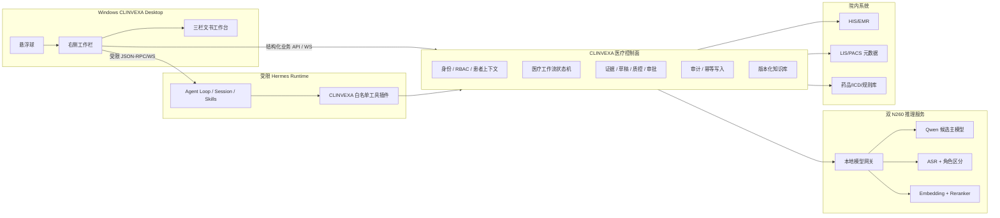

# CLINVEXA 双 N260 医生 AI 办公工作站 Implementation Plan

> **状态：已被新版范围替代。** 当前执行依据为 `docs/plans/2026-08-04-clinvexa-revised-phase-gated-plan.md`；本文件仅保留为早期分析记录。

> **For implementation:** Follow this plan task-by-task. Steps use checkbox (`- [ ]`) syntax for tracking.

**Goal:** 以当前 Hermes Agent 源码为通用 Agent 底座，交付一个本地部署、患者级隔离、全流程可追溯、医生确认后才允许写入 HIS 的 CLINVEXA V1.0。

**Architecture:** 采用“CLINVEXA 产品层 + 独立医疗控制面 + 受限 Hermes Runtime + 本地模型服务”的四层结构。Hermes 复用会话、流式 Agent、Skills、任务调度、桌面运行时和 JSON-RPC/WebSocket，不承载患者主数据、医疗权限、医疗审批或正式写入；所有高风险医疗流程由 CLINVEXA 控制面中的确定性状态机执行。

**Tech Stack:** Electron 40、React 19、TypeScript 6、Python 3.11–3.13、FastAPI、Pydantic v2、PostgreSQL 16 + pgvector、Alembic、Hermes `hermes serve`、vLLM-MetaX/OpenAI-compatible API、pytest、Vitest、Playwright。

## Global Constraints

- 产品定位：本地部署医生 AI 办公工作站，不是“AI 医生”或自动诊疗系统。
- 适配硬件：沐曦 N260 双卡工作站；单卡 64 GB 显存，最终模型和并行方案以实机基准为准。
- V1.0 完整流程：当前患者自动识别、问诊录音转病历、病历质控与医生确认写入、历史病历一页摘要、诊后随访计划生成。
- 未经医生确认不得写入正式病历；自动诊断、自动处方和无审核自动写入不在范围内。
- 患者数据以 `tenant_id + patient_id + encounter_id` 隔离；切换患者立即终止旧任务并清空临时上下文。
- 关键 AI 结果必须关联原始证据、模型版本、Prompt 版本、知识库版本和规则版本。
- 数值计算、单位、时间、左右侧、权限、写入和审计由程序或规则负责，不由大模型凭记忆决定。
- 医疗生产会话默认禁用 Terminal、任意文件读取、浏览器控制、任意 MCP、自动消息和 Hermes 普通长期记忆。
- 医疗 Skills 不允许 Agent 自行发布；必须经过技术审核、医学审核、测试、签名和授权。
- 面向调用者的错误消息使用英文小写开头且不以句号结尾；公开 Python API 具备完整类型标注和 Google style docstring。
- 不在代码、日志、埋点或配置模板中写入密钥、Token 或不必要的患者明文。

---

## 1. 本次分析结论

### 1.1 Hermes 适合作为底座，但只适合承担通用 Agent 能力

从当前源码确认可直接复用：

| 能力 | 现有依据 | CLINVEXA 用法 |
|---|---|---|
| Agent Loop 与模型路由 | `run_agent.py`、`model_tools.py`、`providers/` | 受限医疗助手和低风险办公任务 |
| JSON-RPC/WebSocket | `tui_gateway/ws.py`、`tui_gateway/methods_*.py` | 会话、流式输出、中断、审批、后台任务 |
| 原生桌面端 | `apps/desktop/` | Windows 启动、打包、窗口、全局快捷键和侧边窗口基础 |
| 会话与持久化 | `hermes_state.py`、`tui_gateway/methods_session.py` | Agent 会话历史；不保存患者主数据 |
| Skills 与插件工具 | `skills/`、`hermes_cli/plugins.py` | 只加载已签名、只读、已授权的医疗 Skills |
| 子 Agent | `delegate_task`、delegation RPC | V1 只保留能力，不作为关键医疗流水线依赖 |
| Cron/计划任务 | `cron/`、`cron.manage` | V1.1 后用于经授权的随访待办和科室提醒 |
| Desktop 审批 UI | `approval.request` / `approval.respond` | 仅复用交互模式；医疗确认另建业务审批对象 |

不能直接复用或不能作为生产安全边界：

- Hermes Memory 不是患者档案系统，患者资料禁止写入普通 Agent 长期记忆。
- Hermes Profile 是运行实例隔离，不是医院、科室、角色、患者的数据权限模型。
- Hermes 通用审批针对工具/命令，不能替代病历事实确认、质控处置和正式写入审批。
- Hermes middleware 和 observer hook 为 fail-open，不能承担医疗访问控制或写入拦截。
- 默认 Desktop/CLI 工具集合包含 Terminal、文件、浏览器、Skills 写入等高权限能力，医疗会话必须用显式白名单替换。
- 通用 `file.attach`、工作区和日志路径不作为 PHI 存储；患者文件必须先进入 CLINVEXA 受控文档库。

### 1.2 推荐改造方式

不复制一套新的 Hermes，也不在 `run_agent.py` 中堆医疗逻辑。保留一个可跟踪上游的 Hermes 薄分叉：

1. 在现有 `apps/desktop` 增加 CLINVEXA 产品贡献模块、悬浮球窗口和侧边栏窗口，继续复用后台探测、WebSocket、更新和 Windows 打包。
2. 新增独立 `clinvexa/` Python 服务，持有医疗数据、权限、工作流、审计、知识库、规则和 HIS 适配器。
3. 新增独立 `clinvexa-hermes-plugin/`，只注册少量白名单工具；工具调用 CLINVEXA API，服务端再次鉴权。
4. 通过 `HERMES_TUI_TOOLSETS=clinvexa` 启动医疗 Runtime，确保通用 Terminal、文件、浏览器、Memory、Skill 管理和任意 MCP 不进入模型工具表。
5. 关键按钮流程由桌面端直接调用 CLINVEXA API；自然语言助手才进入 Hermes。模型不能绕过控制面完成写入。

### 1.3 产品与部署逻辑图



高风险路径始终是：

```text
原始证据 → 结构化事实 → 医生确认事实 → 文书草稿 → 规则/模型质控
→ 医生处置高风险问题 → 医生确认写入 → 幂等写入 HIS → 回执 → 审计闭环
```

---

## 2. V1.0 功能框架

### 2.1 桌面交互层

#### 悬浮球

- 七种明确状态：待机、已识别患者、记录中、处理中、待确认、风险提醒、系统异常。
- 单击展开四个高频动作，双击打开右侧栏，拖动定位，右键进入历史/设置/退出。
- 不自动开始录音，不全屏监听，不读取未由用户主动复制或拖入的内容。
- 患者切换、任务完成和高风险事项改变状态时更新角标，但后台事件不抢焦点。

#### 右侧智能工作栏

- 顶部固定当前患者、就诊、科室、医生、数据来源和 HIS 连接状态。
- 中部展示当前任务阶段、关键事实、待补充问题、质控卡片和待确认项。
- 底部提供病历生成、摘要、质控、随访、知识查询和对话输入。
- 90% 高频操作在侧边栏完成；复杂编辑进入全屏工作台。

#### 全屏文书工作台

- 左栏：录音转写、历史病历、检查检验和用药等原始证据。
- 中栏：事实字段和 AI 文书草稿，可编辑、撤销、查看修改差异。
- 右栏：红黄蓝质控、证据、原因、建议和处理状态。
- 正文句子、证据片段、质控问题之间可双向定位。

### 2.2 医疗业务层

#### 当前患者上下文

- 通过 HIS 正式接口、院内集成平台或明确授权的插件识别患者；V1 开发期提供 Mock HIS。
- 不采用屏幕 OCR/RPA 作为默认生产方案。
- 每个活动会话只绑定一个 `(patient_id, encounter_id)`；切换时先中断旧任务，再清空缓存，再加载新患者。

#### 问诊记录与事实确认

- 录音必须由医生主动开始；记录许可、麦克风、空间、ASR 健康检查全部通过后才启动。
- 音频分段加密保存，转写包含 speaker、时间戳和来源哈希。
- 抽取结果使用结构化字段，不允许直接从转写跳到正式长文。
- 字段状态固定为：`confirmed`、`needs_review`、`conflict`、`not_asked`、`not_mentioned`、`denied`、`unknown`。

#### 病历草稿和质控

- 模板、Prompt、JSON Schema、规则集均版本化。
- 文书只消费医生已确认事实和带来源的历史数据。
- 高风险问题默认阻断写入；医生强制继续时必须填原因并单独审计。
- 写入使用幂等键，断网重试不能产生重复病历。

#### 患者一页摘要

- 数值趋势由程序计算，模型只把确定结果转成语言摘要。
- 每条摘要带 `EvidenceRef[]`，支持跳转到具体日期、原始报告和计算方式。
- 默认只查询当前授权患者，禁止跨患者检索。

#### 随访计划

- 生成的是草稿；医生确认后才成为计划。
- V1 生成节点、问题、指标、复查项、患者任务、医生任务和风险触发条件。
- 自动触达、异常分级和企业微信/短信发送放入 V1.1，且高风险消息仍需人工确认。

#### 医学知识助手

- 作为 V1 的支撑能力交付最小版本：院内制度/路径/说明书的版本化检索与引用。
- 无可靠依据时必须拒答；不使用模型记忆替代药品、ICD、医保、参考范围和临床路径数据库。
- 完整知识管理后台、科室共享和批量发布进入 V1.1。

### 2.3 Skills 分级与治理

```text
平台 Skills（官方发布）
  └─ 科室 Skills（科室授权）
       └─ 医生个人模板/偏好（只影响表达，不改变医疗规则）
```

每个生产 Skill 包含：

```yaml
id: record-structuring
version: 1.0.0
risk_level: high
prompt_version: record-structuring@1.0.0
input_schema: schemas/record-input.json
output_schema: schemas/record-facts.json
rule_set: outpatient-record@1.0.0
medical_reviewer: reviewer-id
technical_reviewer: reviewer-id
test_dataset: outpatient-gold-v1
signature: detached-signature
```

发布流程固定为：草稿 → 技术审核 → 医学审核 → 离线评测 → 签名 → 灰度 → 科室授权 → 正式发布；Hermes 的 `skill_manage` 不在医疗运行时中启用。

---

## 3. 建议代码结构

```text
hermes-agent-main/
├── apps/
│   └── desktop/                         # 保持 Hermes Desktop 薄分叉
│       ├── electron/
│       │   ├── clinvexa-windows.ts    # 悬浮球/侧边栏/工作台窗口生命周期
│       │   ├── clinvexa-service.ts    # 控制面和 Hermes 双服务健康/启动
│       │   └── main.ts                  # 仅增加窄入口
│       └── src/
│           └── clinvexa/
│               ├── api/                 # 医疗 API 与事件流客户端
│               ├── app/                 # 路由和产品壳
│               ├── floating-ball/       # 悬浮球
│               ├── sidebar/             # 右侧工作栏
│               ├── workbench/           # 三栏文书工作台
│               ├── features/            # patient/record/qc/summary/followup/knowledge
│               ├── stores/              # 以患者/就诊为作用域的 UI 状态
│               └── types/               # 共享 DTO
├── clinvexa/
│   ├── pyproject.toml                    # 独立 Python 服务与精确锁定依赖
│   ├── alembic.ini
│   ├── migrations/
│   ├── src/clinvexa/
│   │   ├── main.py                       # FastAPI 入口
│   │   ├── config.py                     # 非密钥配置
│   │   ├── auth/                         # 登录、会话、RBAC、数据范围
│   │   ├── context/                      # 患者/就诊绑定和切换护栏
│   │   ├── evidence/                     # SourceArtifact/EvidenceSpan
│   │   ├── workflows/                    # 状态机、任务、事件流
│   │   ├── records/                      # 事实、草稿、版本、模板
│   │   ├── quality/                      # 确定性规则和质控结果
│   │   ├── approvals/                    # 医生确认、强制继续原因
│   │   ├── summaries/                    # 时间线、趋势和一页摘要
│   │   ├── followups/                    # 随访草稿和任务
│   │   ├── knowledge/                    # 文档版本、切分、检索、引用
│   │   ├── skills/                       # Skill 审核、签名、发布、授权
│   │   ├── integrations/                 # HIS/LIS/药品/消息适配器
│   │   ├── inference/                    # LLM/ASR/Embedding/Reranker 客户端
│   │   ├── audit/                        # 追加式审计和哈希链
│   │   └── telemetry/                    # 无 PHI 指标和健康检查
│   └── tests/
│       ├── unit/
│       ├── contract/
│       ├── integration/
│       ├── security/
│       └── evaluation/
├── clinvexa-hermes-plugin/
│   ├── plugin.yaml
│   ├── clinvexa_plugin/
│   │   ├── __init__.py                   # 注册白名单工具
│   │   ├── client.py                     # 控制面客户端和服务身份
│   │   ├── schemas.py                    # 工具 schema
│   │   └── handlers.py                   # fail-closed 工具处理器
│   └── tests/
├── medical-skills/
│   ├── record-structuring/
│   ├── record-quality-control/
│   ├── patient-summary/
│   └── followup-planning/
├── deploy/clinvexa/
│   ├── compose.control-plane.yml
│   ├── compose.inference-metax.yml
│   ├── config/
│   ├── healthcheck/
│   └── backup/
└── docs/clinvexa/
    ├── architecture.md
    ├── threat-model.md
    ├── data-dictionary.md
    ├── his-adapter-contract.md
    ├── model-benchmark.md
    └── clinical-validation.md
```

不建议把 CLINVEXA 代码写入 `run_agent.py`、`model_tools.py`、`hermes_state.py` 或 `tui_gateway` 的核心流程。若确实需要新增通用 RPC seam，应先证明现有接口无法满足，再以与医疗无关的通用能力提交小改动。

---

## 4. 核心接口与数据合同

### 4.1 请求上下文

所有医疗 API 和后台任务显式携带并校验：

```python
class RequestContext(BaseModel):
    tenant_id: UUID
    department_id: UUID
    user_id: UUID
    role_codes: frozenset[str]
    patient_id: UUID | None
    encounter_id: UUID | None
    correlation_id: UUID
```

`tenant_id`、`department_id`、`user_id` 和 `role_codes` 必须由服务端从已认证会话构造，不能信任客户端提交值。患者级 API 缺少 `patient_id` 或 `encounter_id` 时直接拒绝；不能从模型文本、前端缓存或最近一次会话猜测患者身份。

### 4.2 证据合同

```python
class EvidenceRef(BaseModel):
    artifact_id: UUID
    artifact_version: int
    source_type: Literal["conversation", "medical_record", "lab", "exam", "medication", "knowledge"]
    start_offset: int | None
    end_offset: int | None
    start_ms: int | None
    end_ms: int | None
    source_sha256: str
```

```python
class ClinicalFact(BaseModel):
    fact_id: UUID
    field_name: str
    display_name: str
    value: JsonValue | None
    status: Literal["confirmed", "needs_review", "conflict", "not_asked", "not_mentioned", "denied", "unknown"]
    confidence: float | None
    evidence: list[EvidenceRef]
    confirmed_by: UUID | None
    confirmed_at: datetime | None
```

### 4.3 医疗工作流状态机

```text
created → source_collecting → extracting → fact_review
→ drafting → quality_check → doctor_review → approved
→ writing → written
```

异常状态：`cancelled`、`failed`、`write_unknown`。`write_unknown` 表示请求已发出但回执不明确，只能查询/对账，禁止盲目重试。

### 4.4 业务 API

| 接口 | 作用 | 关键约束 |
|---|---|---|
| `POST /v1/patient-context/bind` | 绑定当前患者/就诊 | 服务端查权限；返回 context revision |
| `DELETE /v1/patient-context/active` | 清空上下文 | 先取消旧任务并记录审计 |
| `POST /v1/encounters/{id}/recordings` | 开始录音会话 | 显式同意、设备和 ASR 检查 |
| `POST /v1/workflows/record-from-audio` | 启动问诊转病历 | 返回 workflow ID |
| `GET /v1/workflows/{id}/events` | SSE/WS 任务事件 | 只返回当前授权上下文 |
| `PATCH /v1/facts/{id}` | 医生确认/修改事实 | 产生新版本，不覆盖历史 |
| `POST /v1/drafts` | 基于确认事实生成草稿 | 输入锁定 fact revision |
| `POST /v1/drafts/{id}/quality-checks` | 执行质控 | 规则结果与模型建议分开 |
| `POST /v1/drafts/{id}/approvals` | 医生确认 | 保存 diff、风险处置和身份 |
| `POST /v1/drafts/{id}/writebacks` | 写入 HIS | 必须带 `Idempotency-Key` |
| `GET /v1/patients/{id}/summary` | 一页摘要 | 逐条返回证据和算法版本 |
| `POST /v1/followup-plans` | 生成随访草稿 | 不自动启用、不自动发送 |
| `POST /v1/knowledge/query` | 院内知识检索 | 返回版本、段落和原文件引用 |
| `GET /v1/audit/events` | 授权审计查询 | 运维角色默认不见患者正文 |

### 4.5 Hermes 白名单工具

V1 只向模型暴露：

- `dc_get_active_context()`：返回脱敏、最小化的当前上下文摘要。
- `dc_start_workflow(workflow_type, input_refs)`：启动受支持的医疗工作流。
- `dc_get_workflow_status(workflow_id)`：读取状态和可展示结果。
- `dc_search_knowledge(query, scope)`：查询已授权知识库并返回证据。
- `dc_create_followup_draft(encounter_id, template_id)`：生成随访草稿。
- `dc_list_pending_tasks()`：读取当前医生待办。

不提供 `execute_sql`、`call_any_his_api`、`write_record_directly`、`send_message_raw` 或任意 URL/命令执行工具。插件每次调用都使用短时服务令牌，并把 Hermes session ID 映射到控制面中已绑定的用户和患者上下文；映射不存在或过期时 fail closed。

---

## 5. 推理与双 N260 部署方案

### 5.1 现阶段能确认的事实

- 沐曦官方 N260 产品页标明单卡 64 GB 显存，双卡合计物理显存 128 GB，但可用 KV Cache、通信和并行效率不能由容量简单推导。
- 沐曦 MIM 模型中心已列出 Qwen3.5-35B-A3B 的适配信息；vLLM-MetaX 提供硬件插件和官方容器路径。
- vLLM-MetaX 公开 README 的通用前置条件仍写为 MetaX C-series，而开发者社区另有 N260 专用镜像实践；在厂商给出 N260 对应的驱动/MACA/镜像支持矩阵前，不能把通用 release 分支视为 N260 生产支持承诺。
- “能启动模型”不代表满足临床交互延迟；不同 MACA、驱动、镜像、量化和 batch 配置会显著影响结果。
- N260 的生产推理资料主要面向 Linux/容器，因此 Windows 客户端与 Linux 推理节点应视为两个逻辑节点；是否能同机部署必须由厂商支持矩阵确认。

参考资料：

- [MetaX N260 官方产品页](https://www.metax-tech.com/en/goods/prod.html?cid=106&id=39)
- [沐曦 MIM 模型中心](https://developer.metax-tech.com/mim)
- [vLLM-MetaX 官方仓库说明](https://gitee.com/metax-maca/vLLM-metax/blob/master/README.md)

### 5.2 必须先完成的模型闸门

候选配置至少覆盖：

1. 双卡 TP=2 的 27B/32B Dense 或 35B-A3B MoE 候选。
2. 单卡主模型 + 单卡 ASR/Embedding/Reranker 的并行方案。
3. BF16、FP8/W8A8 和厂商明确支持的量化方案。
4. 8K、16K、32K 三档真实上下文和 1/2/4 并发。

每个配置记录：镜像 digest、驱动、MACA、vLLM-MetaX、模型 commit、量化方式、TP、上下文、显存、TTFT、TPOT、吞吐、错误率和 8 小时稳定性。

### 5.3 推荐服务划分

- `model-gateway`：唯一对应用暴露的 OpenAI-compatible 接口；鉴权、限流、路由和请求审计在此完成。
- `llm-primary`：病历抽取、草稿、摘要和知识回答。
- `asr-service`：流式转写、时间戳、角色区分；模型候选经中文医疗语音集验证后决定。
- `embedding-service` 与 `reranker-service`：知识库检索；可与辅助卡共享但必须设资源上限。
- `rule-engine`：CPU 服务，不占 GPU；负责数值、单位、时间、左右侧和字段完整性。

模型网关必须允许“快速模型/主模型”按工作流路由，但医生界面不展示具体模型名称。

---

## 6. 实施任务

### Task 0: 建立可追踪的 Hermes 基线与决策记录

**Files:**
- Create: `docs/clinvexa/architecture.md`
- Create: `docs/clinvexa/adr/0001-hermes-runtime-boundary.md`
- Create: `docs/clinvexa/adr/0002-medical-control-plane.md`
- Create: `docs/clinvexa/upstream-baseline.md`
- Modify: `.gitignore`

**Interfaces:**
- Consumes: 当前解压源码（Python 0.19.1、Desktop 0.17.0）和 MIT `LICENSE`。
- Produces: 可复现的上游 commit/tag、CLINVEXA patch 边界和升级流程。

- [ ] 确认源码来源、上游 URL、commit/tag、所有本地修改和依赖锁文件；当前目录没有 `.git` 元数据，不能把版本号当作完整 provenance。
- [ ] 把原始 Hermes 设为只读 upstream，CLINVEXA 在独立分支维护；禁止直接把医疗逻辑写进 Hermes 核心大文件。
- [ ] 记录允许修改的窄入口：Desktop 产品层、启动环境、通用窗口 seam、必要的通用 RPC seam。
- [ ] 建立每月 upstream rebase/merge 演练和回归清单。
- [ ] 验证：干净环境能按 `README.md` 启动 `hermes serve` 和 Desktop mock 模式。
- [ ] Commit: `docs: record hermes baseline and clinvexa boundaries`

### Task 1: 双 N260 与院内接口可行性 Spike

**Files:**
- Create: `benchmarks/n260/model_matrix.yaml`
- Create: `benchmarks/n260/run_benchmark.py`
- Create: `benchmarks/n260/clinical_prompts.jsonl`
- Create: `docs/clinvexa/model-benchmark.md`
- Create: `docs/clinvexa/his-adapter-contract.md`

**Interfaces:**
- Consumes: N260 驱动/MACA/容器、候选模型、脱敏临床样例、HIS/LIS 接口文档。
- Produces: `InferenceProfile`、性能基线和 `HisAdapter` 合同。

- [ ] 固化硬件、OS、驱动、MACA、Docker runtime、镜像 digest 和卡间互联信息。
- [ ] 对候选主模型执行标准和真实工作流压测，分别验证冷启动、TTFT、TPOT、长上下文、并发和 8 小时稳定性。
- [ ] 对 ASR 候选测试中文医疗术语、数字、单位、药名、左右侧和医患角色区分。
- [ ] 与院方确认患者识别、病历读取、检查检验、正式写入、回执查询和幂等能力；没有正式接口时只做 Mock HIS，不以 RPA 冒充完成集成。
- [ ] 闸门：至少一个模型组合满足产品时延目标，且 HIS 能提供可审计的读写接口，才进入生产实现。
- [ ] Commit: `bench: establish n260 and his feasibility gates`

### Task 2: 医疗控制面、数据库和安全基线

**Files:**
- Create: `clinvexa/pyproject.toml`
- Create: `clinvexa/src/clinvexa/main.py`
- Create: `clinvexa/src/clinvexa/config.py`
- Create: `clinvexa/src/clinvexa/db.py`
- Create: `clinvexa/src/clinvexa/auth/`
- Create: `clinvexa/src/clinvexa/context/`
- Create: `clinvexa/src/clinvexa/audit/`
- Create: `clinvexa/migrations/`
- Test: `clinvexa/tests/security/test_patient_isolation.py`
- Test: `clinvexa/tests/security/test_rbac.py`
- Test: `clinvexa/tests/integration/test_audit_chain.py`

**Interfaces:**
- Consumes: `RequestContext`、院内身份字段和数据保留策略。
- Produces: `get_request_context()`、`PatientContextService.bind/switch/clear()`、`AuditWriter.append()`。

- [ ] 先写患者跨租户、跨医生、跨科室和患者切换泄漏的失败测试。
- [ ] 建立 PostgreSQL schema、迁移和 tenant/patient/encounter 复合约束；查询层禁止无上下文的患者数据访问。
- [ ] 实现本地账号/RBAC 最小版本，并预留 OIDC/LDAP 适配器；技术运维角色默认无法读取患者正文。
- [ ] 实现追加式审计、哈希链和签名检查点；审计写入失败时高风险业务 fail closed。
- [ ] 实现日志脱敏、密钥外置、TLS、会话超时和备份恢复脚本。
- [ ] Run: `uv run --project clinvexa pytest clinvexa/tests/security clinvexa/tests/integration/test_audit_chain.py -q`
- [ ] Commit: `feat: establish medical data and audit boundary`

### Task 3: 证据模型与医疗工作流状态机

**Files:**
- Create: `clinvexa/src/clinvexa/evidence/models.py`
- Create: `clinvexa/src/clinvexa/workflows/models.py`
- Create: `clinvexa/src/clinvexa/workflows/service.py`
- Create: `clinvexa/src/clinvexa/workflows/events.py`
- Create: `clinvexa/src/clinvexa/records/facts.py`
- Test: `clinvexa/tests/unit/test_workflow_transitions.py`
- Test: `clinvexa/tests/security/test_context_revision.py`

**Interfaces:**
- Consumes: `RequestContext`、`SourceArtifact` 和外部服务事件。
- Produces: `WorkflowService.start/cancel/transition()`、`EvidenceRef`、`ClinicalFact`、`WorkflowEvent`。

- [ ] 写非法状态跃迁、旧 context revision、切换患者时在途任务取消和事件越权读取测试。
- [ ] 实现证据内容哈希、版本、偏移/时间戳和不可变来源引用。
- [ ] 实现状态机及持久化 outbox，确保任务事件与数据库状态一致。
- [ ] 实现超时、取消、失败和 `write_unknown`，禁止不明回执下自动重复写入。
- [ ] Run: `uv run --project clinvexa pytest clinvexa/tests/unit/test_workflow_transitions.py clinvexa/tests/security/test_context_revision.py -q`
- [ ] Commit: `feat: add evidence-backed medical workflows`

### Task 4: Hermes 受限运行时与白名单插件

**Files:**
- Create: `clinvexa-hermes-plugin/plugin.yaml`
- Create: `clinvexa-hermes-plugin/clinvexa_plugin/__init__.py`
- Create: `clinvexa-hermes-plugin/clinvexa_plugin/client.py`
- Create: `clinvexa-hermes-plugin/clinvexa_plugin/schemas.py`
- Create: `clinvexa-hermes-plugin/clinvexa_plugin/handlers.py`
- Create: `clinvexa-hermes-plugin/tests/test_tool_policy.py`
- Create: `deploy/clinvexa/config/hermes-config.yaml`

**Interfaces:**
- Consumes: 控制面服务身份和 session-to-context binding API。
- Produces: `clinvexa` toolset，以及本方案 4.5 节列出的六个 `dc_*` 工具。

- [ ] 写测试证明工具在控制面不可达、令牌过期、上下文缺失、患者不匹配时全部 fail closed。
- [ ] 注册窄工具 schema，处理器只调用固定控制面路径，不接受任意 URL、SQL、命令或文件路径。
- [ ] 启动医疗 Runtime 时固定 `HERMES_TUI_TOOLSETS=clinvexa`；同时关闭默认 MCP、Memory、Skills 写入、Terminal、文件和浏览器工具。
- [ ] 验证 `tools.list` 的模型可见工具仅为批准的 CLINVEXA 工具，不依赖 middleware 的 fail-open 阻断。
- [ ] 验证 Hermes session 中不落患者主数据，普通长期记忆只允许医生非医疗偏好。
- [ ] Commit: `feat: restrict hermes to clinvexa tools`

### Task 5: CLINVEXA 桌面壳、悬浮球和患者上下文 UI

**Files:**
- Create: `apps/desktop/electron/clinvexa-windows.ts`
- Create: `apps/desktop/electron/clinvexa-service.ts`
- Modify: `apps/desktop/electron/main.ts`
- Modify: `apps/desktop/src/main.tsx`
- Create: `apps/desktop/src/clinvexa/floating-ball/`
- Create: `apps/desktop/src/clinvexa/sidebar/`
- Create: `apps/desktop/src/clinvexa/stores/patient-context.ts`
- Create: `apps/desktop/src/clinvexa/api/client.ts`
- Test: `apps/desktop/src/clinvexa/stores/patient-context.test.ts`
- Test: `apps/desktop/electron/clinvexa-windows.test.ts`

**Interfaces:**
- Consumes: `/v1/patient-context/*`、`/v1/health`、Hermes shared JSON-RPC client。
- Produces: `CLINVEXAWindowController`、`$activePatientContext`、`$workflowStatus`。

- [ ] 写窗口边界、焦点不劫持、全局快捷键冲突、患者切换清空和旧异步响应不能覆盖新患者的测试。
- [ ] 新增 `?win=clinvexa-ball` 和 `?win=clinvexa-sidebar` 渲染入口，复用现有 Electron 安全 preload，不给 renderer 通用 Node 能力。
- [ ] 实现七状态悬浮球、右侧栏固定患者头部、明确处理阶段和断连恢复。
- [ ] 患者切换采用 generation/context revision：先取消旧任务，清理患者级 store，再请求新上下文。
- [ ] 完成 CLINVEXA 品牌、Windows appId/安装器/图标和中文文案；保留 Hermes 许可证声明。
- [ ] Run: `npm run test:ui --workspace apps/desktop`
- [ ] Run: `npm run test:desktop:platforms --workspace apps/desktop`
- [ ] Commit: `feat: add clinvexa desktop shell`

### Task 6: 问诊录音、事实确认和病历草稿纵向切片

**Files:**
- Create: `clinvexa/src/clinvexa/inference/asr.py`
- Create: `clinvexa/src/clinvexa/records/extraction.py`
- Create: `clinvexa/src/clinvexa/records/drafts.py`
- Create: `medical-skills/record-structuring/`
- Create: `apps/desktop/src/clinvexa/features/recording/`
- Create: `apps/desktop/src/clinvexa/features/fact-review/`
- Create: `apps/desktop/src/clinvexa/workbench/`
- Test: `clinvexa/tests/evaluation/test_fact_extraction_goldset.py`
- Test: `apps/desktop/src/clinvexa/features/fact-review/fact-review.test.tsx`

**Interfaces:**
- Consumes: ASR 流、`EvidenceRef`、确认事实 schema 和版本化模板。
- Produces: `TranscriptSegment[]`、`ClinicalFact[]`、`DocumentDraftRevision`。

- [ ] 先用脱敏标注集写数字、单位、药名、左右侧、否定、未询问和冲突测试。
- [ ] 实现录音前置检查、流式上传、暂停/结束、断点保存和按策略删除临时音频。
- [ ] 实现 ASR 分段、说话人、时间戳和证据定位；转写不可直接覆盖原始音频引用。
- [ ] 结构化抽取必须通过 Pydantic/JSON Schema；异常输出只重试一次，仍失败则进入人工处理。
- [ ] 医生逐项确认后才能生成草稿；生成器只消费确认事实和明确的灰色占位。
- [ ] UI 显示证据、状态、冲突和修改历史，支持撤销。
- [ ] 闸门：关键字段 Precision ≥ 99%、Recall ≥ 98%，严重临床错误为 0。
- [ ] Commit: `feat: deliver evidence-backed record drafting`

### Task 7: 质控、医疗审批和 HIS 幂等写入

**Files:**
- Create: `clinvexa/src/clinvexa/quality/rules/`
- Create: `clinvexa/src/clinvexa/quality/service.py`
- Create: `clinvexa/src/clinvexa/approvals/service.py`
- Create: `clinvexa/src/clinvexa/integrations/his/base.py`
- Create: `clinvexa/src/clinvexa/integrations/his/mock.py`
- Create: `clinvexa/src/clinvexa/integrations/his/<vendor>.py`
- Create: `apps/desktop/src/clinvexa/features/quality/`
- Test: `clinvexa/tests/contract/test_his_adapter.py`
- Test: `clinvexa/tests/integration/test_writeback_idempotency.py`
- Test: `clinvexa/tests/security/test_unapproved_write_blocked.py`

**Interfaces:**
- Consumes: 锁定的草稿 revision、规则集、HIS adapter。
- Produces: `QualityFinding[]`、`ApprovalDecision`、`WritebackReceipt`。

- [ ] 写患者错配、未审批、高风险未处置、重复请求、超时后重试和回执不明的失败测试。
- [ ] 先实现确定性规则，再增加 LLM 辅助建议；两类结果保存不同 `source_kind`。
- [ ] 实现医生接受、手改、忽略和强制继续；高风险强制继续必须填写原因。
- [ ] `HisAdapter` 只暴露固定业务方法，正式写入前再次检查 patient/context revision、approval revision 和幂等键。
- [ ] 成功、明确失败和未知状态分别处理；未知状态只允许对账查询。
- [ ] 闸门：患者串档 0、未经确认写入 0、重复写入 0、审计完整率 100%。
- [ ] Commit: `feat: enforce medical approval and idempotent writeback`

### Task 8: 一页摘要、随访草稿和最小知识库

**Files:**
- Create: `clinvexa/src/clinvexa/summaries/`
- Create: `clinvexa/src/clinvexa/followups/`
- Create: `clinvexa/src/clinvexa/knowledge/`
- Create: `medical-skills/patient-summary/`
- Create: `medical-skills/followup-planning/`
- Create: `apps/desktop/src/clinvexa/features/summary/`
- Create: `apps/desktop/src/clinvexa/features/followup/`
- Create: `apps/desktop/src/clinvexa/features/knowledge/`
- Test: `clinvexa/tests/evaluation/test_summary_evidence_coverage.py`
- Test: `clinvexa/tests/evaluation/test_knowledge_refusal.py`

**Interfaces:**
- Consumes: 授权患者时间线、结构化指标、版本化知识文档。
- Produces: `PatientSummaryItem[]`、`TrendSeries[]`、`FollowupPlanDraft`、`KnowledgeAnswer`。

- [ ] 程序构建时间线、趋势和逾期天数，LLM 只生成有证据的语言层。
- [ ] 每条摘要必须至少有一个证据引用；无证据内容不得进入正式摘要。
- [ ] 随访计划默认 `draft`，医生确认才激活；V1 不自动发送高风险医学建议。
- [ ] 知识文档保存版本、生效日期、来源和哈希；检索不足时返回固定拒答。
- [ ] Run: `uv run --project clinvexa pytest clinvexa/tests/evaluation -q`
- [ ] Commit: `feat: add summary followup and cited knowledge workflows`

### Task 9: Skills 发布治理和管理后台

**Files:**
- Create: `clinvexa/src/clinvexa/skills/models.py`
- Create: `clinvexa/src/clinvexa/skills/service.py`
- Create: `clinvexa/src/clinvexa/skills/signing.py`
- Create: `apps/desktop/src/clinvexa/features/skill-admin/`
- Test: `clinvexa/tests/security/test_unsigned_skill_rejected.py`
- Test: `clinvexa/tests/integration/test_skill_rollout.py`

**Interfaces:**
- Consumes: Skill 包、医学/技术审核、离线评测结果和科室授权。
- Produces: 不可变 `SkillRelease` 和 read-only runtime mount。

- [ ] 未签名、签名不匹配、审核不全、评测不达标或未授权的 Skill 一律不能加载到生产 Runtime。
- [ ] 实现版本、审核、签名、灰度、回滚和科室/医生授权。
- [ ] Hermes 仅看到已发布 Skill 的只读副本；Agent 生成的 Skill 永远停留在草稿区。
- [ ] V1 管理后台只做必要的列表、审核、发布、回滚和授权，不做智能体广场首页。
- [ ] Commit: `feat: govern medical skill releases`

### Task 10: 部署、恢复、全链路验证和试点

**Files:**
- Create: `deploy/clinvexa/compose.control-plane.yml`
- Create: `deploy/clinvexa/compose.inference-metax.yml`
- Create: `deploy/clinvexa/healthcheck/verify_stack.py`
- Create: `deploy/clinvexa/backup/backup.ps1`
- Create: `deploy/clinvexa/backup/restore.ps1`
- Create: `docs/clinvexa/threat-model.md`
- Create: `docs/clinvexa/clinical-validation.md`
- Create: `apps/desktop/e2e/clinvexa-record-workflow.spec.ts`

**Interfaces:**
- Consumes: 完整服务、脱敏金标集、Mock HIS 和试点 HIS。
- Produces: 可安装包、可恢复部署、验证报告和试点准入结论。

- [ ] 绑定最小网络端口；vLLM、PostgreSQL 和 Hermes 管理端口不直接暴露给医生终端。
- [ ] 完成 TLS、证书轮换、密钥轮换、磁盘加密、备份加密和恢复演练。
- [ ] 注入 HIS 断连、模型超时、ASR 失败、无效 JSON、患者中途切换、数据库重启和回执丢失故障。
- [ ] 运行 Desktop typecheck/lint/Vitest/Playwright，Hermes 回归测试，CLINVEXA 单元/契约/集成/安全/评测测试。
- [ ] 使用真实、脱敏、标注病例验证产品文档第 21 节全部门槛。
- [ ] 先在单科室、少量医生、只读/草稿模式试点；通过医学和安全评审后才开放正式写入。
- [ ] Commit: `release: prepare clinvexa clinical pilot`

---

## 7. 需求追踪矩阵

| 产品文档要求 | 主要落点 | 验收依据 |
|---|---|---|
| 第 4 节三层交互 | Task 5、Task 6 | 悬浮球、侧边栏、三栏工作台 E2E |
| 第 6 节当前患者识别 | Task 1、Task 2、Task 5 | 3 秒识别、切换无残留、权限测试 |
| 第 7–9 节问诊/事实/病历 | Task 3、Task 6 | ASR/事实金标、证据跳转、草稿流程 |
| 第 10 节一页摘要 | Task 8 | 时间线/趋势程序计算、逐条证据覆盖 |
| 第 11 节文书质控 | Task 7 | 红黄蓝规则、高风险拦截、医生处置记录 |
| 第 12 节随访管理 | Task 8 | 草稿确认、风险边界、无自动高风险发送 |
| 第 13 节知识助手 | Task 8 | 文档版本/生效日期/引用/无依据拒答 |
| 第 14 节科室办公 | V1.1 | 不抢占 V1 接诊主流程 |
| 第 15 节加载/超时/离线/模型异常 | Task 5、Task 10 | 明确状态、取消/保存/恢复、一次重试、故障注入 |
| 第 16 节权限/隔离/审计 | Task 2、Task 3、Task 7 | RBAC、患者串档 0、审计完整率 100% |
| 第 17 节模型与规则分工 | Task 6–Task 8 | 数值/单位/趋势/写入均有确定性实现 |
| 第 18 节双 N260 | Task 1、Task 10 | 实机模型矩阵和 8 小时稳定性 |
| 第 19–20 节 V1 范围/页面 | Task 5–Task 8 | 五条流程与核心页面覆盖 |
| 第 21–22 节指标/埋点 | Task 10 | 无 PHI 指标、临床评测和效率试点 |
| 第 23–24 节流程/禁止项 | 全局约束、Task 6–Task 8 | 无自动录音/诊断/处方/未确认写入 |

---

## 8. 测试与验收矩阵

| 层级 | 必测内容 | 通过标准 |
|---|---|---|
| 单元测试 | 状态机、规则、数据转换、权限判断、幂等键 | 关键分支全覆盖 |
| Schema/契约 | Desktop↔控制面、插件↔控制面、HIS adapter、模型结构化输出 | 版本兼容且坏输入 fail closed |
| 集成测试 | PostgreSQL、队列、模型 stub、Mock HIS、审计链 | 可重复、无外网依赖 |
| 安全测试 | 跨租户/跨科室/跨患者访问、旧 context revision、令牌过期、日志脱敏 | 所有越权均拒绝且被审计 |
| E2E | 初诊、复诊、质控、患者切换、断网恢复、未知写入回执 | 五条 V1 流程闭环 |
| 医疗评测 | 事实抽取、否定/未询问、药物剂量、左右侧、时间线、摘要证据 | 达到文档第 21 节门槛 |
| 性能 | 患者识别、TTFT、生成、长摘要、ASR 延迟、并发、显存 | 达到经实机确认的 SLO |
| 恢复 | 备份恢复、服务重启、模型切换、HIS 恢复 | 不重复写入、不丢审计 |

产品文档中的关键硬门槛原样保留：

- 打开患者后 3 秒内识别患者。
- 三次点击内生成门诊病历草稿。
- 90% 以上高频操作在侧边栏完成。
- 切换患者后不存在上一患者残留。
- 关键字段 Precision ≥ 99%，Recall ≥ 98%，普通字段 F1 ≥ 95%。
- 测试集严重临床错误 0；患者串档 0；未经医生确认写入 0；重复写入 0；审计完整率 100%。

效率指标（病历时间减少 50%、历史资料查看减少 60% 等）属于试点临床运营指标，不能用纯实验室测试替代。

---

## 9. 里程碑、团队和周期建议

以下为 7–9 人核心团队的估算，硬件驱动/HIS 接口或标注数据延迟不包含在纯开发时间内：

| 阶段 | 周期 | 可验收产物 |
|---|---:|---|
| M0 基线与可行性 | 2–3 周 | Hermes 基线、N260 报告、HIS 合同、威胁模型 |
| M1 控制面与桌面壳 | 3–4 周 | 登录/RBAC/审计、悬浮球、侧边栏、患者上下文 |
| M2 问诊转病历纵向切片 | 4–5 周 | 录音→事实→草稿→证据闭环（Mock HIS） |
| M3 质控与正式写入 | 3–4 周 | 风险处置、医生审批、幂等 HIS 写入 |
| M4 摘要/随访/知识 | 3–4 周 | 复诊摘要、随访草稿、最小引用知识库 |
| M5 硬化与科室试点 | 4–6 周 | 性能、安全、恢复、金标评测、试点报告 |

总周期建议：19–26 周。若真实 HIS 接口、N260 镜像和脱敏标注集已准备充分，可并行压缩；不建议通过删除安全/评测阶段压缩。

建议配置：产品/项目 1、临床产品/医学专家 1、桌面前端 2、Python 后端 2、模型/ASR/RAG 2、QA 自动化 1，安全/运维和 HIS 厂商接口人员按阶段投入。

---

## 10. 关键风险与处理

| 风险 | 影响 | 处理 |
|---|---|---|
| 当前源码无 Git 元数据 | 无法确定安全补丁和升级差异 | Task 0 先恢复 provenance，未完成不进入正式开发 |
| N260 模型可运行但临床时延不足 | 产品不可用 | 先做实机闸门，保留 27B/32B/35B-A3B 多候选 |
| Windows 客户端与 N260 Linux 软件栈不一致 | 安装架构变化 | 客户端/推理逻辑分节点，先确认厂商支持矩阵 |
| HIS 不提供患者事件或幂等写入 | 自动识别/写入不可交付 | 先做 adapter + Mock；接口不足时 V1 只读/复制草稿，不上 RPA |
| 医疗语音数字/药名/左右侧错误 | 严重临床风险 | ASR 金标集、事实确认、规则校验、原音定位 |
| Hermes 默认工具权限过大 | 数据泄露/越权 | `HERMES_TUI_TOOLSETS=clinvexa` 白名单，不依赖 fail-open hook |
| 患者数据进入 Agent Memory/日志 | 串档和隐私风险 | 患者库独立、日志脱敏、Memory 禁用、自动化泄漏测试 |
| Agent 自行更新 Skill | 未审核行为进入生产 | 签名发布、只读挂载、草稿与生产仓隔离 |
| LLM 输出结构不稳定 | 流程卡死或错误文书 | 强 schema、一次重试、确定性降级、人工接管 |
| 知识库过期 | 错误依据 | 文档版本/生效日期/失效机制和引用强制 |

---

## 11. 本轮确认项

开始实现前需要产品/院方确认以下决策：

1. 接受“独立医疗控制面 + 受限 Hermes Runtime”，不把患者数据和医疗权限直接放进 Hermes。
2. V1 以产品文档五条闭环为主；医学知识库交付最小引用版，完整 Skills/知识管理放 V1.1。
3. 不以屏幕 OCR/RPA 作为默认 HIS 集成方式；没有正式写入接口时先交付只读/草稿/复制模式。
4. 允许 Windows 客户端与 Linux N260 推理服务作为两个逻辑节点部署。
5. 接受 PostgreSQL + pgvector 作为医疗数据和知识索引底座，并使用加密磁盘、TLS 和加密备份。
6. 接受先以 Mock HIS + 脱敏金标数据完成纵向切片，再接真实院内系统。
7. 明确第一试点科室、首批病历模板、HIS 厂商/版本、数据保留周期和录音同意规则。

确认后，建议把本总方案拆成六份独立执行计划：

- `01-hermes-baseline-and-runtime-plan.md`
- `02-medical-control-plane-plan.md`
- `03-clinvexa-desktop-plan.md`
- `04-record-workflow-and-his-plan.md`
- `05-summary-followup-knowledge-plan.md`
- `06-deployment-security-validation-plan.md`

每份计划单独形成可运行、可测试、可评审的交付，不一次性并行铺开所有功能。
