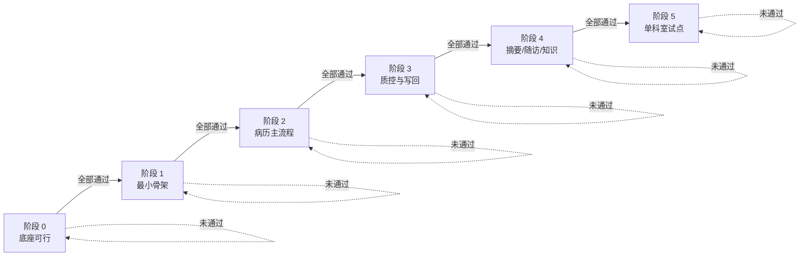

# CLINVEXA 轻量化分阶段交付 Implementation Plan

> **状态：已被用户确认的新范围替代。** 当前执行依据为 `docs/plans/2026-08-04-clinvexa-revised-phase-gated-plan.md`；本文件仅保留为方案变更记录。

> **For implementation:** Follow this plan task-by-task. Steps use checkbox (`- [ ]`) syntax for tracking.

**Goal:** 以现有 Hermes 为通用 Agent 与桌面底座，交付一个功能明确、操作便捷、可安全试点的 CLINVEXA V1。

**Architecture:** 保留 Hermes Agent Loop、JSON-RPC/WebSocket、Desktop 窗口与流式交互；新增一个轻量 Python 医疗控制服务，负责患者上下文、文书流程、确认、审计和 HIS 适配。V1 只保留一条主链路和三项必要安全优化，不建设大而全的平台。

**Tech Stack:** Python 3.11–3.13、FastAPI、Pydantic、PostgreSQL、Electron、React、TypeScript、Hermes 0.19.1、Hermes Desktop 0.17.0、本地 OpenAI-compatible 推理服务、pytest、Vitest、Playwright。

## Global Constraints

- V1 只支持 Windows 医生端和院内/本地 N260 推理节点。
- 患者医疗数据不进入 Hermes Memory；医疗会话不开放 Terminal、任意文件、浏览器、Skills 写入和任意 MCP。
- 同一个 Hermes session 只允许绑定一个患者的一次就诊，不允许在同一 session 内切换患者。
- 所有正式病历写入必须经过医生确认，并使用患者绑定、草稿版本和幂等键再次校验。
- 没有正式 HIS 写入接口时，阶段范围固定为“生成、审核、复制/导出”，不使用 RPA 冒充正式集成。
- 每个阶段只有“通过”或“未通过”；未达到全部硬门槛，不启动下一阶段。

---

## 1. 底座结论

### 1.1 现有 Hermes 能否作为 CLINVEXA 底座

结论：**可以，但属于“条件式可用”，不能原样作为医疗生产系统。**

可直接复用的基础能力：

| Hermes 现有能力 | CLINVEXA 用法 | 处理方式 |
|---|---|---|
| Agent Loop、模型路由、流式输出 | 自然语言助手、文书生成 | 直接复用 |
| JSON-RPC/WebSocket、会话、中断 | 侧边栏与后台 Agent 通信 | 直接复用 |
| Electron/React Desktop | Windows 安装、悬浮球、侧边栏 | 薄改造 |
| Pet overlay、Quick Entry | 悬浮球和快捷入口 | 改造现有窗口，不重写窗口系统 |
| Skills/插件工具机制 | 注册少量 `dc_*` 医疗工具 | 受限复用 |
| 审批 UI、任务状态 | 展示执行过程和确认入口 | 只复用交互，不作为医疗审批数据 |

不能直接承担的能力：

- Hermes Memory/Profile 不能代替患者数据库与医院权限。
- Hermes 普通会话会持久化消息并建立全文索引，不能直接承载未受控的患者数据。
- Hermes 工具集选择默认不是医疗级严格白名单：无效工具集可能回退到 CLI 配置，极端情况下启用全部工具。
- Hermes 通用审批不能代替患者绑定、文书版本确认和 HIS 幂等写入。

因此，Hermes 的定位固定为：**可替换的通用 Agent Runtime + 可复用桌面壳**。CLINVEXA 自己持有医疗数据与关键业务规则。

### 1.2 只保留最重要的 3 项优化

#### 优化 1：工具白名单改为严格失败关闭

当前源码 `tui_gateway/server.py::_load_enabled_toolsets()` 在显式工具集无效时存在回退行为。CLINVEXA 必须增加 strict 模式：

- `clinvexa` 工具集不存在、包含未知项或加载失败时，Runtime 直接拒绝启动。
- 启动后执行一次 `tools.list` 自检，结果不是批准清单时 Desktop 显示“安全配置错误”，不允许进入聊天。
- 模型可见工具只保留固定 `dc_*` 工具；不开放任意 URL、SQL、命令和本地路径参数。

#### 优化 2：患者会话与普通 Hermes 持久化隔离

- 一次就诊创建一个新的 Hermes session，并固定 `patient_id + encounter_id + context_revision`。
- 医疗 session 禁用普通 Memory、分支、全文检索和跨患者恢复；会话结束按数据保留策略销毁或转存到受控医疗库。
- 患者切换时先取消旧任务、关闭旧 session、清空患者级 UI store，再创建新 session。

#### 优化 3：患者上下文、医生确认和写回做成一个原子闸门

- 所有高风险请求携带 `patient_id`、`encounter_id`、`context_revision`、`draft_revision`。
- 正式写入前服务端重新检查当前患者、医生权限、确认版本和幂等键；前端状态不能作为授权依据。
- 患者切换、草稿被修改、确认过期或 HIS 回执未知时一律停止写入并提示人工处理。

这三项解决的是工具越权、患者串档和错误写入，属于最小医疗安全边界；其余优化全部延后。

---

## 2. V1 最小范围

### 2.1 必须交付

1. Windows 悬浮球、右侧栏和简化文书工作台。
2. 当前患者绑定与明显的患者切换提示。
3. 录音、文本或受控文件输入。
4. 转写/抽取事实、医生确认、生成门诊病历草稿。
5. 文书质控、医生确认、复制/导出或正式 HIS 写回。
6. 一页患者摘要、随访计划草稿、带来源的最小知识问答。
7. 必要的登录、医生/管理员两种角色、患者隔离和关键操作审计。

### 2.2 V1 不做

- 多 Agent 编排和十几个专业 Agent。
- Skill 广场、复杂发布后台和 Agent 自动创建/发布 Skill；V1 使用随版本发布的只读 Skills。
- 复杂多租户运营后台、科室经营统计和个性化长期记忆。
- 自动发送患者消息、自动开医嘱、自动开处方、自动修改正式病历。
- 屏幕持续监听、OCR/RPA 自动点击 HIS、任意电脑控制。
- 独立 Redis、Kafka、Celery 和微服务集群；V1 使用一个 Python 服务、一个数据库和本地后台任务。

---

## 3. 最小代码边界

```text
hermes-agent-main/
├── apps/desktop/src/clinvexa/          # 悬浮球、侧边栏、工作台、患者状态
├── apps/desktop/electron/clinvexa.ts   # CLINVEXA 窗口与本地服务生命周期
├── clinvexa/
│   ├── src/clinvexa/main.py            # FastAPI 入口
│   ├── src/clinvexa/context.py         # 患者/session 绑定
│   ├── src/clinvexa/records.py         # 事实与病历草稿
│   ├── src/clinvexa/quality.py         # 确定性规则和模型建议
│   ├── src/clinvexa/writeback.py       # 确认、幂等与 HIS 适配
│   ├── src/clinvexa/summary.py         # 一页摘要
│   ├── src/clinvexa/followup.py        # 随访草稿
│   ├── src/clinvexa/knowledge.py       # 最小引用检索
│   └── src/clinvexa/audit.py           # 关键事件审计
├── clinvexa-hermes-plugin/             # 固定 dc_* 工具
├── medical-skills/                       # 随版本发布的只读 Skills
└── deploy/clinvexa/                    # 单机/院内部署与恢复脚本
```

不得把医疗权限、患者数据查询或 HIS 写入逻辑写进 Hermes Agent Loop。

---

## 4. 分阶段任务与强制准入标准

### 阶段 0：Hermes 底座与硬件可行性

**周期：** 1–2 周

**Files:**
- Modify: `tui_gateway/server.py`
- Test: `tests/test_tui_gateway_server.py`
- Create: `docs/clinvexa/upstream-baseline.md`
- Create: `benchmarks/n260/run_benchmark.py`
- Create: `benchmarks/n260/clinical_prompts.jsonl`
- Create: `docs/clinvexa/his-scope.md`

**交付内容：**

- [ ] 恢复可追踪的 Hermes upstream URL、commit/tag 和本地改动基线；当前解压目录无 `.git`，版本号不能代替源码来源。
- [ ] 为工具集解析增加 CLINVEXA strict 模式，并先写“未知/空/加载失败必须拒绝启动”的测试。
- [ ] 跑通 Hermes Runtime、Desktop mock、N260 主模型和 ASR 最小链路。
- [ ] 用 20 份脱敏病例完成生成时延、显存、并发和 2 小时稳定性测试。
- [ ] 锁定 HIS 交付模式：正式接口写回，或复制/导出；阶段结束后不在 V1 中临时改用 RPA。

**通过标准：**

- strict 模式下 `tools.list` 与批准清单完全一致；任一未知工具集都导致进程非零退出，绝不回退。
- Desktop 能稳定连接 Runtime，连续运行 2 小时无崩溃、无 OOM、无会话丢失。
- 20 份样例病历草稿 P95 生成时间不超过 20 秒；若未达到，先缩小模型或上下文再复测。
- HIS 范围、字段和回执方式形成书面合同。

**不通过处理：** 不进入产品开发；先解决 Runtime 安全、N260 模型组合或 HIS 范围问题。

### 阶段 1：最小产品骨架与患者上下文

**周期：** 2–3 周

**Files:**
- Create: `clinvexa/src/clinvexa/main.py`
- Create: `clinvexa/src/clinvexa/context.py`
- Create: `clinvexa/src/clinvexa/audit.py`
- Create: `clinvexa/tests/test_patient_context.py`
- Create: `apps/desktop/electron/clinvexa.ts`
- Create: `apps/desktop/src/clinvexa/`

**交付内容：**

- [ ] 复用 Hermes pet overlay 和 quick-entry 窗口基础，实现 CLINVEXA 悬浮球与右侧栏。
- [ ] 建立最小 FastAPI 服务、PostgreSQL schema、医生/管理员角色和追加式关键审计。
- [ ] 实现 session 与 `patient_id + encounter_id + context_revision` 的唯一绑定。
- [ ] 实现患者切换顺序：取消旧任务 → 关闭旧 session → 清空 store → 绑定新患者。
- [ ] 为跨患者访问、旧 revision 响应和患者切换竞态编写自动化测试。

**通过标准：**

- 打开患者后 3 秒内显示患者身份和就诊信息。
- 连续切换 50 次患者，上一患者姓名、文本、任务、附件和模型响应残留为 0。
- 跨患者、旧 revision 和无上下文请求拒绝率 100%，且全部写入审计。
- 悬浮球单击展开、再次单击收起；90% 高频入口可在侧边栏触达。

**不通过处理：** 不接入录音和病历生成；先消除患者上下文串线或窗口交互问题。

### 阶段 2：问诊到病历草稿主流程

**周期：** 3–4 周

**Files:**
- Create: `clinvexa/src/clinvexa/records.py`
- Create: `clinvexa/tests/test_record_goldset.py`
- Create: `medical-skills/record-structuring/SKILL.md`
- Create: `apps/desktop/src/clinvexa/recording/`
- Create: `apps/desktop/src/clinvexa/workbench/`

**交付内容：**

- [ ] 实现录音/文本/受控文件输入、ASR 分段、说话人和时间戳。
- [ ] 从原始证据抽取结构化事实，明确区分阳性、否定、未询问和冲突。
- [ ] 医生确认事实后生成病历草稿；未确认事实不得作为确定内容写入。
- [ ] 工作台展示原始证据、确认事实和草稿，支持回看来源与手工修改。
- [ ] 用脱敏金标集测试数字、单位、药名、左右侧、时间和否定表达。

**通过标准：**

- 三次点击内完成“开始处理 → 确认事实 → 生成草稿”。
- 关键字段 Precision ≥ 99%、Recall ≥ 98%，普通字段 F1 ≥ 95%。
- 金标测试集严重临床错误为 0；所有草稿关键事实都能回到原文或录音时间点。
- ASR 或结构化失败时保留原始输入并进入人工编辑，不生成伪造事实。

**不通过处理：** 不开发正式写回；继续修正 ASR、抽取和事实确认流程。

### 阶段 3：质控、医生确认与安全写回

**周期：** 2–3 周

**Files:**
- Create: `clinvexa/src/clinvexa/quality.py`
- Create: `clinvexa/src/clinvexa/writeback.py`
- Create: `clinvexa/tests/test_writeback_gate.py`
- Create: `clinvexa/tests/test_writeback_idempotency.py`
- Create: `apps/desktop/src/clinvexa/quality/`

**交付内容：**

- [ ] 先实现必填、数值/单位、时间、冲突和患者一致性等确定性规则，再增加少量模型建议。
- [ ] 医生可接受、手改或忽略问题；高风险项未处置时禁止写回。
- [ ] 写回前原子检查患者、context revision、draft revision、医生确认和幂等键。
- [ ] 按阶段 0 锁定的 HIS 模式实现固定适配器；未知回执只允许查询，不自动重写。

**通过标准：**

- 患者串档 0、未经医生确认写入 0、重复写入 0、关键审计完整率 100%。
- 100 次重复提交和超时重试只产生一次有效写入或一次有效导出。
- 患者切换、草稿修改、确认过期和未知回执四类情况全部 fail closed。
- 医生可在一个页面完成质控处置和最终确认。

**不通过处理：** 保持只读/草稿模式，不开放正式写回。

### 阶段 4：一页摘要、随访草稿与最小知识问答

**周期：** 2–3 周

**Files:**
- Create: `clinvexa/src/clinvexa/summary.py`
- Create: `clinvexa/src/clinvexa/followup.py`
- Create: `clinvexa/src/clinvexa/knowledge.py`
- Create: `clinvexa/tests/test_summary_evidence.py`
- Create: `clinvexa/tests/test_knowledge_refusal.py`
- Create: `apps/desktop/src/clinvexa/summary/`

**交付内容：**

- [ ] 由程序构建时间线、检验趋势和逾期天数，模型只负责有证据的语言表达。
- [ ] 生成默认未激活的随访计划草稿，医生确认后才能成为待办。
- [ ] 实现只收录少量已审核文档的知识检索，回答显示文档名称、版本和来源片段。
- [ ] 检索证据不足时返回固定拒答，不让模型凭常识补充诊疗结论。

**通过标准：**

- 摘要条目证据覆盖率 100%，数值和趋势与源数据一致率 100%。
- 随访计划未经医生确认不能激活，不能自动发送患者消息。
- 无答案测试集拒答率 100%；有答案测试集每条结论至少有一个有效来源。
- 医生从侧边栏两次操作内打开摘要、随访或知识入口。

**不通过处理：** 保留已通过的病历主流程，不发布对应附加功能。

### 阶段 5：安装、恢复与单科室试点

**周期：** 3–4 周

**Files:**
- Create: `deploy/clinvexa/compose.yml`
- Create: `deploy/clinvexa/backup.ps1`
- Create: `deploy/clinvexa/restore.ps1`
- Create: `apps/desktop/e2e/clinvexa.spec.ts`
- Create: `docs/clinvexa/pilot-acceptance.md`

**交付内容：**

- [ ] 交付 Windows 安装包、院内服务部署、健康检查、加密备份和恢复脚本。
- [ ] 注入模型超时、ASR 失败、HIS 断连、数据库重启、患者切换和未知回执故障。
- [ ] 完成 8 小时稳定性、端到端、安全、恢复和性能测试。
- [ ] 在一个科室、3–5 名医生、至少 100 次脱敏或受控真实就诊中试点 2 周。

**通过标准：**

- 8 小时连续运行无 OOM；核心服务恢复后不重复写入、不丢关键审计。
- 核心流程 E2E 通过率 100%，崩溃会话率低于 0.5%。
- 试点期间患者串档、未经确认写入、重复写入和严重临床错误均为 0。
- 高频病历处理时间相较试点基线下降至少 50%，且医生可用性评分不低于 4/5。
- 医学负责人、信息科和产品负责人共同签署试点验收。

**不通过处理：** 不扩大科室和医生范围；修复问题后重新完成对应测试与试点计数。

---

## 5. 阶段流转规则



每个阶段结束必须产出：测试报告、未解决缺陷清单、验收记录和明确的 Go/No-Go 结论。P0 级安全问题、患者串档、未经确认写入或严重临床错误未关闭时，任何负责人都不能签署 Go。

---

## 6. 周期与团队建议

- 总周期：13–19 周，不含院方接口审批和脱敏数据准备等待时间。
- 最小团队：产品/临床 1、Python/LLM 2、Electron/React 1–2、测试 1；HIS 接口和医学评审按阶段投入。
- 优先级固定：患者安全 > 病历主流程 > 使用便捷 > 附加功能。
- 如需进一步缩短周期，先移除阶段 4 的附加功能，不削减三项关键优化和阶段 0–3 的硬门槛。

## 7. 开发启动前的确认

开始阶段 0 前只需确认以下四点：

1. 首个试点科室与一份门诊病历模板。
2. Windows 医生端与 N260 推理节点的实际部署位置。
3. HIS 采用正式接口写回，还是 V1 仅复制/导出。
4. 提供至少 20 份脱敏样例用于阶段 0，后续准备正式金标评测集。
