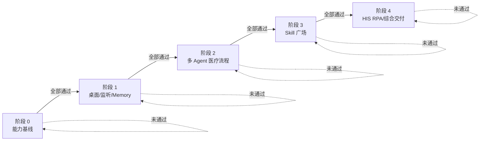

# CLINVEXA 用户确认范围分阶段交付 Implementation Plan

> **For implementation:** Follow this plan task-by-task. Steps use checkbox (`- [ ]`) syntax for tracking.

**Goal:** 基于现有 Hermes 快速交付具备多 Agent、Skill 广场、屏幕监听和 HIS RPA 的 CLINVEXA V1，同时保持产品结构简单、入口集中、操作便捷。

**Architecture:** 直接复用 Hermes Agent、Memory、Skills、工具注册、子 Agent 和 Desktop；新增 CLINVEXA UI、屏幕感知模块、轻量 Skill 广场服务及 HIS RPA 适配器。所有 Hermes 已存在且成功加载的工具均可调用，未加载的工具明确返回“当前环境无该工具可调用”。

**Tech Stack:** Python 3.11–3.13、FastAPI、Pydantic、PostgreSQL、Electron、React、TypeScript、Hermes 0.19.1、Hermes Desktop 0.17.0、Windows UI Automation、OpenAI-compatible 本地推理服务、pytest、Vitest、Playwright。

## Global Constraints

- 不限制 Hermes 已成功加载的工具，不建立 CLINVEXA 工具白名单。
- 工具不存在、插件未加载或运行环境不支持时，不虚构调用结果，统一显示“当前环境无该工具可调用”。
- 允许患者数据进入 Hermes session 和 Memory，并提供查看、检索、删除和保留周期配置。
- V1 必须包含多 Agent、Skill 广场、屏幕监听和 RPA 自动点击 HIS。
- RPA 可以自动定位、点击和录入；正式保存、提交或覆盖病历前仍保留一次医生确认。
- 不安排单科室试点；最终阶段改为测试环境与院内验收环境的综合交付验收。
- 保持单体优先：一个 CLINVEXA Python 服务、一个数据库、一个 Hermes Runtime、一个 Desktop，不引入 Kafka、Redis、Celery 或微服务集群。

---

## 1. 调整后的底座判断

现有 Hermes **可以直接作为 CLINVEXA 的主要技术底座开始开发**，原因如下：

| 现有能力 | V1 用法 |
|---|---|
| Agent Loop、模型路由、流式输出 | CLINVEXA 主对话与任务执行 |
| `delegate_task`、子 Agent | 病历、知识、RPA 等专业 Agent |
| Memory 和 session 持久化 | 保存医生偏好、患者内容和历史任务 |
| Skills 与插件发现 | Skill 广场安装、启用与执行 |
| JSON-RPC/WebSocket | Desktop 与 Hermes 实时通信 |
| Electron pet overlay、quick-entry | 悬浮球、快捷输入和屏幕任务入口 |
| Terminal、文件、浏览器及其他现有工具 | 按 Hermes 实际加载结果直接授权调用 |

CLINVEXA 仍需开发的部分只有四类：产品 UI、医疗任务编排、Skill 广场、屏幕监听与 HIS RPA。无需重写 Hermes Agent Loop、Memory 或工具权限体系。

---

## 2. V1 功能范围

### 2.1 桌面入口

- 常驻悬浮球、右侧栏、完整工作台。
- 文字、语音、文件、截图和当前屏幕作为任务输入。
- 当前患者、后台任务、Agent 执行状态和工具调用过程可见。
- 全局快捷键打开、暂停监听、截图提问和停止任务。

### 2.2 医疗工作流

- 问诊录音转写、病历结构化、病历草稿和文书质控。
- 一页患者摘要、随访计划草稿、医学知识检索。
- 患者资料与医生偏好可写入 Hermes Memory，并能在后续任务中检索。
- RPA 识别 HIS 页面、定位患者、填写字段、自动点击和提交前确认。

### 2.3 多 Agent

为避免过度拆分，V1 固定为一个主 Agent 加三个专业 Agent：

```text
CLINVEXA 主控 Agent
├── 病历 Agent：转写、事实抽取、病历草稿、质控
├── 知识与患者管理 Agent：摘要、检索、随访
└── 桌面与 HIS Agent：屏幕理解、工具调用、HIS RPA
```

主控 Agent 负责意图判断和结果汇总；专业 Agent 通过 Hermes 子 Agent 机制执行，不另建第二套 Agent 框架。

### 2.4 Skill 广场

- 浏览、搜索、查看详情、安装、启用、禁用、卸载和版本切换。
- 支持平台 Skill、科室 Skill 和医生个人 Skill 三种标签。
- V1 采用本地/院内 Skill 仓库，不做公开社区、支付、评论和排行榜。
- 安装后的 Skill 继续使用 Hermes 原生 Skills 加载机制。

### 2.5 V1 暂不包含

- 公开互联网 Skill 商城及商业交易体系。
- 自动开处方、自动开医嘱和无需医生确认的正式病历提交。
- 复杂医院集团多租户运营平台。
- 独立微服务、消息队列和大数据分析平台。
- 单科室试点阶段。

---

## 3. 只保留的 3 项关键优化

### 优化 1：工具能力自动发现和明确反馈

- Desktop 启动后读取 Hermes `tools.list`，形成当前环境实际可用工具清单。
- Agent Prompt 中注入可用工具摘要，减少请求不存在工具的情况。
- 工具不存在、插件加载失败或平台不支持时，统一返回“当前环境无该工具可调用”，并给出可执行的替代方式。
- 不限制已经成功加载的工具，也不增加额外审批名单。

### 优化 2：屏幕监听采用事件触发，降低资源占用

- 监听前台窗口、窗口标题和页面变化；发生变化时再截图/OCR，不持续高帧率录屏。
- 悬浮球必须显示监听状态，支持一键暂停和全局快捷键暂停。
- 只保留任务所需的最新截图和识别结果；保留周期由设置项控制。
- HIS 页面优先使用 Windows UI Automation 读取控件，无法读取时才使用截图和视觉模型。

### 优化 3：RPA 执行前后验证页面状态

- 每个 RPA 动作包含目标窗口、目标控件、预期旧值和预期新值。
- 点击或录入前检查窗口和患者信息，执行后检查页面是否进入预期状态。
- 页面变化、弹窗遮挡、患者不一致或控件不存在时立即停止并显示失败步骤。
- 正式保存/提交前展示本次自动操作摘要，由医生一次确认后继续。

---

## 4. 最小代码结构

```text
hermes-agent-main/
├── apps/desktop/src/clinvexa/
│   ├── floating-ball/          # 悬浮球与监听状态
│   ├── sidebar/                # 对话、任务和快捷技能
│   ├── workbench/              # 病历、摘要、随访
│   ├── screen-monitor/         # 屏幕事件、截图和暂停
│   └── skill-plaza/            # Skill 浏览与管理
├── apps/desktop/electron/clinvexa.ts
├── clinvexa/
│   └── src/clinvexa/
│       ├── main.py             # 单体 FastAPI 入口
│       ├── agents.py           # 主控与三个专业 Agent 配置
│       ├── records.py          # 病历、质控、摘要和随访
│       ├── screen.py           # 屏幕理解服务
│       ├── rpa.py              # HIS RPA 状态机
│       ├── skills.py           # Skill 广场目录与安装
│       └── audit.py            # 关键任务和 RPA 操作记录
├── medical-skills/             # CLINVEXA 内置 Skills
└── deploy/clinvexa/          # 启动、安装、备份和恢复
```

---

## 5. 分阶段任务与交付闸门

### 阶段 0：Hermes 能力基线与运行验证

**周期：** 1–2 周

**Files:**
- Create: `docs/clinvexa/upstream-baseline.md`
- Create: `clinvexa/src/clinvexa/tool_inventory.py`
- Create: `clinvexa/tests/test_tool_inventory.py`
- Create: `benchmarks/n260/run_benchmark.py`
- Create: `docs/clinvexa/his-rpa-target.md`

**交付任务：**

- [ ] 恢复 Hermes upstream URL、commit/tag 和依赖锁定信息；当前源码目录没有 `.git` 元数据。
- [ ] 跑通 Hermes Runtime、Desktop、Memory、Skills、子 Agent 和现有工具调用。
- [ ] 实现 `tools.list` 能力同步和不存在工具的统一反馈。
- [ ] 使用 20 份脱敏样例完成 N260 模型、ASR 和多 Agent 并行压测。
- [ ] 记录目标 HIS 版本、分辨率、窗口标题、页面、控件和完整操作路径。

**通过标准：**

- Hermes 已加载工具均可从 CLINVEXA 调用，成功率 100%。
- 对 20 个不存在的工具请求均明确显示“当前环境无该工具可调用”，不产生伪造结果。
- 主 Agent 同时调度三个子 Agent 连续运行 100 次，无死锁、无任务丢失。
- N260 连续运行 2 小时无崩溃和 OOM；病历草稿 P95 生成时间不超过 20 秒。
- HIS RPA 操作路径可在验收环境稳定手工复现。

**未通过：** 保持在阶段 0，修复环境、模型或工具发现问题后重新验收。

### 阶段 1：Desktop、屏幕监听与 Memory

**周期：** 2–3 周

**Files:**
- Create: `apps/desktop/electron/clinvexa.ts`
- Create: `apps/desktop/src/clinvexa/floating-ball/`
- Create: `apps/desktop/src/clinvexa/sidebar/`
- Create: `apps/desktop/src/clinvexa/screen-monitor/`
- Create: `clinvexa/src/clinvexa/screen.py`
- Test: `apps/desktop/src/clinvexa/screen-monitor/screen-monitor.test.ts`

**交付任务：**

- [ ] 复用 Hermes pet overlay 和 quick-entry，实现悬浮球、侧边栏和快捷键。
- [ ] 实现前台窗口变化监听、事件触发截图、OCR/视觉理解和截图提问。
- [ ] 悬浮球展示监听中、已暂停、处理中和失败状态。
- [ ] 启用 Hermes Memory 保存患者资料、医生偏好和历史任务，并提供查看、搜索和删除入口。
- [ ] 实现录音、文本、文件、截图和当前屏幕五类输入。

**通过标准：**

- 前台窗口变化后 3 秒内更新屏幕上下文，连续 200 次窗口切换识别成功率不低于 98%。
- 监听状态始终可见，暂停快捷键在 1 秒内停止新增截图。
- 20 组患者数据和医生偏好写入 Memory 后，指定内容检索命中率不低于 95%。
- 悬浮球、侧边栏和完整工作台状态同步，无重复任务和界面卡死。

**未通过：** 不进入 Agent 医疗流程开发，先解决桌面稳定性、监听资源占用或 Memory 可用性。

### 阶段 2：多 Agent 医疗主流程

**周期：** 3–4 周

**Files:**
- Create: `clinvexa/src/clinvexa/agents.py`
- Create: `clinvexa/src/clinvexa/records.py`
- Create: `clinvexa/tests/test_agent_routing.py`
- Create: `clinvexa/tests/test_record_goldset.py`
- Create: `medical-skills/record-structuring/SKILL.md`
- Create: `apps/desktop/src/clinvexa/workbench/`

**交付任务：**

- [ ] 配置主控、病历、知识与患者管理、桌面与 HIS 四个 Agent 角色和职责。
- [ ] 实现意图路由、子 Agent 委派、结果汇总、中断和失败回退。
- [ ] 实现录音转写、事实抽取、病历草稿、质控、一页摘要和随访草稿。
- [ ] 医学知识回答显示检索来源；无来源时明确说明依据不足。
- [ ] 在工作台展示 Agent 状态、调用工具、来源证据和最终结果。

**通过标准：**

- 200 条混合任务的 Agent 路由正确率不低于 95%，错误路由可以由用户一键切换。
- 关键病历字段 Precision ≥ 99%、Recall ≥ 98%，普通字段 F1 ≥ 95%。
- 金标评测中严重临床错误为 0；摘要中的数值和趋势与源数据一致率 100%。
- 任一子 Agent 失败不导致主会话崩溃，并明确显示失败 Agent 和可重试操作。

**未通过：** 不接入 Skill 广场和 HIS 自动操作，继续修复路由、病历和结果汇总。

### 阶段 3：Skill 广场

**周期：** 2–3 周

**Files:**
- Create: `clinvexa/src/clinvexa/skills.py`
- Create: `clinvexa/tests/test_skill_install.py`
- Create: `apps/desktop/src/clinvexa/skill-plaza/`
- Create: `medical-skills/catalog.json`

**交付任务：**

- [x] 实现本地/院内 Skill 目录、搜索、分类和详情页。
- [x] 实现安装、启用、禁用、卸载和版本切换，并同步到 Hermes Skills 目录。
- [x] 支持平台、科室和个人标签，允许医生从侧边栏快速运行已启用 Skill。
- [x] Skill 缺少依赖或安装失败时显示明确原因，不影响其他 Skills 和主会话。

**通过标准：**

- 至少 20 个内置 Skills 可浏览、安装和执行，完整操作成功率 100%。
- 启用/禁用后无需重装客户端即可在新会话生效。
- 连续完成 100 次安装、卸载和版本切换，无残留目录、重复条目和 Hermes 启动失败。
- 损坏、缺少 `SKILL.md` 或依赖不可用的包均被拒绝并显示具体原因。

**未通过：** 保留内置 Skills，不开放 Skill 广场入口，修复后重新验收。

### 阶段 4：HIS RPA 与综合交付验收

**周期：** 4–5 周

**Files:**
- Create: `clinvexa/src/clinvexa/rpa.py`
- Create: `clinvexa/tests/test_rpa_state_machine.py`
- Create: `apps/desktop/src/clinvexa/rpa/`
- Create: `apps/desktop/e2e/clinvexa.spec.ts`
- Create: `deploy/clinvexa/compose.yml`
- Create: `docs/clinvexa/delivery-acceptance.md`

**交付任务：**

- [x] 优先使用 Windows UI Automation 实现 HIS 窗口、患者和表单控件识别。
- [x] 对无法使用 UIA 的位置增加截图识别和坐标点击适配。
- [x] 实现打开患者、定位病历、填写字段、处理弹窗、自动点击和提交前确认。
- [x] 记录每个 RPA 步骤、页面截图引用、执行结果和失败位置。
- [x] 完成 Windows 安装包、服务部署、备份恢复和故障注入测试；N260 实机 8 小时由项目授权方于 2026-08-04 明确豁免。

**通过标准：**

- 在固定 HIS 验收环境执行 200 次完整流程，页面定位和字段填写成功率不低于 99%。
- 患者不一致、窗口变化、弹窗遮挡和控件缺失四类异常停止率 100%，不继续盲点。
- 未经医生最终确认的正式提交为 0，重复提交为 0，错误患者提交为 0。
- 8 小时连续运行无 OOM、无主进程崩溃；服务重启后任务状态和 Memory 可恢复。
- Desktop、Memory、多 Agent、Skill 广场、屏幕监听和 HIS RPA 全链路 E2E 通过率 100%。
- 产品负责人、医学负责人和信息科完成综合交付签字后，项目视为 V1 交付完成。

**2026-08-04 用户授权变更：** 项目授权方明确要求忽视 N260 实机运行硬门槛，并授权产品、医学和信息科三项签字验收。该变更仅移除本次交付门槛，不构成 N260 稳定性技术测试通过的声明。

**未通过：** 不交付正式环境；定位到对应阶段修复并重新执行综合验收，不安排单科室试点替代验收。

---

## 6. 阶段流转



每个阶段必须交付自动化测试报告、性能数据、已知缺陷清单和书面 Go/No-Go 结论。上一阶段没有全部通过时，不开始下一阶段。

## 7. 周期与团队

- 总周期：12–17 周，不包含 HIS 环境交付等待时间。
- 最小团队：产品/临床 1、Python/LLM 2、Electron/React 1–2、RPA/测试 1–2。
- 优先顺序：桌面可用性 → 多 Agent 医疗流程 → Skill 广场 → HIS RPA。
- 如需压缩周期，只减少内置 Skills 数量和附加页面，不删除屏幕监听、多 Agent、Skill 广场或 HIS RPA。

## 8. 开发启动前输入

阶段 0 开始前需要准备：

1. 目标 HIS 名称、版本、分辨率和验收账号。
2. 20 份脱敏病历、录音或结构化样例。
3. 屏幕截图与 Hermes Memory 的默认保留天数。
4. 首批 20 个内置 Skills 的名称和优先级。
