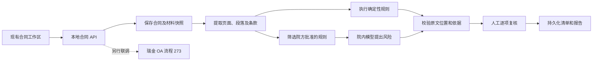

# 智能预审建议架构

建议把 P0 放在现有合同工作区和 FastAPI 服务中。保留现有起草和送审路径，为一次预审建独立记录。模型是受约束的审查步骤，规则和人工复核可单独完成。首轮可在本地 SQLite 保持单实例，医院要求跨用户共享时再核对身份服务、院内服务和存储部署。

| 设计点 | 建议与依据 |
| --- | --- |
| 入口 | 复用 `ContractWorkspace` 和 `contract_router`。现有 `PUT` 草稿及 `POST /review` 保持兼容；新审查任务按固定合同版本读取，不覆盖原草稿 |
| 文档与证据 | 复用本地文本读取和上传限额。扩展抽取结果为 `document_id + sha256 + page/paragraph + offsets + quote`。PDF 页码从 1 开始，Word 优先章节/段落/表格单元；OCR 框和置信状态可选。人工摘录保留页码、提交人及核验记录 |
| 规则与检索 | 规则按合同类型、金额方向、招采适用性和生效日期筛选。规则有 ID、版本、出处、适用条件、等级和测试。第一版可使用元数据过滤和本地文本检索；验证确有语义召回需求后再选择向量化 |
| 规则与模型边界 | 确定性负责必填、日期、金额单位、供应商/编号匹配、来源是否齐全。模型处理语义风险、条款缺失候选、修改建议。先检索批准规则，再由模型引用证据 ID。校验引文确实存在，来源和规则版本可查。未知与未审查分别记录 |
| 数据与任务 | 复用 SQLite 版本机制。另存不可变输入、规则版本、解析版本、模型标识、任务状态和逐项人工决定。长任务从有界工作进程或线程开始，持久化重启恢复。幂等键覆盖合同版本、材料哈希和规则/模型配置 |
| 权限 | 服务端验证审查、复核、查看及导出权限。阶段性单用户运行写明限制。现有进程级法务标志可兼容旧 UI，不承担真实多用户授权 |
| OA 边界 | OA 审批按 273 实际流程，P0 只读关联/手工录入可先做。API 适配独立于审查。正式联调补字段编码、附件和状态查询，超时用回执核对避免重发 |
| 发布和通信 | 本机生成离线包，aDesk 映射盘部署到云桌面 C。默认渲染器调用同机 `127.0.0.1:8001`。模型与 OA 由云桌面后端访问院内授权地址；接口、可达性与日志留存通过院内测试确认 |

以上为建议，未实施。跨版本兼容、状态和安全要求见 [05](05_P0_SCOPE_AND_GAPS.md) 与 [06](06_API_AND_DATA_CONTRACTS.md)。

| 决策问题 | 证据等级及结论 |
| --- | --- |
| 现有前端能承担预审吗 | **已验证**入口和草稿到预审交互测试通过；**合理推断**可在同一页面增加证据和复核 |
| 用服务、Agent 还是 Skill | **代码支持**现有合同服务边界；**合理推断**在该服务补任务比新增 Agent 更少改动 |
| 模型可直接使用吗 | **已验证**模拟结构化响应和超时；**未知**院内端点连通、模型版本和真实质量 |
| 文档解析和检索可用吗 | **已验证**文本读取和扫描件失败；**代码支持**医疗知识条目，合同检索需扩展 |
| 如何管理规则 | **代码支持**现有规则写在 Python；**合理推断**提取批准的规则目录和版本即可起步 |
| 如何绑定原文 | **代码支持**现有自由文本位置；**合理推断**用快照及可验证页段锚点补齐 |
| 云桌面怎样通信 | **代码支持**渲染器调用同机服务；**未知**独立服务器和院内模型从云桌面的可达性 |
| OA 要改架构吗 | **代码支持**现有独立 E9 适配；**合理推断**字段、附件和回读可在该适配边界扩展；**未知**院方具体权限 |
| 先修什么 | **已验证**两个扫描样本无法提取；**代码支持**金额一律必填和进程级授权边界。先补错误呈现、证据、条件规则与授权 |
| 最少改动的方案 | **合理推断**现有 UI、本地服务与 SQLite 承载首轮，院内系统批准后再独立部署或扩展接入 |
